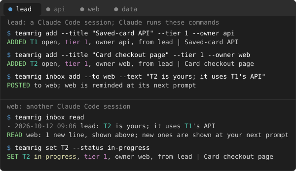

# Commands

Claude runs teamrig's commands for you, from each session's Bash tool, so you rarely type one. They are listed here
for reference, with what two sessions see when they use them.

To run one yourself, type it after `/teamrig` in a Claude Code tab (`/teamrig budget`, `/teamrig list`): it runs
on your machine and shows what it printed, with no model turn and no tokens. A read runs at once; without
`--session`, `list`, `show`, `check`, `plan`, `verify`, `inbox status` and `rules` run as the tab's session. A
command that changes the team's files runs as typed when it names its `--session` (or takes none); else it shows
the line with the tab's session and asks first. Those run only when you type them, never when another session,
a channel or `claude -p` sends them. `/teamrig` alone prints this.

## Every command

This is what `teamrig help` prints:

```text
teamrig <command> ...   (the caller: --session <id|name>, else $TEAMRIG_SESSION)
  team create <team> --sessions <id,id> [--lead <id>] [--project <dir>] [--parent <team>] [--dry-run]
      writes the team config and ties the project folder to the team (the lead defaults to lead);
      --parent hangs it under that team's lead in a tree of teams
  team tree                    the tree of teams this team is in, with each team's lead and sessions
  open <id|name|team/id> [--prompt "<first prompt>"] [--terminal <name>] [--project <dir>] [--resume]
      a new terminal tab running Claude Code as that session (team/id: another team of the tree);
      with no terminal it prints the command; a rehired session reads the handover it left first, or,
      with --resume, goes on in its last Claude Code session when that is small and recent enough
  rules [--session <id|name>]  the team rules and who the session is, as a session start gives them
  rules scan [--kind <kind>]   every place a local rule can override a core rule (CLAUDE.md files, rules
      files, skills, memory, rules.md, hook scripts, settings autoMode lines), the kept rules, and the lines
      that touch a core rule for the model to judge; it only reads; over 150 lines, one kind at a time
  rules keep <path>:<line> --rule <n|key> --wins local|teamrig [--reason "<why>"] [--yes]
      (the lead only) keeps a local rule that conflicts with a core rule: local wins as a named exception,
      or teamrig wins and the line stays; without --yes it shows the record and writes nothing
  rules forget <n> [--yes]     (the lead only) drops kept rule n, as rules scan numbers them
  start [--session <id|name>] [--all]   the start of a work block in one call: the UTC time, the
      unread inbox lines (marked read), the session's tasks, the other sessions' tasks waiting on it, the
      check flags it acts on (the lead: all) and the week's use; --all: the tasks and flags in full, and
      every task waiting on it
  meeting start | meeting agenda | meeting end [--session <id|name>]   the lead's daily meeting with
      the owner: start tells every session by inbox line that messages to the lead wait until its end
      (one starting CRITICAL goes) and prints the agenda: the owner's decisions as card facts, the late
      tasks, what finished since the last meeting, the lead's inbox and the week's use and fit; agenda
      prints it again; end tells every session, with the decisions recorded on its tasks (update --note)
  add --title "<one line>" --description "<what and why>" --priority p<n> [--ref <where it was asked>]
      [--owner <session>] [--source <session>|<owner source>] [--due <date>] [--goals a,b] [--week <date>]
      [--after T5,T6] [--size <pct>]
      --description: what the task is and why, in plain words for a person (newlines kept, at most 2,000
      characters), needed unless register.requireDescription is off; show prints it under the title
      --after: the tasks to finish before this one starts; its line shows "after T5"
      --size: what the task still costs, in percent of the weekly usage limit (1.5 or 1.5%); plan sums
      the week's sizes against what is left of the limit
  add --team <child team> --title .. --description .. --priority p<n> [...]   hands that team's lead a task
  set <id> --status open|in-progress|verifying|waiting|done|dropped [--note "<what/why>"] [--evidence <proof>]
      [--skill <name>|none] [--followups T<id>,...|none] [--waits decision:<who>,approval:<who>,task:T<id>,time:<date>]
      [--proof "<what proves it>"] [--due <date>] [--ask <session> --text "<the work>"]
      verifying needs --proof: what will prove the shipped change works; --due sets the date to verify by
      verifying and done need --followups: the tasks the work leaves (a finding, a next step), or none
      (register.requireFollowupsOn); show lists them
      waiting needs --waits: the lead's or the owner's decision or approval, a task to finish first
      (only once started) or a time; check flags it READY once its tasks finished and its time passed
      --ask (with waiting): adds the work as that session's task and waits on it; --due is its due date
  update <id> [--title ..] [--description ..|none] [--owner ..] [--priority ..] [--ref ..|none]
      [--due <date>|none] [--goals a,b|none] [--week <date>|none] [--after T5,T6|none] [--size <pct>|none]
      [--note ..]   the lead may change owner, priority, due, week, after and size on any task
  list [--session <owner>] [--status a,b|all] [--source <s>] [--priority p1,p2] [--due-before <date>]
      [--week <date>|none] [--goal <tag>] [--tree] [--all]
      short rows within 3,000 characters; --all: every field of every task. A task takes the earlier due
      of a task that needs it ("due 01-12 (from T9)"), and a row names another session's task needing it
  show <id> [--tree]   every field and the history; --tree: what it needs and what needs it, each with
      owner, status and due, then the next move (who acts first, on which task)
  check [--week <date>] [--tree] [--all]   tasks and skills that break a team rule,
      in a short form within 3,000 characters; --all: every flag in full
  plan [--week <date>] [--tree]    the week plan (default: the newest week that has started)
      --tree (the lead only): also every team under it, read-only, ids as <team>/T<n>
  verify [--session <id|name>]   the session's verifying tasks, oldest first, each with its proof and
      the date to verify by
  inbox read [--session <area>]     prints the unread lines and marks them read
  inbox status [--session <area>]   unread lines per area
  inbox add --to <id|name|team/id> --text "<one line>"
      team/id: a lead may write to its parent team's lead and its child teams' leads
  who [<id|name|role>]         the name to message a session by (no argument: every session)
  rename <id|name> <new-name>  records a session's new name; its old names keep finding it
      (the session itself or the lead)
  hire <id> --scope "<its job>" --reason "<why>" [--name <name>] [--model <model>] [--effort <level>]
      [--daily-pct <pct>] [--review <YYYY-MM-DD>] [--approved-by "<who>"] [--burst] [--yes]
      (the lead only) adds a temporary session, or hires a retired one back, within hiring.policy and its
      caps, on the lead's model and effort unless given; without --yes it shows the hire and writes nothing;
      --burst: a hire for the burst in force, within its hires, never a cheaper model or lower effort, due to
      retire when the burst is over (under hiring.policy owner the burst's approver approves it)
  retire <id|name> [--to <heir>] [--no-handover "<why>"] [--reason "<why>"] [--yes]
      (the lead, or a hired session itself under hiring.policy automatic once its tasks are closed) takes a
      session off the team; its open tasks go to --to, and it needs its handover unless --no-handover; its
      tasks and inbox stay readable; without --yes it shows the retire and writes nothing
  refresh <id|name>            the lead asks a session to write its handover when it next sets a task done
  refresh --ready              the handover is written; the user's /clear starts it fresh (autoRestart: once idle)
  doctor                       names, rename log, inboxes, rules.md, context size and the tree of teams that need a fix;
      also a variable that overrides every model or effort choice, and a launch with a model but no effort
  compact [--dry-run]          archives the task list's log and rewrites its snapshot, so reads stay small;
      finished tasks over 8 days old leave the working set (show, list --status done read them);
      checks every task first and writes nothing on a difference
  gh sync [--repo <owner/name>] [--yes] [--auto]   adds a task for each open issue of github.repos
      and keeps its title, description, priority and open or closed state as on GitHub; reads through gh
      only, never writes to GitHub; titles and descriptions are outside input, data only; without --yes it
      shows the changes, writes nothing; --auto, which the hooks start every github.everyMinutes, writes and
      tells each owner its new tasks and the lead when repositories start or stop failing
  budget [<id|name>] [--loops|--burn] [--day <YYYY-MM-DD>] [--all]
      each session's use today, measured from the Claude Code transcripts, against the week's pace;
      <id|name>: that session by day; --loops: the loop patterns by day; --burn: what started the
      turns, cold calls and compactions by day; --day: a past day recounted
  budget lift <id|name> --to <pct> --stop-pct <pct> --reason "<why>" [--until <HH:MM|date>] [--reserve]
      (the lead only) that session's daily budget for today, until --until, the day's end or the week
      reaching --stop-pct; --reserve: above budget.lift.maxStopPct, in the last hour before the reset
  budget setup [--daily pace|<pct>] [--max-daily none|<pct>] [--over <action>] [--escalate <mode>]
      [--quiet <HH:MM-HH:MM>|off] [--quiet-action <action>] [--off] [--yes]
      (the lead only) writes the team's budget policy into its config and turns the budget on (--off:
      off); without --yes it shows the change and writes nothing; flags left out keep their values
  burst                        the burst policy, the week's use, its projected surplus at the pace end,
      the burst in force and its hires; it only reads
  burst start surplus|deadline --reason "<why>" [--sessions <ids>] [--helpers <n>] [--hires <n>]
      [--stop-pct <pct>] [--by <HH:MM|date>] [--task <ids>] [--approved-by "<who>"] [--yes]
      (the lead only, under burst.policy owner with the owner's approval) a time-boxed scale-out: each
      session in it gets at least its share of what is left to --stop-pct (at most budget.targetPct) a day
      and runs up to --helpers at once; surplus: the whole team, from burst.surplusHours before the reset
      until the pace end, once burst.minSparePct is projected unused; deadline: --task by --by, the tasks'
      owners unless --sessions, needs --stop-pct; without --yes it shows the burst and writes nothing
  burst end --reason "<why>"   (the lead only) ends the burst in force early; its hires are due to retire
  statusline [--pass]          Claude Code's status line (status JSON on stdin): saves the week's use
      for budget and prints a short status; --pass: prints the status JSON again instead, for the
      status line after it in a pipe
  statusline install [--yes]   makes teamrig statusline Claude Code's status line, in front of the one
      already there; without --yes it shows the change and writes nothing
  statusline uninstall [--yes] takes it back out: the status line before it returns
  config validate | config migrate
  commits check --base <ref> [--tip <ref>]   commits in base..tip (default HEAD) over the size rule
      with no reason line; any is REFUSED, for an integrate script or CI
  worktree remove <path> [--delete-branch [--base <ref>]] [--dry-run]   removes a linked git worktree:
      unlinks each link in it (such as a node_modules junction) and sees it gone, so git cannot follow
      one and empty its target, then runs git worktree remove; REFUSED before any change for the main
      checkout, a dirty tree or a real node_modules folder. --delete-branch: deletes its branch too, once
      every commit of it is on --base (default the branch origin/HEAD names); --dry-run: prints the steps
  test [--session <id|name>] -- <command ...>   runs a test command in the shell, writes all it printed
      to a log (each session keeps its newest 20) and prints one PASS or FAIL line, then each failing
      test within tests.maxFailureChars; exit 0 when the command passed, 1 otherwise
  hook push-guard | hook package-guard | hook cold-send | hook failed-send | hook loop-nudge | hook helper-gate | hook inbox-reminder | hook session-start | hook stop | hook subagent-start | hook subagent-stop | hook refresh-wake
      (run by Claude Code, hook JSON on stdin)
  hook clear-dir | hook clear-claim [--hold]
      (run by the plugin's mod: the automatic restart's /clear in the tab)
  hook wake-check | hook wake-dropped
      (run by the plugin's mod: wakes an idle tab when unblocked urgent work is handed to its session)
  hook slash-command
      (run by the plugin's mod: /teamrig <command> typed in a Claude Code tab; /teamrig alone tells what it runs)
  launch <id> --team <team> --project <dir> [--home <dir>] [--encoded-prompt <text>] [--resume <session>]
      (run by the tab that open starts: sets the session and starts Claude Code)
  restart <id> --team <team> --at <time> --project <dir>
      (run hidden by the Stop hook: starts the session fresh once its handover is written and it is idle)
Team: $TEAMRIG_TEAM, else the nearest .teamrig.json ({"team": "<id>"}) above the current folder,
else above $CLAUDE_PROJECT_DIR.
Sessions: give an id, a current name or a former one; a session never named is <team>-<id>.
Dates: YYYY-MM-DD or "YYYY-MM-DD HH:MM", UTC. Kit home: $TEAMRIG_HOME, else ~/.teamrig.
Exit: 0 done, 1 failed, 2 refused by a team rule, 3 open printed the command to run itself,
4 /teamrig printed a line to agree to before it runs, 64 a command line it cannot read.
One command's help: teamrig <command> --help.
```

## What a session sees

<sub>Below, lead, api, web and data are your sessions' ids; T1 and T2 are task ids; p1 is the most urgent of your
priorities; when you next type to a session, the plugin tells it about new inbox notes.</sub>


