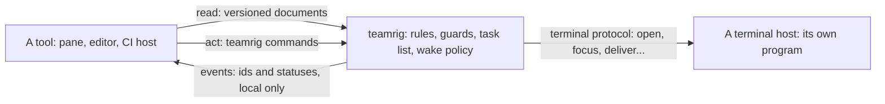

# Build on teamrig: the public interface (design)

> **Status: accepted** (written 2026-11-15, agreed 2026-11-20) on
> [#1048](https://github.com/teamrig/teamrig/issues/1048), with the changes agreed in that thread folded in. This is a
> design record, not a description of how teamrig works today: only the read side's version 1 is built ([What
> version 1 ships](#what-version-1-ships)).

It answers [#1048](https://github.com/teamrig/teamrig/issues/1048), which asks how a terminal app can work with teamrig
without following teamrig's insides. What ships is marked in [Everything teamrig does](../features.md) as each part
lands. It is built alongside the harness work that makes every AI CLI and every outside tool a plug-in of teamrig
([#1884](https://github.com/teamrig/teamrig/issues/1884), [#1885](https://github.com/teamrig/teamrig/issues/1885)).

**Contents**

- [Why an interface](#why-an-interface)
- [Five rules it keeps](#five-rules-it-keeps)
- [Read](#read)
- [Act](#act)
- [Events](#events)
- [The owner's own acts](#the-owners-own-acts)
- [Terminals as a protocol](#terminals-as-a-protocol)
- [Versions and notice](#versions-and-notice)
- [The conformance kit](#the-conformance-kit)
- [Order of work](#order-of-work)
- [Left for later](#left-for-later)
- [Answers to #1048's open questions](#answers-to-1048s-open-questions)

## Why an interface

teamrig changes many times a day. A tool that reads its files, runs its commands with a fixed argument list, parses
their output or patches its code breaks with each change, and catching up costs more than the tool's own work. One
small interface, versioned on its own, lets a terminal app, a task pane, an editor or a CI host work with any teamrig
release whose interface version it supports.

Today the public part is small: the pure reader `src/read/index.ts`, which the
[teamrig-pane](https://github.com/teamrig/teamrig-pane) task pane uses ([Room for other
tools](../how-it-works.md#room-for-other-tools)), and the `--json` output of `teamrig config` and `teamrig meetings`.
Everything else (file layouts, other commands' text, hook fields, environment variables) is internal and may change in
any release.

The interface has three parts, **read**, **act** and **events**, plus a **terminal protocol** for the apps that show
the sessions.

## Five rules it keeps

1. **The rules stay in teamrig.** Guards, approvals, the task rules, the budget and the decision to wake a session are
   teamrig's. A tool reads and asks; teamrig decides. A host never carries a rule, so a team's safety does not depend
   on which terminal it runs in.
2. **Outside code stays outside.** teamrig loads no other project's code into its own process. A host is a separate
   program that speaks a protocol, the way an editor and a language server do, so each side is written in any language
   and released on its own.
3. **A wake delivers a message, never keystrokes.** teamrig decides that a session should wake; the host delivers one
   fixed message only into an idle pane with no question showing.
4. **Each side owns its code.** teamrig owns the interface and its tests; a host's authors own the host, in their own
   repository.
5. **Outside text is data.** Text that came from outside the team (an issue's title, a comment) is marked as such on
   every read, and nothing the interface sends asks a reader to run it.

## Read

A read returns a versioned JSON document built from parsed data, never a file's raw bytes:

| Document | What it holds |
| --- | --- |
| `tasks` | Each task's id, title, owner, status, priority, what it waits on, due time and ref |
| `inbox` | A session's unread lines with their sender and time |
| `sessions` | Each session with its team, its leader and whether it is busy, idle or asking |
| `meetings` | The meetings and their agenda, as `teamrig meetings --json` gives them today |
| `config` | The team's settings a tool may show, as `teamrig config --json` gives them today |

- Out of process, a tool runs `teamrig read <document> --json`. A JavaScript tool may instead import the reader
  library, which is what `src/read/index.ts` becomes.
- Every document carries `interface`, the interface version that wrote it. A reader ignores fields it does not know.
- Text passes the same secret scan as the inbox (`register.secretPatterns`) before it leaves teamrig: a line that looks
  like it holds a secret is cut to its link or its id.
- A text field that came from outside the team carries `"source": "outside"`, with its control characters and
  bidirectional marks escaped. A tool shows it as quoted data, never as an instruction, and never puts it into a prompt.
- A read changes no state: it marks no line read and binds nothing to the caller.
- A session reads its own team and the teams above it; another team's notes and inbox stay out. The one exception is
  the roster: `sessions` serves every team of the caller's tree, since a pane draws the whole tree, and holds back
  what a team beside or below wrote for itself.

### What version 1 ships

`teamrig read <document>... --json` serves the five documents of 1.0 and each one a minor version added since (1.1:
`plan`, 1.2: `goals`, 1.3: `history`, 1.4: `stats`; 1.5 added a field, `plan`'s `ownerCards`; 1.6 added the
task fields the pane folded itself, `tasks`' `card`, `descriptionCut`, `sizeBase`, `prepares`, `noGoal`, `startedAt`
and `waitsAt`); [the commands page](../commands.md) has its usage and the plugin's guide describes every field. What
the design above left open is settled this way:

- **One line a document.** Each document asked is one JSON object on one line of stdout, in the order asked, and
  nothing else is written there: a refusal is one line on stderr. A run answers every document asked or none. With
  no team yet, `config` alone is answered, with the machine's teams to join, so a setup screen has something to read.
- **`revision`.** 16 hex characters of a hash over the interface version, the document's name, the arguments that
  shape it and the stamp (size and change time) of every file it reads, a missing file counted as missing.
  teamrig's own version is hashed in too: a release may serve the same files differently with no new interface
  version, and a reader must not be told `unchanged` across it. `--unless <document>=<revision>` answers a document
  still at the revision the reader holds as `{ interface, document, revision, unchanged: true }`, from the stamps
  alone, with nothing folded.
- **What `revision` leaves out.** The clock. The inbox's `--since` window and a meeting's `missed` move with time
  and no file, so with an unchanged revision the reader works them out again from the times it holds. The team's
  zone is inside the revision: a meeting's `atText` is written in it.
- **A limit of the stamps.** `sessions` reads the tree's configs before it takes their stamps, so a config written
  between the two gives a revision one write newer than the answer beside it, and `--unless` then holds that answer
  as current until a file changes again.
- **The roster exception.** `sessions` serves each session's place, state and unread count for the whole tree. A
  hire's scope and reason, a retirement's reason and a launch text are served only for the caller's own team and
  the teams above it, and a conversation id only for the caller's own team.
- **Cuts.** A text matching a secret shape is served as `[cut: <shape>]` and listed in `cuts`, each text scanned by
  itself so a cut never takes its neighbours. An inbox line whose text is cut has the key `cut-<n>`, its place in
  the file, which moves when old lines are trimmed.
- **No place on a disk is served.** `problems` names a file from its team's folder down and carries fixed texts
  with counts, never a parser's words, which may quote the line; `failures[].reason` is one fixed text. A meeting's
  `brief` is served as typed when it has no root, from the team's folder down when it is inside it, and by its file
  name alone otherwise.
- **`config`.** Each key of the schema is a row, as `teamrig config get --json` prints it. The schema marks a key
  that names where a secret is kept (`x-teamrig-served: location`): its value is never served, only a fixed note,
  and a key of that kind with no mark is read as marked. A value comes less every key the schema does not name.
- **`plan` (1.1).** A reader must not rank tasks itself: plan order needs every register of the tree, the goals and
  the metered spend, and a second copy of that rule would drift. So `plan` serves the answers of teamrig's own task
  tree, the tree `teamrig list` prints from: the team's active tasks in plan order, each with the keys of that
  order, its needs, who needs it and who moves next. `tasks` stays the stored facts, whose revision moves only with
  the team's own register. No tree of tasks is served: of another team's task `plan` names the id, the team, the
  owner and the status, and no text. Its revision covers every file the plan reads, so it moves at nearly every
  metered turn of a working team; what turns with the clock alone (a due coming near, a wait ending, the park rule)
  is told ahead in `validUntil`, after which a reader asks again without `--unless`. When a register of the tree
  cannot be read, no task is served and a problem says why. Since 1.5 it also serves `ownerCards`, each session's
  cards on the owner as `teamrig meet` asks them: which waits are the owner's to hear (the gate rule, a card put
  off until a time) is a rule of the register, so the pane reads its Team tab's counts and cards from here and
  keeps no copy of it.
- **`goals` (1.2).** `plan` names a task's goal by tag and rank only, so a reader drawing a goal's title or window
  folded the goals files itself, and had to know which team's goal a tag means. `goals` serves the goals a task of
  the asked team may serve: its own and those of every team above it, a tag two of them hold served once as the
  nearer team's, which is the goal teamrig ranks by. A team beside or below is never read. It serves the stored
  facts (title, parent, rank, the open slice's number, the window, every move of the target day with who moved it
  and why) and judges nothing: done counts, pace and forecast are computed from tasks and time, so they belong to a
  document that says when it was judged, and would move this one's revision with every task. Its revision moves
  only with the goals files and the tree's configs.
- **`history` (1.3).** `tasks` serves each task folded to what it is now, so a reader drawing how a task got there
  parsed the register's log itself, and its archive for an old task. `history` serves one task's events in the
  order written, the task named with `--task`: its creation, each status set, each change of its fields and a
  move to another team. It is one task a run and never the whole log, which would be the register's bytes under
  another name and grow without end. Each event is written out field by field, the fields `tasks` serves and no
  other, so a field the register adds is not served by accident; a text is marked by the source the task had at
  that event, and a cut names its event. An id with no event is answered empty, since a run answers every document
  asked or none. A task whose events left the working set is read from the archive, the one read here that costs
  more with the register's age, which the guide tells a reader.
- **`stats` (1.4).** The pane's Stats tab and `teamrig stats` folded the register themselves, so a reader drawing
  the team's numbers parsed the log and its archive. `stats` serves that fold under its own field names, with the
  Health levels and, for each headline count, the ids of the tasks it counts, each named once in a slim `tasks` row.
  A range reaches past the working set, so it reads the whole history, every archive segment, and costs more with
  the register's age; a gone segment counts nothing and says so, since a partial count would mislead. Its numbers
  age with the clock, which is no part of `revision`, so `validUntil` says when they next may change: the end of
  the team's day or an active task's due. Only the asked team is counted, never the teams below it, since a read
  serves the own team and those above it. The days the account's week sat at its limit come from the meter log, as
  `teamrig stats` reads it.

## Act

An act is a teamrig command, run through the same code the command line runs, so the interface never has a second,
weaker copy of a rule:

- the task list: add a task, set its status, add an inbox line;
- sessions: open, focus or wake one (each through teamrig's wake rules);
- answers: answer a decision put to the caller, or ask for an approval.

Three things hold for every act:

- **Who acts comes from the channel, never from a field.** A session's act carries the session its process was started
  for; a tool started by the owner acts as the owner's tool, with the reach the team's config gives it. Among programs
  of one operating system user, the channel stops mistakes, not a program set on passing as another session: acts that
  must hold against a session (the owner's own, and a leader's or the reviewer's answers, such as approving a push,
  auditing a hand step or answering a decision) need the proof below.
- **Every act is logged**: who, through which channel, what, when and how it ended, refusals too.
- **An owner-only act needs the owner's proof** ([The owner's own acts](#the-owners-own-acts)); without it, it is
  refused, or turned into a request the owner answers.

## Events

A tool that shows the team learns that something changed from events, then reads what it needs:

- **Local only.** Events go over a named pipe (Windows) or a Unix socket (macOS, Linux) that only the user's account
  can open. Where neither works, a `127.0.0.1` listener checks the `Host` and `Origin` headers and wants a per-client
  token. Never on another address.
- **Ids and statuses only**: `task T12 is waiting`, `session alpha has 2 unread lines`, `session bravo is asking`. No
  text, no titles, no inbox lines: those come only through a read, which scans and marks them.
- A frame carries the interface version; a client ignores frames and fields it does not know.

**What interface 1.7 ships: the follower first, the pipe after it.** `teamrig events --json` is a process the tool
starts and reads: its stdout is a pipe only that tool holds, so no address is opened and no token is needed. Its
frames are `hello` (every followed document with its revision) and `changed` (the documents whose revision moved),
which is less than ids and statuses: a frame names documents and revisions, and the tool reads the document with
`teamrig read --unless` to learn what changed. It looks at the documents' files once a second and sends at most one
frame a look. The named pipe or socket, for a tool that cannot keep a child process, and frames that name a task or
a session come after it, in a later minor version with the same frame envelope.

## The owner's own acts

Some acts are the owner's alone: approving a push to a protected branch, an owner gate (a destructive data change, a
budget or permission change), a grant. A token a tool holds cannot prove the owner pressed the button, because any
program running as the same user could read it. So an owner-only act needs one of:

- a gesture the operating system checks (Windows Hello, Touch ID, a polkit prompt), or
- the act made from a separate operating system account that only the owner uses.

The proof is bound to one action (the exact command and the commit it names), carries a one-time nonce and expires
within minutes. An act without a proof is never run; it becomes a request in the owner's decision queue, the way an
owner gate reaches the owner today.

The same proof, or a separate account, covers a leader's or the reviewer's answers that must hold against a session.
Until it exists for them, those answers stop mistakes, not a session set on passing as its leader.

## Terminals as a protocol

Today the terminals teamrig opens sessions in are a fixed list (`open.terminal`), each built in. The design makes a
terminal a **host**: a program teamrig runs, speaking a small protocol, in the manner of the Language Server Protocol.

| Request | What the host does |
| --- | --- |
| `open` | Opens a pane for a session, with the command, folder, title and an opaque identity bag teamrig gives, and answers with the host's own pane id |
| `focus` | Brings a session's pane forward |
| `close` | Closes it |
| `restart` | Restarts it, resuming the conversation when asked |
| `rename` | Changes its title |
| `deliver` | Delivers one wake message, only when no turn runs, no question shows and the input holds nothing unsent; else it answers `held` with why (`held: draft` for unsent input) |
| `isIdle` | Says whether the pane is idle, busy, asking, holding a draft or gone |
| `list` | Lists the host's panes: each pane id, its idle state and its identity bag |

- **Pane ids.** The id `open` returns stays the same across the host's own restart, and teamrig sends it back on every
  later request for that pane. teamrig re-links only pane ids it recorded itself: a pane `list` reports that teamrig did
  not record is reported to the owner, never adopted as a session.
- **A draft is not idle.** A person typing into a session's input box is using it, so a wake never lands on top of
  their text. A host that cannot see its input box says so in its capabilities, and teamrig treats its panes as never
  sure to be free of a draft.

- **Transport.** teamrig runs the host program, writes one JSON-RPC 2.0 request to its standard input and reads one
  answer from its standard output, with a time limit. A host that fronts a running app forwards the request over its
  own channel. This works the same on Windows, macOS and Linux.
- **Capabilities.** The host's first answer lists the requests it serves and the interface versions it speaks; teamrig
  uses nothing else. A host without `deliver` gets no wakes; the session sees new work at its next prompt.
- **Pinned by the owner.** The team's config names a host by its path and its sha256, and only the owner sets them.
  teamrig refuses to run a host whose file no longer matches, and says so.
- **After a host update.** A check flag names the host and its new sha256. One command, which only the owner runs,
  shows the old and the new hash and pins the new one. Until then the host gets no wakes; its sessions see new work at
  their next prompt. A host is pinned by hash only, not by a release signing key ([Left for later](#left-for-later)).
- **Run by its path, with a short environment.** teamrig runs a host by its absolute path, with no shell and its
  arguments only, and gives it a short, explicit environment: never the GitHub key or any other teamrig credential.
  The sha256 is checked on the exact bytes that run, so the file cannot change between the check and the start.
- **A host's answer is outside data.** Its size is capped and it is checked against the protocol's schema; a `held`
  reason is text to quote, never an instruction. teamrig never takes a session's identity or role back from a host or
  from pane meta: the identity bag is a label for the host, never a proof.
- **Built-in terminals are hosts too.** tmux, Windows Terminal and the others move behind the same protocol, inside
  teamrig, with no change in what they do, and pass the same conformance tests.
- **Waking is delivery.** Whether and when to wake a session (its priority, the budget, quiet hours, once per task)
  stays teamrig's decision. The host only delivers, under these conditions:
  - a token per pane that allows a wake and nothing else;
  - its channel bound to `127.0.0.1`, or a pipe or socket only the user can open;
  - fixed wake text: teamrig's message, which points the session at its inbox, never text from a caller;
  - one atomic check, at the moment of delivery, that no turn runs, no question shows and the input holds nothing
    unsent.

## Versions and notice

- The interface has its own version, `interface`, apart from the plugin's. Read documents, act results, event frames
  and host answers all carry it.
- **Minor** (1.0 to 1.1): a new document, field, act, frame or request. Readers ignore what they do not know.
- **Major** (1.x to 2.0): a removal or a change in meaning. teamrig serves the old major beside the new one for at
  least 30 days, and gives notice at least 30 days before, in the release notes and as a `deprecated` field on what
  goes.
- **A security fix may break the interface at once, without notice.** The release notes name what broke once the fix
  ships.
- A tool or host states the range it supports; teamrig refuses a range it cannot serve, and says which it serves.

## The conformance kit

teamrig ships a conformance kit with the interface:

- **For hosts**: a test runner that drives a host through scripted cases and checks each answer against the protocol.
- **For tools**: a fake teamrig that serves read documents and events from a scripted team and records the acts it
  gets.
- **One kit with the harness's contract suites.** The same suite runs an adapter inside teamrig directly and an outside
  program through the protocol, so a built-in terminal, an in-repo adapter and an outside host are held to the same
  cases.
- **Negative tests are part of it**, and a host passes only with them: `deliver` held in a busy pane, in one that shows
  a question, in one whose input holds a draft, or with a wrong token; a pane that `list` reports and teamrig did not
  record never adopted as a session; a listener refused on any address but `127.0.0.1`; an owner-only act refused
  without its proof; an act with a forged identity field refused or ignored; an owner proof that is replayed, expired
  or made for another command or commit refused; a read of `inbox` that leaves the unread state as it was; outside
  text never in an event frame; unknown fields ignored.
- teamrig's own CI runs the kit against its built-in hosts at each change; a host's CI runs it against the host.

## Order of work

1. A security review of every path the interface reaches, fixed until it passes. No part ships before that.
2. **Read** version 1: the documents above, with the scan and the outside marks.
3. **The terminal protocol and the kit**: the built-in terminals move behind it with no change in behaviour.
4. **Outside hosts**, pinned by path and sha256, with the re-pin after an update.
5. **Events**: ids and statuses only, local only.
6. **Act**: through the same code the command line runs.
7. **The owner's own acts**, once the proof exists on each operating system.

Each step ships on its own and is usable without the next. Events come before act (agreed on #1048): a tool that shows
the team needs to learn of changes before it needs to make them, and act carries the harder identity questions.

## Left for later

Agreed on #1048 as not part of this design's steps:

- **Pinning a host by a release signing key**, beside or instead of its sha256: a later minor version.
- **A long-lived host process** (a `session` capability), instead of one process per request: only if a measurement
  on Windows shows a process per request costs too much.
- **An owner proof signed on the owner's own computer**, for an owner who reaches the team's machine over SSH: open,
  the maintainer's call after a security review. If taken, it uses FIDO `sk-` keys only; the signature covers the
  action, the commit, a nonce and an expiry, once; changing the pinned key needs a proof by an already-pinned method.

## Answers to #1048's open questions

These are teamrig's answers. The questions about the terminal app's own design are its maintainers' to answer.

**For the teamrig author**

1. **A terminal-host port in core?** Yes, as the protocol above rather than code loaded into teamrig. The generic
   changes proposed for upstream are welcome as separate pull requests, smallest first, each judged on whether it
   works for every user on every operating system.
2. **Loading an extension.** teamrig loads no extension code. A host is a program the owner pins by path and sha256 in
   the team's config. A host's own commands stay in the host's own command line, which calls teamrig's act interface;
   teamrig gets no extension command group.
3. **Where the adapter lives.** In the host's own repository, owned and reviewed by its maintainers. A host can speak
   the protocol in its own language, so it may need no adapter. teamrig owns the interface, the kit and the built-in
   hosts.
4. **The push guard without a person at the prompt.** Generic, so it belongs in core: in a session nobody watches, a
   guard question is refused and routed to the session's leader as a request; a grant covers one exact command and
   commit, once, and expires.
5. **The memory headroom gate.** A separate change from the interface. It is welcome upstream if it works on Windows,
   macOS and Linux, each with its own way to measure.
6. **Naming.** Per [the teamrig name](../../TRADEMARKS.md): a separately made host says what it is ("works with teamrig")
   under a name of its own that is not easily mistaken for teamrig. A name built on "teamrig" fits only work the
   project itself ships.

**Shared**

1. **A red contract suite** blocks the release of the side whose change turned it red, not the other side's: each
   side's release states the interface versions it supports.
2. **What version 1 holds**, on teamrig's side: read, and the terminal protocol with `deliver` (its atomic check of no
   turn, no question and no draft), `isIdle` and `list`. Events, then act, follow in minor versions; the owner's own
   acts come last.

**For the owner, teamrig's view**

- **Bundled or installed?** Installed. A bundled copy lags the releases, and a host's supported interface range already
  says which teamrig releases it works with.
- **Pane meta keys.** Under this design teamrig writes no keys into a host's panes; the identity bag `open` carries is
  the host's to store. A host that keeps it in shared meta should put it under its own namespace.
