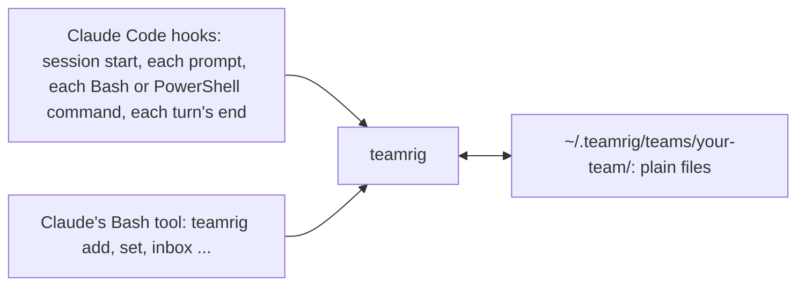

# What teamrig does

**One lead. Many AI sessions. One task list.** Run several Claude Code sessions on one project as one team, without
two of them owning the same task, and with a guard against their force-pushes to your main branch. You name the
sessions; one leads and hands out tasks, every task has one owner, and each session can list its own tasks
(`teamrig list --session web`) and is told of new inbox notes. Claude runs the `teamrig` [commands](commands.md) for
you; you need a terminal, Claude Code 2.1.139 or later and Node.js 22.18 or later.

To install, see [Get started](../README.md#get-started); to set a team up yourself, see
[Set up a team by hand](setup-by-hand.md).

> The Status column says whether each part works today, is being built (with its task id) or is planned.

## Why teamrig

Parallel AI sessions on one project collide, forget what was asked of them, and burn through your budget. teamrig gives
them what a human team has: one list of who does what, a way to pass notes, and shared rules, all in plain files on
your machine.

| You get | How | Status |
| --- | --- | --- |
| **Nothing to run or host** | Plain files on disk, a small CLI with no runtime dependencies, and Claude Code hooks. Works offline; no account. | works today |
| **A task list nobody loses** | `teamrig add`, `set`, `update`, `list`, `show`: owner, priority (p1 first), due date, goals and week; `show` also lists who changed the task. `check` finds tasks that break a team rule; `plan` prints the week. | works today |
| | Dependencies and parent/child tasks | being built (T205) |
| | Planned start and ETA, history across tasks (`history --by <session>`), token estimates | being built (T209, T210, T211) |
| **Notes between sessions, no server** | `teamrig inbox add --to web`; the receiver sees the new lines at its next prompt, and `inbox read` marks them read. A tab you start yourself joins the session its title names (`/rename web`). `who` gives the name to message a session by. | works today |
| **A lead that runs the team** | One session holds the lead role in the team config; every session learns at start who it is and whom to message. | works today |
| | Names that survive a rename: `teamrig rename` keeps the session's id, and its old names keep finding it until another session takes one; `teamrig doctor` finds name and inbox problems | works today |
| | Teams of teams: `team create --parent` hangs a sub-team under a lead (up to 3 levels, 8 sub-teams each); `add --team` hands its lead a task, `list`, `check` and `plan` with `--tree` read every team below, and notes go up and down only through leads | works today |
| | Shipped work not verified yet has its own status, `verifying`: its note names the proof, its due date is the date to verify it by, it stays in `list` and `check`, and `check` flags it VERIFY-OVERDUE once that date passes | works today |
| | Drift checks the lead acts on: `check` flags work in progress below its session's own waiting p1 (PRIORITY-SKIP) or with no goal outside the week plan (OFF-GOAL) | works today |
| | Each session on its own model and effort: `teamrig open` starts it with the config's `launch` entry (the lead on Opus at xhigh unless set), and a MODEL line tells you when a session runs on another model or effort, or Claude Code switched its model after a safeguard stop, with the `/model` or `/effort` to type | works today |
| **Shared rules, loaded every time** | At start, each session gets the core rules and your team's own rules (`teams/<team>/rules.md` in the kit home; over 3,500 characters, a pointer to it); where the two conflict, yours win. `teamrig rules` prints them, and `check` also lints your skills. | works today |
| **Safe pushes from parallel sessions** | A push guard asks before Claude pushes to a protected branch (such as main) and refuses a `--force` push or a delete of one (a `--force-with-lease` push asks; [what it cannot see](how-it-works.md#safe-pushes)); `commits check` holds commits to a size rule. | works today |
| | A deploy coordinator: one push at a time, a lock for heavy steps, no-deploy windows | planned (T228) |
| **A fresh context, nothing forgotten** | When a session marks a task done with its context over the team's threshold (250k tokens by default), or the lead asked (`teamrig refresh <session>`), it writes a handover; you type `/clear` (a hook cannot) and it starts again from the handover. | works today |
| | Restarting the tab for you instead of `/clear` | planned (T201, T212) |
| **Survives reboots** | Reopens your sessions and tabs after a restart | planned (T201) |
| **Budget control** | `teamrig budget`: each session's token use today, measured from the Claude Code transcripts, against the week's pace line and its daily budget; `--loops` counts the costly loop patterns (read after read, edit after edit, reruns); the lead lifts a session's budget for a day, always with a stop %. The week's use comes from `teamrig statusline` or your own status line. Measuring and showing only. | works today |
| | Warnings when a session passes its daily budget, pauses by priority | planned |
| **Hire and retire sessions** | From off to automatic within a budget; rehire from a handover note | planned (T212) |
| **Settings and upgrades** | `teamrig config validate` and `config migrate` | works today |
| | A new-version notice and `teamrig upgrade` with rollback | planned (T203) |
| **Works everywhere** | Windows, macOS and Linux; every change is tested on all three. | works today |

## Works with

teamrig runs with Claude Code in a terminal today; other AI tools and task trackers come after its first release.

| | Today | Planned |
| --- | --- | --- |
| AI coding tools | Claude Code | Codex (T204) |
| Editors | Any terminal Claude Code runs in; `teamrig open` opens tabs in six ([which](setup-by-hand.md#configuration)) | VS Code family, JetBrains |
| Task tools | Its own task list | Jira, Linear, GitHub Issues, Asana (T206) |

## How it works

Every session runs the same small `teamrig` program, from four Claude Code hooks and from its Bash tool, and that
program reads and writes plain files in your team's folder. Nothing runs between sessions.

[How it works](how-it-works.md) draws each part: the team, a task's life, notes between sessions, a fresh
context, safe pushes and room for other tools.
