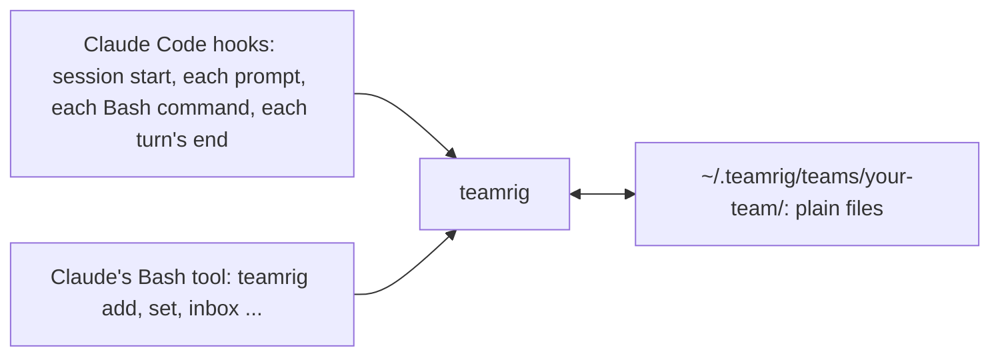

# What teamrig does

**One lead. Many AI sessions. One task list.** Run several Claude Code sessions on one project as one team, without
two of them owning the same task or force-pushing your main branch. You name the sessions; one leads and hands out
tasks, every task has one owner, and each session sees its own tasks and inbox notes. Claude runs the `teamrig`
[commands](commands.md) for you; you need a terminal, Claude Code and Node.js 22.18 or later.

To install, see [Get started](../README.md#get-started); to set a team up yourself, see
[Set up a team by hand](setup-by-hand.md).

> Status marks below: ✅ works today · 🚧 being built (task id) · 🗺 planned.

## Why teamrig

Parallel AI sessions on one project collide, forget what was asked of them, and burn through your budget. teamrig gives
them what a human team has: one list of who does what, a way to pass notes, and shared rules, all in plain files on
your machine.

| You get | How | Status |
| --- | --- | --- |
| **Nothing to run or host** | Plain files on disk, a small CLI and Claude Code hooks. Works offline; no account. | ✅ |
| **A task list nobody loses** | `teamrig add`, `set`, `update`, `list`, `show`: owner, priority tier, due date, goals and week; `show` also lists who changed the task. `check` finds tasks that break a team rule; `plan` prints the week. | ✅ |
| | Dependencies and parent/child tasks | 🚧 T205 |
| | Planned start and ETA, history across tasks (`history --by <session>`), token estimates | 🚧 T209, T210, T211 |
| **Notes between sessions, no server** | `teamrig inbox add --to web`; the receiver is reminded at its next prompt and reads with `inbox read`. `who` gives the name to message a session by. | ✅ |
| **A lead that runs the team** | One session holds the lead role in the team config; every session learns at start who it is and whom to message. | ✅ |
| | Names that survive a rename: `teamrig rename` keeps the session's id, and every old name still works; `teamrig doctor` finds name and inbox problems | ✅ |
| | Sub-team leads (a team tree) | 🗺 |
| **Shared rules, loaded every time** | At start, each session gets the core rules and your team's own rules (`teams/<team>/rules.md` in the kit home; over 3,500 characters, a pointer to it); `check` also lints your skills. | ✅ |
| **Safe pushes from parallel sessions** | A push guard asks before any push to a protected branch (such as main) and refuses a `--force` push or a delete of one (a `--force-with-lease` push asks); `commits check` holds commits to a size rule. | ✅ |
| | A deploy coordinator: one push at a time, a lock for heavy steps, no-deploy windows | 🗺 T228 |
| **A fresh context, nothing forgotten** | When a session marks a task done with its context over the team's threshold (250k tokens by default), or the lead asked (`teamrig refresh <session>`), it writes a handover; you type `/clear` (a hook cannot) and it starts again from the handover. | ✅ |
| | Restarting the tab for you instead of `/clear` | 🗺 T201, T212 |
| **Survives reboots** | Reopens your sessions and tabs after a restart | 🗺 T201 |
| **Budget control** | Pacing to the weekly limit, pauses by priority, a daily cap | 🗺 |
| **Hire and retire sessions** | From off to automatic within a budget; rehire from a handover note | 🗺 T212 |
| **Settings and upgrades** | `teamrig config validate` and `config migrate` | ✅ |
| | A new-version notice and `teamrig upgrade` with rollback | 🗺 T203 |
| **Works everywhere** | Windows, macOS and Linux; every change is tested on all three. | ✅ |

## Works with

teamrig runs with Claude Code in a terminal today; other AI tools and task trackers come after its first release.

| | Today | Planned |
| --- | --- | --- |
| AI coding tools | Claude Code ✅ | Codex 🗺 T204 |
| Editors | Any terminal ✅ | VS Code family, JetBrains 🗺 |
| Task tools | Its own task list ✅ | Jira, Linear, GitHub Issues, Asana 🗺 T206 |

## How it works

Every session runs the same small `teamrig` program, from four Claude Code hooks and from its Bash tool, and that
program reads and writes plain files in your team's folder. Nothing runs between sessions.

[How it works](how-it-works.md) draws each part: the team, a task's life, notes between sessions, a fresh
context, safe pushes and room for other tools.
