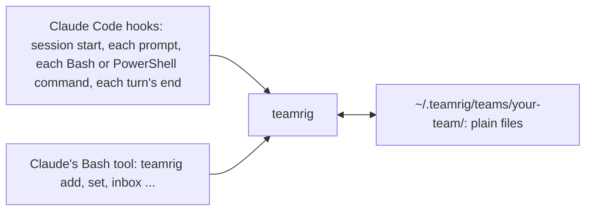

# What teamrig does

**One lead. Many AI sessions. One task list.** Run several Claude Code sessions on one project as one team, without
two of them owning the same task, and with a guard against their force-pushes to your main branch. You name the
sessions; one leads and hands out tasks, every task has one owner, and each session can list its own tasks
(`teamrig list --session web`) and is told of new inbox notes. Claude runs the `teamrig` [commands](commands.md) for
you; you need a terminal, Claude Code 2.1.139 or later and Node.js 22.18 or later.

To install, see [Get started](../README.md#get-started); to set a team up yourself, see
[Set up a team by hand](setup-by-hand.md).

> The Status column says whether each part works today, is being built (with its task id) or is planned.

## Why teamrig

Parallel AI sessions on one project collide, forget what was asked of them, and burn through your budget. teamrig gives
them what a human team has: one list of who does what, a way to pass notes, and shared rules, all in plain files on
your machine.

| You get | How | Status |
| --- | --- | --- |
| **Nothing to run or host** | Plain files on disk, a small CLI with no runtime dependencies, and Claude Code hooks. Works offline; no account. | works today |
| | Commands at your prompt: `/teamrig budget` or `/teamrig list` in a Claude Code tab runs the command on your machine and shows its output, with no model turn and no tokens. A command that changes the team's files runs only when you type it, and asks first when it adds the tab's session | works today |
| **A task list nobody loses** | `teamrig add`, `set`, `update`, `list`, `show`: a plain-words description of what and why, owner, priority (p1 first), due date, goals and week; `show` also lists who changed the task. A task given to another session posts it an inbox line naming the task. `check` finds tasks that break a team rule; `plan` prints the week. | works today |
| | Dependencies and parent/child tasks | being built (T205) |
| | Planned start and ETA, history across tasks (`history --by <session>`), token estimates | being built (T209, T210, T211) |
| **Notes between sessions, no server** | `teamrig inbox add --to web`; the receiver sees the new lines at its next prompt, and `inbox read` marks them read. A tab you start yourself joins the session its title names (`/rename web`); a tab bound with no title gets its session's name as title, so it stays bound after `/clear`. `who` gives the name to message a session by. A message to a session idle an hour or more, which would wake it at full price, is held once with a note: an inbox line, or every ask in one message sent again. | works today |
| **Wakes on urgent work** | A session idle at its prompt wakes by itself when unblocked urgent work is handed to it: a task it owns, at `wake.priority` (p1 by default; p1 only past its daily budget or in quiet hours), not waiting, with every task it comes after finished. Tasks handed within 2 minutes wake it once, each task once, and the prompt and a toast show the wake's cost (about 27k W warm, 210k W cold), logged in `state/wakes.jsonl`. teamrig's mod sends the prompt as the plugin; nothing is typed into the terminal. | works today |
| **A lead that runs the team** | One session holds the lead role in the team config; every session learns at start who it is and whom to message. | works today |
| | The owner's daily meeting: `teamrig meeting start` tells every session by inbox line to hold its messages to the lead (one starting CRITICAL goes; the cold-send hook holds the rest) and prints the agenda in one call: the owner's decisions with their card facts, the late tasks, what finished since the last meeting, the lead's inbox and the week's use and fit; `meeting end` tells each session the decisions recorded on its tasks. The `daily-meeting` skill walks the lead through it | works today |
| | Names that survive a rename: `teamrig rename` keeps the session's id, and its old names keep finding it until another session takes one; `teamrig doctor` finds name and inbox problems | works today |
| | Teams of teams: `team create --parent` hangs a sub-team under a lead (up to 3 levels, 8 sub-teams each); `add --team` hands its lead a task, `list`, `check` and `plan` with `--tree` read every team below, and notes go up and down only through leads | works today |
| | Shipped work not verified yet has its own status, `verifying`: `--proof` names the proof and `--due` the date to verify it by; `teamrig verify`, the start context and `inbox read` keep a session's queue in view, a start that needs a verifying task waits for its proof, and `check` flags VERIFY-OVERDUE past that date, VERIFY-BLOCKS when work needs it and PILE-UP when a session holds too many | works today |
| | A task that cannot go on is `waiting`, with what it waits for: a decision or an approval (a session's or the owner's), another task, or a time; `check` flags it READY once they have cleared. A task not started that needs another first stays open, planned `--after` it | works today |
| | Drift checks the lead acts on: `check` flags work in progress below its session's own waiting p1 (PRIORITY-SKIP) or with no goal outside the week plan (OFF-GOAL) | works today |
| | Stopgaps that outlive their fix: mark a local stopgap `stopgap T<id>` in a skill, `CLAUDE.md` or a rule file, and `check` flags STOPGAP-DONE, with each place, once that task is done or dropped | works today |
| | Each session on its own model and effort: `teamrig open` starts it with the config's `launch` entry (the lead on Opus at xhigh unless set), and a MODEL line tells you when a session runs on another model or effort, or Claude Code switched its model after a safeguard stop, with the `/model` or `/effort` to type; `teamrig doctor` warns when `CLAUDE_CODE_EFFORT_LEVEL` or `CLAUDE_CODE_SUBAGENT_MODEL_FORCE` is set, since either overrides every effort or helper model a session picks, and when a `launch` entry names a model but no effort | works today |
| **Shared rules, loaded every time** | At start, each session gets the core rules and your team's own rules (`teams/<team>/rules.md` in the kit home; over 2,995 characters, a pointer to it). The core rules win over a conflicting CLAUDE.md, rules file, skill, memory, hook text or team rule, except the local rules you keep: `teamrig rules scan` lists every place one can override them, and team setup asks you about each conflict (remove it, keep it as an exception that wins, keep the text but let teamrig win, or rewrite it). `teamrig rules` prints them, and `check` also lints your skills. | works today |
| **Safe pushes from parallel sessions** | A push guard asks before Claude pushes to a protected branch (such as main) and refuses a `--force` push or a delete of one (a `--force-with-lease` push asks; [what it cannot see](how-it-works.md#safe-pushes)); `commits check` holds commits to a size rule. | works today |
| | Skill edits that survive parallel sessions: when Claude Code refuses a session's or a helper's edit of a skill (another session changed the file since it was read) and the turn would end without the edit redone, the turn's end sends it back once to read the file again and redo the change, or say why it dropped it. `check` flags a `Last verified:` line with a note after its date (`VERIFIED-NOTE`), the line every run rewrote at its end, so parallel runs change only the date | works today |
| | `teamrig worktree remove` removes a finished worktree, and its merged branch with `--delete-branch`: it unlinks a `node_modules` link first, so git cannot follow it and empty the main checkout's, and refuses the main checkout, a dirty tree or a real `node_modules` folder | works today |
| | A deploy coordinator: one push at a time, a lock for heavy steps, no-deploy windows | planned (T228) |
| **A fresh context, nothing forgotten** | When a session marks a task done with its context over the team's threshold (120k tokens by default), at every third finished task once its context passes 80k, or when the lead asked (`teamrig refresh <session>`), it writes a handover once its background work has finished; once it is idle, teamrig restarts it and it carries on from the handover by itself, with its id, scheduled jobs, scratchpad and plan file (type anything to keep the context; with the restart off, you type `/clear`). The handover holds only what the register lacks: the fresh start, and every start after a compaction, lists the session's active tasks read live from the register (status, waits, due; at most 6 and `+N more`), so no stale status carries over. | works today |
| | Starting the session fresh for you: teamrig's mod runs `/clear` in its tab; without the mod, a restart in the same tab when teamrig opened it, else in a new tab | works today |
| **Survives reboots** | Reopens your sessions and tabs after a restart | planned (T201) |
| **Budget control** | `teamrig budget`: each session's token use today, measured from the Claude Code transcripts (a helper's W at its own price, `budget.subagentWeight`), against the week's pace line and its daily budget; `--loops` counts the costly loop patterns (read after read, edit after edit, reruns); `--burn` shows where each day's W came from (the owner, peer messages, notifications, scheduled wakes, subagents), cold calls and compactions; the lead lifts a session's budget for a day, always with a stop %. The week's use comes from `teamrig statusline` or your own status line. A session past its daily budget is warned, the lead gets an inbox line, and its helper launches can ask first or be refused, past the budget or in quiet hours. A session making six single-step calls in a row is asked once to batch them (`loops.chainNudgeAt`). `teamrig test -- <command>` runs a test command and prints one PASS or FAIL line and the failing tests, keeping the whole output in a log. `teamrig doctor` weighs the CLAUDE.md files, memory index and skill listing every call re-reads against the `contextFiles` budgets. | works today |
| | Planning to the limit: a task's `--size` is its % of the weekly limit; `plan` sums the week's sized to-do tasks in plan order against the limit left after the week's use and names the first that doesn't fit, which `check` flags `OVER-LIMIT` | works today |
| | Bursts: `teamrig burst` projects the share of the week left unused at the pace end; `teamrig burst start` (the lead, with the owner's approval under `burst.policy` owner, the default; never automatic) gives each session in it a bigger daily budget and more helpers at once until the pace end (surplus) or a task's deadline, never past `budget.targetPct`; its sessions are told to split only independent tasks, a worktree per repo edit, one integrate at a time, the same model and effort; `hire --burst` adds sessions for it, due to retire when it ends | works today |
| **Lead boundary** | The lead decides, briefs and reads results; others do the work. On the lead's tab, its first edit outside its own files, first test or build and third code search of a turn bring it one line asking it to hand the work to the owning session, a helper or a temporary session, and you see at the turn's end what it did itself (`leadBoundary`). It never blocks. | works today |
| | Pausing sessions by priority when the week runs short | planned |
| **Hire and retire sessions** | `teamrig hire`: the lead adds a temporary session for one job within `hiring.policy` (off, the owner approves each hire, or the lead decides) and its caps on hired sessions and their daily budget; each hire is logged with its job, approver and review day. `teamrig retire`: the lead takes a session off the team once its work is done, handing its open tasks to an heir (`--to`) and pointing at its handover note; its tasks, inbox and records stay readable by its id, and `check` flags a hired session with no open task for `hiring.idleHours` (RETIRE-DUE) or past its review day (REVIEW-DUE) | works today |
| | A hired session asked, at its turn end, to write its handover and retire itself once its last task closes (`hiring.policy` `automatic`); rehiring a retired id, fresh on its handover or resumed in its last Claude Code session when that is at most `hiring.resumeMaxTokens` and `hiring.resumeMaxIdleDays` (`teamrig open --resume`); the `hire` skill | works today |
| **Settings and upgrades** | `teamrig config validate` and `config migrate` | works today |
| | Open tabs take a plugin update by themselves: once an install changed and no turn runs, teamrig's mod runs `/reload-plugins` in each tab, at most once per 5 minutes (a Claude Code without mods still needs it typed) | works today |
| | A new-version notice and `teamrig upgrade` with rollback | planned (T203) |
| **Works everywhere** | Windows, macOS and Linux; every change is tested on all three. | works today |

## Works with

teamrig runs with Claude Code in a terminal today; other AI tools and more task trackers come after its first release.

| | Today | Planned |
| --- | --- | --- |
| AI coding tools | Claude Code | Codex (T204) |
| Editors | Any terminal Claude Code runs in; `teamrig open` opens tabs in six ([which](setup-by-hand.md#configuration)) | VS Code family, JetBrains |
| Task tools | Its own task list; GitHub issues imported into it, read-only (`teamrig gh sync`) | Jira, Linear, Asana (T206) |

## How it works

Every session runs the same small `teamrig` program, from four Claude Code hooks and from its Bash tool, and that
program reads and writes plain files in your team's folder. Nothing runs between sessions.

[How it works](how-it-works.md) draws each part: the team, a task's life, notes between sessions, a fresh
context, safe pushes and room for other tools.
