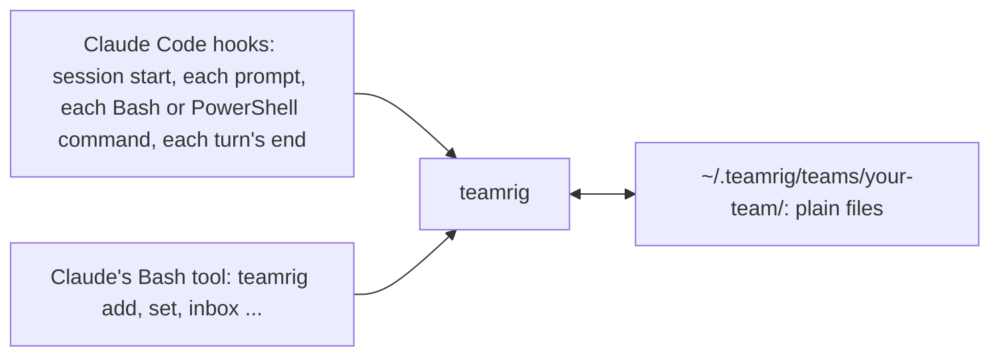

# What teamrig does

**One lead. Many AI sessions. One task list.** Run several Claude Code sessions on one project as one team, without
two of them owning the same task, and with a guard against their force-pushes to your main branch. You name the
sessions; one leads and hands out tasks, every task has one owner, and each session can list its own tasks
(`teamrig list --session web`) and is told of new inbox notes. Claude runs the `teamrig` [commands](commands.md) for
you; you need a terminal, Claude Code 2.1.139 or later and Node.js 22.18 or later.

To install, see [Get started](../README.md#get-started); to set a team up yourself, see
[Set up a team by hand](setup-by-hand.md).

> The Status column says whether each part works today, is being built (with its task id) or is planned.

## Why teamrig

Parallel AI sessions on one project collide, forget what was asked of them, and burn through your budget. teamrig gives
them what a human team has: one list of who does what, a way to pass notes, and shared rules, all in plain files on
your machine.

| You get | How | Status |
| --- | --- | --- |
| **Nothing to run or host** | Plain files on disk, a small CLI with no runtime dependencies, and Claude Code hooks. Works offline; no account. | works today |
| | Commands at your prompt: `/teamrig budget` or `/teamrig list` in a Claude Code tab runs the command on your machine and shows its output, with no model turn and no tokens. A command that changes the team's files runs only when you type it, and asks first when it adds the tab's session | works today |
| **A task list nobody loses** | `teamrig add`, `set`, `update`, `list`, `show`: a plain-words description of what and why, owner, priority (p1 first, with teamrig's own p0 above every level for urgent work done right now), due date, goals and week; `show` also lists the task's files (`teamrig files`), who changed the task, and every inbox line that names it, so a correction sent by line stays with the task. A task given to another session posts it an inbox line naming the task. `check` finds tasks that break a team rule; `plan` prints the week. | works today |
| | Dependencies: `--after T5,T6` names the tasks to finish before this one starts, and its line shows `after T5` | works today |
| | Token estimates: `--size` gives what a task still costs, in percent of the weekly usage limit, and `plan` sums the sizes against the week | works today |
| | Reads that stay small: `teamrig compact` archives the task list's log and rewrites its snapshot, so finished tasks over 8 days old leave the working set (`show` and `list --status done` still read them); it checks every task first and writes nothing on a difference | works today |
| | A place for each task's files: `teamrig files T12` prints (and makes) the folder for its design, build notes, plan, review and evidence, in the team whose task list holds it, and `teamrig files --notes` a session's folder for notes that belong to no task, so no session invents its own place | works today |
| **Notes between sessions, no server** | `teamrig inbox add --to web`; the receiver sees the new lines at its next prompt, and `inbox read` marks them read. `--to all`, `leads` or `group:<leader>` posts one line to a group of your team, `team:<team>` to every session of a team of your tree, `tree:leads` to every team's lead in it and `task:T<n>` to everyone working a task (its owner and the owner of each active task whose ref is `T<n>`, in any team of your tree), you left out, and a comma-separated list posts it to each receiver once; when any receiver is refused, none gets it. `--wake now` also wakes each receiver idle at its prompt within about 3 minutes and says what that costs, and `--wake-by 14:30` wakes it at that time only if it has not seen the line by then; a group is woken only by a leader, another team only by the lead of a team above it. A tab you start yourself joins the session its title names (`/rename web`); a tab bound with no title gets its session's name as title, so it stays bound after `/clear`. `who` gives the name to message a session by, `who <team>/<id>` one of another team of your tree. A message to a session idle an hour or more, which would wake it at full price, is held once with a note: an inbox line, or every ask in one message sent again. With `open.idle.mode: on`, a message to a session teamrig closed goes in as its urgent line instead, and the idle pass reopens it with the line quoted in its first prompt. | works today |
| **Wakes on urgent work** | A session idle at its prompt wakes by itself when unblocked urgent work is handed to it: a task it owns, at `wake.priority` (p1 by default; p0 only while its budget holds it, p0 and p1 only in quiet hours), not waiting, with every task it comes after finished. Tasks handed within 2 minutes wake it once, each task once, and the prompt and a toast show the wake's cost (about 27k W warm, 210k W cold), logged in `state/wakes.jsonl`. An urgent line (an inbox line its sender also posts as a wake ask) wakes it the same way, quoted in the prompt, held by neither the gap between wakes nor its budget; a session busy in a turn is shown the line at its next tool call's end instead. teamrig's mod sends the prompt as the plugin; nothing is typed into the terminal. | works today |
| **Every tab's state at a glance** | With `tabStatus.enabled` (on in every new team) and Claude Code's own title off, a colored circle before each tab's title: green ready, yellow working (also while a helper it started still runs), orange waiting on you, blue waiting on your decision (a turn that ends asking you to decide), red an API error, purple compacting; then the session's title or first prompt. | works today |
| **What a tab showed, after a clear** | Each session's prompts and replies for the last day (`turnLog`), secret shapes masked, with a mark at each /clear or compaction, so a refresh never takes away what you were reading. The task pane's Log view shows them. | log works today; pane view being built (T587) |
| **Secrets kept out of the conversation** | Before a Bash, PowerShell, Read or Grep call, the secret guard refuses one that would print a secret file (`.env`, `~/.npmrc`, `~/.ssh/**`, `*.pem`, Claude Code's prompt history, the shells' histories...), the whole environment, a secret variable, a Kubernetes secret's data or a dump command's output (`kubectl config view --raw`) into the session, where it would stay in the transcript, and a shell line that holds a secret as text (a token, credentials in a URL or an `Authorization` header), and a Write or Edit whose text holds one outside a secret file such as `.env`; output piped or redirected away passes, and so does a reference or a placeholder. `secretGuard` sets deny, ask or allow and adds the team's own files, names and dump commands. After a call runs, the secret redactor replaces each secret its result still holds (a token, credentials, a secret variable's value) with `[redacted <kind>]` before Claude and the transcript see it, and names the kinds and the task it filed to rotate each (`secretGuard.redact`). `check` warns the lead (SECRET-GUARD-OFF) while a secret check is turned off, by these keys or a settings file's `disableAllHooks`. `teamrig doctor` flags a PowerShell history that no profile keeps credentials out of, and the guide gives the handler to paste. | works today |
| | No secret into a commit or a push: a repo's git hooks call `teamrig secrets staged`, `teamrig secrets message` and `teamrig secrets pushed`, which refuse a staged line, a message line or a pushed commit (a merge's own resolution too) or annotated tag message in a secret shape, and a file the secret paths list (`.env`, `*.pem`...) whatever it holds, named by place and shape, never by value; outside a team the default shapes and paths still scan, inside one the team's own are added; `check` warns the lead (SECRET-HOOK) of each repository in `delivery.repos` whose hooks skip one of the three, with the line to add | works today |
| **Reads without a prompt** | With `readonlyShell.enabled`, a Bash or PowerShell line whose every command provably only reads (`grep`, `cat`, `sed -n`, `git log`, `kubectl get`, `Get-Content`...) runs without a permission prompt; any other line gets Claude Code's own check, and the push and package guards still win. `readonlyShell.allowPrefixes` adds commands the team trusts with any arguments (`npx tsc --noEmit`). | works today |
| **Auto mode knows the team** | `teamrig automode install` adds the team's lines, tagged `[teamrig <team>]`, to Claude Code's `autoMode.environment` in your own settings: the protected branches and what a push to one does, the register commands every session runs, what `heavy` and `test` wrap (nothing granted: the command after `--` is judged alone), who removes a worktree, and that a session may rebase its own branch and push it back with `--force-with-lease` (never a protected one). Auto mode's classifier takes them as true, so it stops asking about them; a plugin cannot ship these lines itself. Without `--yes` it shows the change; `teamrig automode uninstall` takes out only the team's tagged lines. | works today |
| **No prompt while nobody answers** | With `prompts.hookAsks: refuse`, a permission prompt a teamrig hook or Claude Code would raise never waits: a line that provably only reads runs, a line teamrig can rewrite is refused with the line to run instead, and anything else is refused with the note to record the step for the owner and take the next task, so no session waits hours for an answer. | works today |
| **Never stuck on a question** | The core rules send the owner only an owner gate or a business decision; any other question, staffing too, is the session's or its leader's however many good answers it has. With `pickerGuard.enabled`, a session that needs the owner's decision makes it when it is its own, else records it on its task with its default and goes on with its next one: the question picker, which would stop it until the owner answers, is refused to every session and helper, and to the lead outside the owner's daily meeting, and the refusal says what to do instead. The meeting asks the cards in plain text, the owner answering in their own words, unless the team asks with the picker (`decisions.askWith`). | works today |
| **A lead that runs the team** | One session holds the lead role in the team config; every session learns at start who it is and whom to message. | works today |
| | The owner's daily meeting: `teamrig meeting start` holds every message to the lead (one starting CRITICAL goes; the cold-send hook tells each sender, so no session is told) and prints the agenda in one call: the owner's decisions with their card facts (only those naming an owner gate or a business decision; the ungated ones in a list of their own, never read to the owner), the late tasks, what finished since the last meeting, the lead's inbox and the week's use and fit; `meeting end` tells each session the decisions recorded on its tasks, and posts no line to a session with none. The `daily-meeting` skill walks the lead through it, and has the lead decide before the meeting each card that names no owner gate or business reason | works today |
| | The owner's meetings with one session at a set time, apart from the daily one: `teamrig meeting schedule` books one (`M3`) on its tasks, with its brief, and tells the session met and those joining by one inbox line; at its time one open tab of the team sends an OS notification (a Windows toast, a macOS banner, `notify-send` on Linux) that names it and its start command; `meeting list` shows them by time, a scheduled one past its slot as missed (`--json` for the task pane), and each session's `start` and the daily agenda show today's and the missed ones; the owner starts one from any session (`meeting start M3`): the session met gets its opening prompt in its own tab, a running one brought to the front (Windows Terminal, tmux) and woken once idle or a closed one opened, no keystroke typed into it, and those joining are told where it is held; the lead or the session met moves, ends (`meeting end M3`) or drops one, those it meets told | works today |
| | A decision put off, or brought by its own session: `update <id> --later <date> --note ..` puts a card waiting on the owner off to that time, out of the meeting's decisions and the batches until then (the agenda lists it under LATER), and `--later none` brings it back; `teamrig meet <id\|name>` has the session that holds the cards bring them to the owner itself, an inbox line from the owner waking its tab, or a fresh tab when it is not running, refused when none of its cards is due | works today |
| | The owner's decisions in batches: `teamrig decisions` lists the waits on the owner not yet asked and the asked ones past due, as card facts, and the lead's `start` and `check` say when a batch is due: a wait due before the next batch (asked at once), `decisions.batchAt` waits not yet asked, or a `decisions.batchTimesUtc` time passed. `decisions asked`, or a meeting start, records the batch asked, so the owner is asked together, not once per wait. A new owner wait's inbox line to the lead says when the owner hears of it, and one due at once wakes the lead who asks it (in a tree of teams, the root's) | works today |
| | Names that survive a rename: `teamrig rename` keeps the session's id, and its old names keep finding it until another session takes one; `teamrig doctor` finds name and inbox problems | works today |
| | Teams of teams: `team create --parent` hangs a sub-team under a lead (up to 3 levels, 8 sub-teams each), and `team split` moves sessions, with the tasks they own, their files and renames, into a new sub-team (`--dry-run` prints the plan and what blocks it); any session asks any team of its tree for work with `add --team` (its `--owner`, else that team's lead, who gets a copy line to reorder or reassign it; the done or dropped line comes back to the asker), a task id names one task in the whole tree, so a wait or an `after` may name another team's task, `list`, `check` and `plan` with `--tree` read every team below, every team's waits on your decision reach the root's lead, whose decisions batch and daily meeting list them as `<team>/<id>` and whose `update <team>/<id> --note` records your answer for the meeting's end to send to the task's owner, a child team's lead asks the parent team's lead for its approvals, its pushes included (`approval:app/lead`), answered with `approve <team>/<id>`, a note reaches any session of the tree as `<team>/<id>` (waking one of another team only from a lead above it), and a sub-team's sessions start with the `rules.md` of each team above | works today |
| | Sub-leads: `teamrig promote` (the lead or a sub-lead) makes one session it leads the sub-lead of others it leads, so their decision and approval waits may go to it and it approves them; `demote` takes its members back | works today |
| | Shipped work not verified yet has its own status, `verifying`: `--proof` names the proof, `--waits` when it runs (a time, or a task under way whose end runs it) and `--due` the date to verify it by; `teamrig verify`, the start context and `inbox read` keep a session's queue in view, a proof another party makes is asked of it as its task (`set --status waiting --ask`, then verifying on that task once it starts), and `check` flags READY once the proof's waits cleared and REPARKED when a proof keeps being put off; a change tests or a dry run proved, whose proof is a sighting still to come, closes `done` with `--watch` and stays in `teamrig verify` under WATCH until it shows; a start that needs a verifying task waits for its proof, and `check` flags VERIFY-OVERDUE past that date, VERIFY-BLOCKS when work needs it and PILE-UP when a session holds too many | works today |
| | A task that cannot go on is `waiting`, with what it waits for: the lead's or the owner's decision or approval (the lead gets an inbox line; a wait on the owner carries a card: the question, the options with their numbers, a recommendation and the default, so the owner decides from it alone, and `check` flags one without it NO-CARD; an owner's order approves its own work and proof, so a task the owner ordered asks the owner only with `--why-ask`, else `check` flags it OWNER-ORDERED; only an owner gate or a business decision is the owner's to decide, so a wait on the owner's decision names it with `--gate`, else `check` flags it UNGATED), another task, or a time; `check` flags it READY once they have cleared. A peer's work is a task, never an approval: `set --status waiting --ask <session> --text "<the work>"` adds it as that session's task and waits on it in one step, and `check` flags a peer wait an older teamrig wrote (PEER-WAIT). A task not started that needs another first keeps its status (open, or waiting on an approval), planned `--after` it | works today |
| | While a task waits, its session keeps working: at its next turn end after the `set`, a session that owns a task it can start that does not come after the waiting one is sent back once to work it, never in quiet hours or while its budget holds it; with nothing to start, the turn ends | works today |
| | A dependency tree: a task takes the earlier due date of a task that needs it (`due 10-17 (from T9)`), so lists, plans, the late tasks and `check` put the work a dated task needs first; a row names another session's task that needs it (`needed by T9 (api)`), `show <id> --tree` prints what a task needs and what needs it with each owner, status and due, then the next move (who acts first, on which task), `start` and the live task list show the tasks waiting on you, a plan or a wait that would close a loop is refused (`check` flags an old one LOOP), and lists sort by a leader's pin, priority, then started work, effective due, what a task unblocks, the week plan and size, each row saying why it sorts ahead of the next (`· ahead: unblocks T9 p1`) | works today |
| | Drift checks the lead acts on: `check` flags work in progress below its session's own waiting p1 (PRIORITY-SKIP) or with no goal outside the week plan (OFF-GOAL), a session adding more tasks for itself in a day than the team allows (SELF-MADE), and a session holding more p1 work than it finished in the last 7 days (OVER-PACE), and a day that ended with no goal or week-plan task moved (NO-PROGRESS) | works today |
| | Stopgaps that outlive their fix: mark a local stopgap `stopgap T<id>` in a skill, `CLAUDE.md` or a rule file, and `check` flags STOPGAP-DONE, with each place, once that task is done or dropped | works today |
| | Each session on its own model and effort: `teamrig open` starts it with the config's `launch` entry (the lead on Opus at xhigh unless set), and a MODEL line tells you when a session runs on another model or effort, or Claude Code switched its model after a safeguard stop, with the `/model` or `/effort` to type; `teamrig doctor` warns when `CLAUDE_CODE_EFFORT_LEVEL` or `CLAUDE_CODE_SUBAGENT_MODEL_FORCE` is set, since either overrides every effort or helper model a session picks, and when a `launch` entry names a model but no effort | works today |
| **Shared rules, loaded every time** | At start, each session gets the core rules and your team's own rules (`teams/<team>/rules.md` in the kit home; in a sub-team, each team above's first, root first; past 2,750 characters together, a pointer to the file that does not fit), and so does each helper it starts, told whose helper it is. The core rules win over a conflicting CLAUDE.md, rules file, skill, memory, hook text or team rule, except the local rules you keep: `teamrig rules scan` lists every place one can override them, and team setup asks you about each conflict (remove it, keep it as an exception that wins, keep the text but let teamrig win, or rewrite it). Lines judged no conflict are recorded (`teamrig rules clear`), so a rescan lists only new or changed ones. `teamrig rules` prints them, and `check` also lints your skills. | works today |
| **Safe pushes from parallel sessions** | A push guard asks before Claude pushes to a protected branch (such as main) and refuses a `--force` push or a delete of one (a `--force-with-lease` push asks; [what it cannot see](guides/keep-it-safe.md#safe-pushes)); with `pushGuard.pushToProtected: lead` the lead approves those pushes instead of you (`teamrig approve`, by the `approvals` skill's checklist), and with `gated`, `teamrig merge` merges a change that holds its self-merge gates with no approval and holds the rest for a leader; it refuses a commit or push run without the repository's hooks ([skipped hooks](guides/keep-it-safe.md#skipped-hooks)); `commits check` holds commits to a size rule. | works today |
| | Vetted packages: a package guard refuses a package runner that would fetch an unvetted tool (`npx`, `npm exec`, `npm create`, `pnpm dlx`, `yarn dlx`) and an install that would rewrite a worktree's `node_modules` linked to the main checkout's, and the [security skill](../plugins/teamrig/skills/security/SKILL.md) has the steps for vetting an install, pinning overrides, secrets, pod specs and a page's CSP | works today |
| | An install of an unvetted version refused (`npm install <pkg>` of a release under the cooldown or with an advisory) | works today |
| | Skill edits that survive parallel sessions: when Claude Code refuses a session's or a helper's edit of a skill (another session changed the file since it was read) and the turn would end without the edit redone, the turn's end sends it back once to read the file again and redo the change, or say why it dropped it. `check` flags a `Last verified:` line with a note after its date (`VERIFIED-NOTE`), the line every run rewrote at its end, so parallel runs change only the date | works today |
| | A skills scorecard: `teamrig skills scorecard` reads the transcripts and shows, per skill, its loads, its missed uses (the procedure run by hand, found by the skill's `Signature:` regex, with no load before it) and the calls and errors per run against a hand-run baseline, so a team sees which skills save work and which are skipped. Each run reads only what the transcripts gained since the last one | works today |
| | Privileged calls hidden in skill scripts: auto mode judges `node flow.js`, not the kubectl exec, cluster secret or credential header the script sends, so `check` flags each such call kind a script at the top of a skill's folder makes with no `Grants: <kind>` line in its SKILL.md naming the owner's grant (GRANT) | works today |
| | Skills listed where they are used: a session teamrig launches lists another area's skill by name only, without its description, unless the skill's `Used by:` line names that session (`skills.otherAreas`: `on`, `name-only`, `user-invocable-only` or `off`), so each call carries only the descriptions of the skills that session runs | works today |
| | Privileged commands on review: `teamrig exec request` asks to run one from a JSON file naming the command, its code binding, a dry run or preview, its purpose, expected effect and rollback; `exec dry-run` runs the dry run for the reviewer; the security reviewer (`roles.securityReviewer`; a child team's may sit on a team above as `<team>/<id>` and review with `--team <child>`) or the owner approves one run (`exec approve`; an owner-gated request only the owner), refuses it naming the safe alternative (`exec refuse`) or hands it to the owner (`exec escalate`); `exec run` runs it once before the approval expires, and `exec status` shows each request's stage | works today |
| | Allow rules that skip auto mode trimmed: an allow rule approves a call before auto mode's classifier sees it, so `teamrig doctor` and `check` flag a local rule off the config's `permissions.keepAllow` that approves a whole tool or program (`Bash`, `Bash(node:*)`) or holds a credential Claude Code saved with an approved command, and `teamrig permissions trim` backs up the team's settings files and removes those rules (`--all`: every rule off the list) on `--yes`, printing counts per file and never a rule | works today |
| | Your Claude Code setup backed up and put back: `teamrig setup backup` copies its CLAUDE.md files, settings, rules, skills, parked skills, agents, commands, output styles, the project's memory and the team's own skills folder byte for byte, with a manifest of each file's sha256, into a folder outside the kit home, printing counts and never a file's text; `teamrig setup restore` lists the backups and previews one (files changed, deleted or made since), and on `--yes` backs the setup up first, writes the backup's files back, each checked by its sha256, and prints the restore that undoes it | works today |
| | What your setup costs each turn: `teamrig setup scan` lists every file and the skill and agent type listings a session loads with their tokens, and the findings to slim, each with the tokens a turn it saves: files over 6,000 chars, skill descriptions over 250, lines loaded twice, rule lines that may override a core rule, wide allow rules, no deny rule, bypassed prompts, hooks writing into the context, skills and agent types unused in 30 days, by the transcripts (read newest first, up to 1 GB) and Claude Code's `/skill-doctor`, plugins' skills too, and your skills and agent types used only in other projects, and names the newest backup of the setup, or NO BACKUP; it works before a team exists and only reads. Team setup backs the setup up and scans it first, then slims each group you say yes to (shorter files, rules moved where they load only when needed, repeats removed, unused skills and agent types parked, ones used elsewhere moved to their projects) and shows the cost before and after | works today |
| | `teamrig worktree add <branch>` makes every session's worktree the same way: a new branch from origin's newest default branch, in the repository's worktree folder (`delivery.repos.<name>.worktreeFolder`), then the repository's setup run in it without a shell (`worktreeSetup`), such as a link to the main checkout's `node_modules`; a branch or folder already there is refused before any change, and a failed setup keeps the worktree to finish by hand | works today |
| | `teamrig worktree remove` removes a finished worktree, and its merged branch with `--delete-branch`: it unlinks a `node_modules` link first, so git cannot follow it and empty the main checkout's, and refuses the main checkout, a dirty tree or a real `node_modules` folder; in a team a session removes only its own worktrees and those of the sessions it leads, the lead any | works today |
| | A deploy coordinator: `teamrig merge` merges a branch, by a push or through the team's own merge command such as a pull request (`delivery.repos.<name>.merge`), and `teamrig deploy` brings it to the running system, each checked and recorded under the host lock that `teamrig heavy` takes for builds and test runs, so they run one at a time, each at below-normal CPU priority so your terminal and apps win the CPU; none starts from the heavy cutoff to midnight UTC, and no merge or deploy in the hours before the weekly reset | works today |
| | Clean measurements beside deploys: `teamrig claim` holds a quiet span on the targets a session measures, so merge and deploy wait (`release` ends it early); `load` declares a background load such as a backfill; `windows` lists each target's stretches no deploy or heavy step touched, with the loads they overlap; `deploy-status` prints the state now: the lock's holder, the cutoffs, the open claims and loads, and what each repository pushed but has not deployed | works today |
| | `teamrig withdraw` takes a session's steps still waiting for the host lock (heavy, merge, deploy) out of the line, so a re-ordered or abandoned step never runs | works today |
| **A fresh context, nothing forgotten** | When a session marks a task done with its context over the team's threshold (120k tokens by default), at every third finished task once its context passes 80k, when the lead asked (`teamrig refresh <session>`), or within a long turn once it passes the threshold (Claude Code's own compaction waits for it), it writes a handover, even while its background work runs (the fresh start waits for that work); once it is idle and you are away (no draft, no key or prompt for 30 minutes, so it never clears while you read its reply, then a 20 s countdown above the prompt with Refresh now and Hold), teamrig restarts it (with no work it can start, once work comes for it) and it carries on from the handover by itself, with its id, scheduled jobs, scratchpad and plan file (send a prompt to keep the context; with the restart off, you type `/clear`). The handover holds only what the register lacks: the fresh start, and every start after a compaction, lists the session's active tasks read live from the register (status, waits, effective due; at most 6 and `+N more`) and the other sessions' tasks waiting on it (at most 3), so no stale status carries over. Each handover replaces the last one whole and stays short, since the fresh start reads all of it: `teamrig refresh --ready` refuses one over 20,000 bytes (`refresh.handoverMaxBytes`). | works today |
| | Starting the session fresh for you: teamrig's mod runs `/clear` in its tab; without the mod, a restart in the same tab when teamrig opened it, else in a new tab | works today |
| **Survives reboots** | After a shutdown or reboot, `teamrig restore run` reopens each Claude Code session it killed, in its folder (the worktree it went into) and at its last effort, never one closed on purpose, and prompts the ones that were mid-turn to re-check and carry on; `teamrig restore install` runs it at logon on Windows | works today |
| | Running the restore at logon on macOS and Linux | planned |
| **Budget control** | `teamrig budget`: each session's token use today, measured from the Claude Code transcripts (a helper's W at its own price, `budget.subagentWeight`), against the week's pace line and its daily budget; `--loops` counts the costly loop patterns (read after read, edit after edit, reruns); `--burn` shows where each day's W came from (the owner, peer messages, notifications, scheduled wakes, subagents), cold calls and compactions; `--misses` counts rule misses per session out of their chances (a work block with no `teamrig start`, `--followups none` on work left, a plain `git worktree remove`, the helpers' share of W, tests and builds outside `teamrig heavy`, an npx that fetches a package); `--task T<n>` shows each session's W on one task by day (a turn's W splits equally over the task ids its calls name, not ids a teamrig note, text, proof or follow-up only mentions); a session's leaders (the lead, or the sub-leads over it) lift its budget for a day, and a leader above a sub-lead lifts the sub-lead's whole group (`--group`), always with a stop %, and the lead tops up a session of a team under its own from its own team's daily budget (`<team>/<session>`); with sub-leads, the table shows each group's use against its part of the day. Past 100% of the week, `teamrig budget extra` enters the extra usage claude.ai goes on with, and that pool sets the daily budget until it is spent. The week's use comes from `teamrig statusline` or your own status line. A session past its daily budget is warned; it is held only once the team has no room left today (everyone's use today at or past the in-day pace), so no session waits while the week has room: then its leader (the lead, or its sub-lead) gets an inbox line and its helper launches can ask first or be refused, as they can in quiet hours. A session making three single-step calls in a row is asked once to send them as several tool calls in one message (`loops.chainNudgeAt`). `teamrig test -- <command>` runs a test command and prints one PASS or FAIL line and the failing tests, keeping the whole output in a log. `teamrig doctor` weighs the CLAUDE.md files, memory index and skill listing every call re-reads against the `contextFiles` budgets. | works today |
| | Planning to the limit: a task's `--size` is its % of the weekly limit; `plan` sums the week's sized to-do tasks in plan order against the limit left after the week's use and names the first that doesn't fit, which `check` flags `OVER-LIMIT`; a task that cost more than twice its size is `OVER-SIZE` | works today |
| | Bursts: `teamrig burst` projects the share of the week left unused at the pace end; `teamrig burst start` (the lead, with the owner's approval under `burst.policy` owner, the default; never automatic) gives each session in it a bigger daily budget and more helpers at once until the pace end (surplus) or a task's deadline, never past `budget.targetPct`; its sessions are told to split only independent tasks, a worktree per repo edit, one merge at a time, the same model and effort; `hire --burst` adds sessions for it, due to retire when it ends | works today |
| **Lead boundary** | The lead decides, briefs and reads results; others do the work. On the lead's tab, its first edit outside its own files, first test or build, first research (a web lookup, or a search of another session's notes or a sub-team's folder) and third code search of a turn bring it one line asking it to hand the work to the owning session, a helper or a hired worker (for research, the session that owns the question, by name when the search or the prompt's tasks show it; for a sub-team's folder, that child team's lead), and you see at the turn's end what it did itself (`leadBoundary`). It never blocks. | works today |
| | Pausing sessions by priority when the week runs short (`budget.pauseByPriority`, off by default): on a day what is left of the week gives less than the pace line plans, the day funds the queued work p0 first and idle sessions last, account-wide; a session none of it reaches gets a daily budget of 0, marked `(paused)` in `teamrig budget` and its Budget line, and is held once the team has no room; the lead, the delivery owner and lifted sessions are never paused | works today |
| **Hire and retire sessions** | `teamrig hire`: the lead, or a sub-lead into its own group, adds a worker it is sure the team needs within `hiring.policy` (off, the owner approves each hire, or the lead decides), with no cap counting hires: a hire the host has no room for (one more tab) starts home, closed until the idle pass opens it once it has work and room; each hire is logged with its job, approver and review day. `teamrig retire`: a lead over the session takes it off the team once the team no longer needs it, handing its open tasks to an heir (`--to`) and pointing at its handover note; its tasks, inbox and records stay readable by its id, and `check` flags a burst hire once its burst is over (RETIRE-DUE) and a hired session past its review day (REVIEW-DUE), which a lead over it clears by keeping it to a new review day (`teamrig hire <id> --review <YYYY-MM-DD> --reason "<why>"`) | works today |
| | When to hire: `check` flags SCALE-OUT on an area whose dated top-priority work outruns its pace (tasks done over `hiring.scaleOut.windowDays`), naming the slice to move, its cost and the week's spare, and what to do: an idle hire takes it, else a new hire; never while the week's spare cannot pay | works today |
| | A hired session asked, at its turn end, to write its handover once its last task closes (`hiring.policy` `automatic`), never to retire itself: only a lead over it retires it; rehiring a retired id, fresh on its handover or resumed in its last Claude Code session when that is at most `hiring.resumeMaxTokens` and `hiring.resumeMaxIdleDays` (`teamrig open --resume`); the `hire` skill | works today |
| | Room on the machine: `teamrig sessions` shows each session running (with the memory its Claude Code holds), closed or never recorded, and the host's free memory; the lead's `teamrig close` ends an idle session's Claude Code and its tab to free the host, and `teamrig open` resumes it. It refuses the lead, a session with work it can start or a time wait of its own ending within 30 minutes, one in a turn, at a tool call or waiting on a decision it put to the person, one running background work, or one too big or old to resume. `teamrig sessions --pass` shows what an idle pass would close and reopen (one reopen a pass, urgent lines first, only on a settled plugin install with room on the host, so a reopened tab never loads a half-copied teamrig; never a close of a session an urgent line waits to wake), changing nothing; with `open.idle.mode: dry-run` an idle tab's wake check runs that pass at most once a minute across the team (every 10 minutes in a quiet team) and logs what changed to `state/idle-pass.jsonl`, and every step at least hourly, with `on` (the default) it also starts those closes and that reopen, each logging its outcome there, each close waking the lead with an urgent line that names the session closed and what its tasks wait on from a person, a reopened tab no teamrig hook started in within 5 minutes waking the lead with a HOOKLESS line, and `check` warns the lead (FLEET-STALE) when the pass stops or fails | works today |
| **Settings and upgrades** | `teamrig config validate` and `config migrate` | works today |
| | Open tabs take a plugin update by themselves: once an install changed and no turn runs, teamrig's mod runs `/reload-plugins` in each tab, at most once per 5 minutes (a Claude Code without mods still needs it typed) | works today |
| | A new-version notice and `teamrig upgrade` with rollback | planned (T203) |
| **Windows and Linux** | Every change passes the local checks on Windows before it lands; on Linux the full test suite and a smoke run of the commands and hooks pass. The tab status circles and teamrig-pane are proven on Windows only; macOS is untested. | works today |

## Works with

teamrig runs with Claude Code in a terminal today; other AI tools and more task trackers come after its first release.

| | Today | Planned |
| --- | --- | --- |
| AI coding tools | Claude Code | Codex (T204) |
| Editors | Any terminal Claude Code runs in; `teamrig open` opens tabs in six ([which](setup-by-hand.md#configuration)), each team's in a Windows Terminal window of its own with `open.teamWindow` | VS Code family, JetBrains |
| Task tools | Its own task list; GitHub issues imported into it, read-only (`teamrig gh sync`) | Jira, Linear, Asana (T206) |

## How it works

Every session runs the same small `teamrig` program, from four Claude Code hooks and from its Bash tool, and that
program reads and writes plain files in your team's folder. Nothing runs between sessions.

[How it works](how-it-works.md) draws each part: a task's life and room for other tools;
[Grow the team](guides/grow-the-team.md) covers setting up a team, hires and child teams,
[Keep it safe](guides/keep-it-safe.md) the guards, [Run your day](guides/run-your-day.md) the daily meeting,
notes between sessions and wakes, [Recover from a crash or a full context](guides/recover.md) a restore after a
reboot, a fresh context and the turn log, [Plan the week](guides/plan-the-week.md) the week plan, the daily
budget and bursts, [Ship from many sessions](guides/ship-from-many-sessions.md) the host lock, merging and
deploying a change, and clean measurements beside deploys, and [Make it improve itself](guides/improve-itself.md)
skills, their scorecard, team rules and the local rules that say otherwise.
