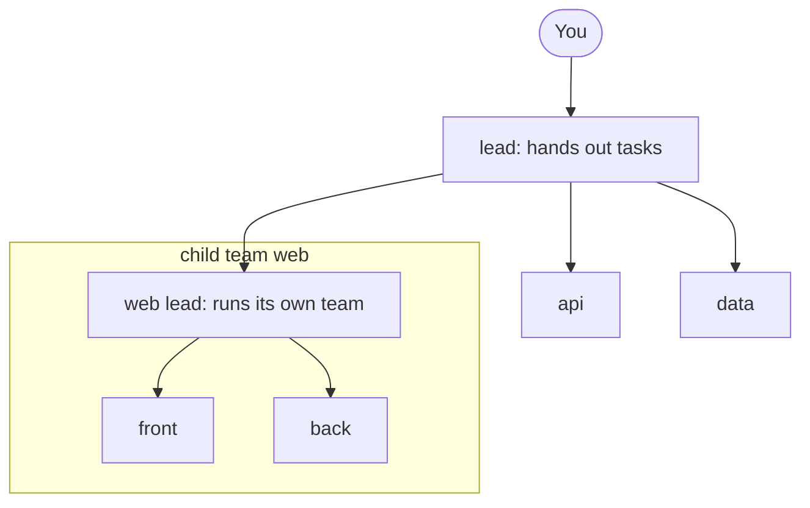
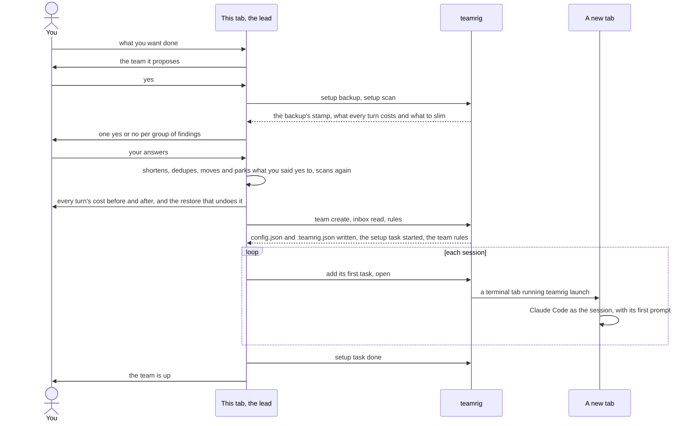

# Grow the team

A team starts in one tab: you say what you want done, the tab proposes the sessions, and on your yes it becomes the
lead, writes the team and opens a tab for each session. The team grows from there: the lead hires a temporary member
for one job and retires it once the job is done, and a part of the work that needs a lead of its own splits off as a
child team under the lead, while you still talk to one lead. The `hiring` and `open` keys in the
[team config](../configuration.md) set how far and how fast it grows.

- [Who is on the team](#who-is-on-the-team)
- [Setting up a team](#setting-up-a-team)

Every command is in [commands](../../plugins/teamrig/skills/teamrig-guide/commands.md), and what each hook does in
[hooks and permissions](../../plugins/teamrig/skills/teamrig-guide/hooks.md).

## Who is on the team

A team is a list of sessions with one lead, and a lead may also lead child teams, each with a lead and a task list
of its own; each session learns at start who it is and whom to message.

You ask one tab for the team in plain words, and it opens a tab for each other session
([Setting up a team](#setting-up-a-team)). At start the session reads "You are the `web` session of team
`your-team` (name `your-team-web`). Message the lead as `your-team-lead`." A session the config gives no name is
called `<team>-<id>`. `teamrig who` prints every session's name, and `teamrig rename` gives a session a new name
while its old names keep finding it until another session takes one. A Claude Code rename of the session
(`/rename`, `claude --name`) is recorded the same way at its next prompt or start, as if it ran `teamrig rename`.

A team grows into a tree of teams when part of its work needs a lead of its own: `teamrig team split` moves that
lead and its sessions, with the tasks they own, into a child team under the lead, and `team create --parent` starts
a new one ([Setting up a team](#setting-up-a-team)). You still talk to one lead: the root team's.

- Each team keeps its own folder, config, task list and inboxes. Its config names its parent team
  (`"team": {"id": "web", "parent": "your-team"}`), so the tree is read from the configs, with no other file to keep
  in step. A tree has at most 3 levels and a team at most 8 child teams. A child made by `team split` starts with a
  copy of its parent's settings and shares its deploy coordinator, so heavy steps of both teams take turns.
- The tree numbers its tasks from one count, so `T12` names one task in every team of it and a moved task keeps its
  number; a wait or an `after` may name another team's task. Work crosses teams as a task: `teamrig add --team web`
  puts it in that team's list, its lead gets a copy line, and the asker hears when it is done or dropped
  ([A task's life](../how-it-works.md#a-tasks-life)).
- Any session writes a note to any session of its tree, `<team>/<id>`, with no relay through the leads between them:
  a note hands no work, which is a task on the receiver's own register, and wakes it only with `--wake now`, or
  with `--wake-by <time>` at that time if it is still unseen. Teams
  of separate trees never reach each other. Only the root's lead talks to you: a wait on your decision in any team of
  the tree is in its decisions batch and daily meeting as `<team>/<id>` (`web/T2`), and your answer, recorded on
  that task, reaches the task's owner when the meeting ends. An urgent one also tells its team's own lead, who
  passes it up.
- A member's leader is its team's lead, and a child team's lead answers to the lead of the team above it: its
  approval waits, say before a push or a merge, go to that lead's inbox (`--waits approval:app/lead`), which answers
  with `teamrig approve web/T3`, and under `pushGuard.pushToProtected: lead` its own push waits for that answer.
- A child team's sessions start with the `rules.md` of each team above, root first, then their own. A role the
  child team leaves to a team above names that team's holder as `<team>/<id>` (`"securityReviewer":
  "your-team/security"`), so its exec requests go to that reviewer; `teamrig doctor` names one that does not hold
  the role there.
- Claude Code session names are machine-wide, so two teams never share one: `team create` refuses a clash and
  `teamrig doctor` names one, along with a broken link in the tree.
- `teamrig team tree` prints the tree with each team's lead and sessions.

The lead hires a temporary member for one job with `teamrig hire`, within the team config's `hiring` block; a
child team's lead hires the same way into its own team:

- `policy`: `off` (no hires by command), `owner` (the default: each hire names who approved it), `lead`, or
  `automatic` (the lead decides, and a hired session whose last open task closes is asked at its next turn end to
  write its handover). Under every policy only a lead over a session retires it, never the session itself.
- No cap counts hires: `hire --yes` refuses only while the host has no room for one more tab; each gets its part of the team's daily budget by its share and queued
  work, like any session; `reviewDays` (7) sets a hire's review day.
- Each hire is logged in `state/hires.jsonl` with its job, reason, approver, model, effort and review day. `teamrig check` flags a hired session with no open task for `idleHours` (4) as RETIRE-DUE, and one past its
  review day as REVIEW-DUE: a lead over it keeps it to a new review day while the team still needs it (`teamrig hire
  <id> --review <YYYY-MM-DD> --reason "<why>" --yes`, which changes only the hire log), else retires it.
- `teamrig hire --burst` hires for the burst in force ([Bursts](plan-the-week.md#bursts)), within its hires,
  on the lead's model and at least its effort; the burst's approver approves it. Once the burst is over, `check`
  flags the hire RETIRE-DUE.
- `scaleOut` says when to hire: `check` flags SCALE-OUT on an area (never the lead or a hire) when more of its dated
  work is due by a date than its pace finishes by then. Its pace is the tasks it finished over the last `windowDays`
  (7), once it finished `minDone` (3); its dated work is its active tasks of the top `topPriorities` (2) priorities
  with a due, their own or that of a task that needs them. The flag names the slice to move (the latest open tasks no
  started work needs) and its cost, a new hire's part of the team's daily budget today, a day until the slice's last
  due or the week's pace end; the areas furthest behind are paid first, out of the team's part of the week's projected
  spare (as for a surplus burst, below), and none
  once it cannot pay or the team's daily budget is unknown. Its action moves the slice to an idle hire, else hires
  for it. The hire retires as RETIRE-DUE once its slice is
  done.

When its job is done, the lead retires it with `teamrig retire <id>`. It refuses while the session owns open tasks
unless `--to <heir>` takes them, and without its handover note (`handover/<id>.md`) unless `--no-handover "<why>"`.
It takes the session's keys out of `sessions`, `names`, `launch` and `budget.sessions`, keeping the old config in
`backups/`, and logs the retire in `state/hires.jsonl`. Its tasks, inbox and records stay where they are, readable by
its id, and `teamrig doctor` reads its inbox as kept, not orphaned.

Hiring a retired id again is a rehire. `teamrig hire` shows the retire and handover it comes back from and measures
the last Claude Code session that read its inbox: when its transcript is still in the project folder, its context is
at most `resumeMaxTokens` (250,000) and it was idle at most `resumeMaxIdleDays` (7), `teamrig open <id> --resume`
goes on in it. Else `teamrig open <id>` starts it fresh, its first prompt sending it to the handover.

## Setting up a team

You tell Claude in any tab what you want the team to do: building, research, writing or any other work, for example
"Price our new plan: one session gathers competitors' prices, one models price points, one drafts the
recommendation." If you ask for a team without saying what for, it asks you first. The plugin's `team-setup` skill
proposes a team in a few lines, and on your yes:

- Before anything changes, `teamrig setup backup` copies your Claude setup (CLAUDE.md and rules files, settings,
  skills, memory) into a dated backup, and `teamrig setup scan` shows what each session start costs and what to slim:
  files over 6,000 chars, lines loaded twice and skills no transcript used in 30 days. On your yes for a group, the
  lead shortens those files, moves rules needed only in some folders into files that load only there, removes the
  repeats and parks the unused skills in `skills-parked/`, then scans again for the before and after.
  `teamrig setup restore <stamp> --yes` puts every backed-up file back.
- `teamrig team create signup --sessions api,web,tests` writes the team's `config.json` and ties the project folder
  to it with `.teamrig.json`, which it keeps out of git in that clone (`.git/info/exclude`). The lead's first task,
  `Set up the team`, goes in the task list in progress, so the setup shows in the task pane like any work, and the
  lead closes it once every session runs its first task. It refuses another team
  with the same id and a project tied to another team, a repeat changes nothing once both are in place, and
  `--dry-run` prints what it would write. `--parent your-team` hangs the new team under that
  team's lead; it refuses a parent with no config, a tree deeper than 3 levels, a team's 9th child team and a
  session name another team uses.
- `teamrig team split front --lead web --sessions ui --dry-run` plans moving sessions of your team, with the tasks
  they own, their inboxes, files and renames, into a new child team `front` under you, and names what blocks it: a
  staying task that waits on a moved session's decision or approval, or a moved session whose Claude Code runs.
  Without `--dry-run` it writes the move, reads both task lists back to check each moved task reads the same, and
  prints the `teamrig open front/<id>` line that reopens each moved session on its new team. The move changes
  stored data and nothing undoes it, so the lead shows you the dry run's counts first.
- The tab that ran the setup becomes the lead without a restart. `teamrig inbox read --session lead` ties its Claude
  Code session to the lead, so the hooks still know it after a compact or a resume, and `teamrig rules --session lead`
  gives it the rules it missed at start. Its next prompt titles the tab with the lead's name, and Claude Code keeps
  that title across a `/clear`, so the session a `/clear` starts binds itself to the lead by it.
- A tab you start by hand binds itself when its Claude Code title (`claude --name`, `/rename`) is a session's id or
  current name, or the `[<team>] <name>` form teamrig titles tabs with, on the team of the folder it started in,
  and on no other team of the tree. The hooks then know it as
  `inbox read` would, but nothing is marked read. A title that names no session, or sessions of two teams, binds
  nothing, and the prompt hook says once how to bind the tab. `$TEAMRIG_SESSION` and an earlier binding always win.
  A bound tab with no title gets its session's name as title at its next prompt (`sessionTitle` in the prompt
  hook's answer); a tab with a title keeps it.
- `teamrig open <session>` opens a tab in tmux (when run inside tmux), Windows Terminal, macOS Terminal, GNOME
  Terminal, Konsole or x-terminal-emulator, in that order; `open.terminal` in the config or `--terminal` picks one.
  With `open.teamWindow: true`, each tab of the team's sessions opens in a Windows Terminal window of the team's
  own (`teamrig-<team>`), apart from other teams' tabs, a restore after a reboot included.
  It refuses any session but the lead, and `hire --yes` refuses a hire, when the host has no room for one more:
  free memory over `coordinator.heavy.memoryFloorMb` and the commit charge within `open.headroom.commitMaxPct` (92%),
  with the session counted at the median running one (what it holds resident against free memory, what it
  committed against the commit charge), else `open.headroom.sessionMb` (1200 MB). A session
  `teamrig close` ended goes on in its last Claude Code session, in the folder it ran in (a worktree too), when that
  is small and recent enough, else opens fresh; `state/session-log.jsonl` logs each close and reopen, and a reboot's
  restore leaves a closed session closed. `teamrig close` (the lead) ends only a session
  quiet `open.headroom.closeIdleMinutes` (60) or more, with no work it can start and no time wait of its own ending
  within 30 minutes, its last turn ended (not at a tool call or a decision put to the person), no background work
  or shells, and
  small and recent enough to resume.
  The tab runs `teamrig launch`, which sets `$TEAMRIG_SESSION` and starts `claude --name <name> "<first prompt>"`,
  with `--model` and `--effort` from the session's `launch` entry in the config. The lead, for each it leaves unset,
  starts on `opus` (Claude Code's newest Opus) at `xhigh` effort; the others on Claude Code's own. The `OPENED` and
  `Starting` lines name the model and effort a tab starts on, and `launch.<id>` in the config changes either one.
  When no terminal opens, it prints the command to paste and exits 3. `teamrig open web/lead` opens a session of
  another team in the same tree.
