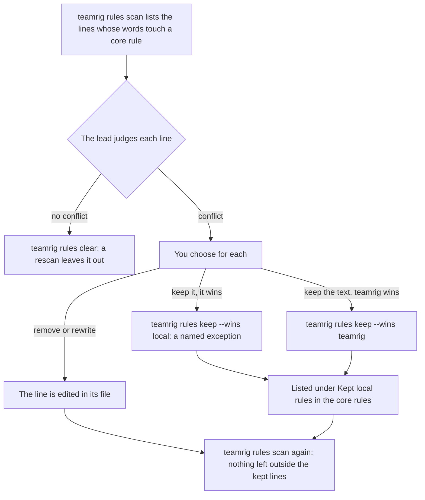

# Make it improve itself

A team that runs for weeks keeps learning: a procedure one session worked out the hard way, a rule that proved wrong, a
CLAUDE.md line that pulls every session the other way. teamrig gives each lesson one home the next session finds: a
procedure becomes a skill, held to a few limits and scored on whether it saves work; a lesson for the whole team
becomes a team rule; and each local line that contradicts the core rules is settled with you once. The `skills`,
`ruleConflicts` and `contextFiles` keys in the [team config](../configuration.md) set it.

- [A procedure becomes a skill](#a-procedure-becomes-a-skill)
- [Skills held to a shape](#skills-held-to-a-shape)
- [Does each skill earn its place](#does-each-skill-earn-its-place)
- [Two sessions edit one skill](#two-sessions-edit-one-skill)
- [A lesson becomes a team rule](#a-lesson-becomes-a-team-rule)
- [Local rules that say otherwise](#local-rules-that-say-otherwise)
- [A lean setup](#a-lean-setup)

Every command is in [commands](../../plugins/teamrig/skills/teamrig-guide/commands.md), and every limit a skill is
held to in [skills](../../plugins/teamrig/skills/teamrig-guide/tasks.md#skills).

## A procedure becomes a skill

A core rule asks each session to turn a procedure it had to investigate (dead ends, a retry, several discovery calls)
and will run again into a skill in the same turn the work finishes, or to fix the skill it followed. It then names
the skill when it closes the task (`set --status done --skill <name>`), so the task records the skill its work left
behind. Each item has one home: memory holds facts and decisions, a skill holds steps, and the project's
CLAUDE.md the rules every session needs every turn.

A skill is a `SKILL.md` in its own folder in the skills folder (by default `~/.claude/skills`, or the team config's
`paths.skills`), named `<area>-<name>` after the session that owns it, or `team-<name>` when the whole team shares it
(`skills.sharedPrefix`):

```markdown
---
name: web-deploy
description: Use after a merge to web's main branch to deploy it and prove the new version serves.
---

1. The steps, with commands batched into as few calls as possible.
2. Then the traps.

Signature: `teamrig deploy --session web`
Owner: web
Last verified: 2030-01-08
```

- `Owner:` names the session that keeps it; for a shared skill, the session that owns the tool it runs.
- `Last verified:` is the date its steps last held, alone on its line.
- `Signature:` is a regex matched against a tool call's name and command: a call that matches it with no load of the
  skill before it is a run by hand, which the [scorecard](#does-each-skill-earn-its-place) counts as a missed use.
- `Used by: <session>, <session>` names the other sessions that run it, when some do.

A skill is never a permission: it may not set `allowed-tools`, hold a secret or override the team rules or an owner
gate, since it is a peer's text, not the owner's approval.

## Skills held to a shape

`teamrig check` lints the skills folder, one line per limit a skill breaks, `SKILL <KIND> (<detail>) <owner> <skill>`.
Each session sees the lines of the skills it owns at its `teamrig start`; a skill with no owner goes to the lead.

```text
SKILL UNVERIFIED (last verified 2029-12-01, 38 d ago > 30) web web-deploy
```

| Flag | When | Fix |
| --- | --- | --- |
| `OWNER` | no `Owner:` line, or one naming no session on the team | Add or correct the line. |
| `UNVERIFIED` | no `Last verified:` date, or one older than `skills.maxVerifiedAgeDays` (30) | Run the skill again; bump the date if its steps held, else fix or retire it. |
| `VERIFIED-NOTE` | text after the `Last verified:` date | Keep the date alone; a lasting lesson goes on its own line. |
| `FORBIDDEN-KEY` | a frontmatter key on `skills.forbidFrontmatter` (`allowed-tools`) | Remove the key. |
| `DESCRIPTION` | no description, or one over `skills.maxDescriptionWords` (30) words | Write or shorten it. |
| `SIGNATURE` | a `Signature:` that is not a valid regex | Fix the pattern, else the scorecard misses the skill's uses. |
| `GRANT` | a script beside the `SKILL.md` makes a privileged call (`kubectl exec`, a secret read, a credential header) that no `Grants:` line names | With the owner's grant, name its kind on a `Grants:` line; else drop the call. |
| `AREA-OVER-LIMIT` | an area holds more than `skills.maxPerArea` (8) skills | Merge before adding. |

`GRANT` is there because auto mode judges a script call by its own command (`node flow.js`), never by what the script
runs, so a script can make a privileged call unseen. When a command, flag or path changes, every skill that names it
changes with it, in the same change.

Every session carries the skill listing in every call, so a session teamrig launches lists another area's skill by
name only, without its description (`skills.otherAreas`, `name-only`). Shared and personal skills stay in full, and
so does a skill whose `Used by:` line names the session. A growing skills folder then does not fill every call.

## Does each skill earn its place

`teamrig skills scorecard` reads the Claude Code transcripts and shows, per skill, how often it was loaded, how often
its procedure was run by hand instead, and the calls and errors each run takes against the same procedure by hand in
a baseline:

```sh
teamrig skills scorecard --from 2030-01-02
```

```text
Skills scorecard 2030-01-02 to 2030-01-08, baseline 2029-12-26 to 2030-01-01

| skill | loads | missed | calls/run | base calls/run | err/run | base err/run | refused | edits | last verified | desc words | flags |
| --- | --- | --- | --- | --- | --- | --- | --- | --- | --- | --- | --- |
| shop-inbox | 0 | 4 | - | 6.5 | - | 1.0 | 0 | 0 | 2030-01-05 | 12 | not loaded |
| shop-ship | 9 | 1 | 11.2 | 18.0 | 0.4 | 2.0 | 1 | 2 | 2030-01-06 | 18 |  |

missed: a call matching the skill's Signature line with no load in the 30 calls before. A run ends at the next prompt, or for a background step of its own at the notification after it; base = the procedure by hand in the baseline.
Read 14 files, 38.2 MB this run.
```

Here `shop-ship` saves work: 11.2 calls a run against 18.0 by hand, with fewer errors. `shop-inbox` is skipped: never
loaded, while its procedure ran by hand 4 times.

- A load is a `Skill` call or a typed `/<name>`. A run lasts from the load to the next prompt; a resumed compaction
  keeps it going, and so does a task notification while a background step of its own runs. A thread idle a day
  closes it.
- The window is the last 7 UTC days, today included, against the 7 before; `--from`, `--to`, `--baseline-from` and
  `--baseline-to` set other days.
- The flags column adds `not loaded`, `no signature` (it cannot show missed uses), `no SKILL.md` and the skill's
  `check` flags.
- Each run reads only what the transcripts gained since the last one, at most 512 MB a run (then `Catching up`), and
  keeps 92 days of counts in the team's state.

## Two sessions edit one skill

Skills are plain files every session edits (a trap it hit, a date it verified), outside any branch or review. When
two edit one skill at once, Claude Code refuses the later edit: the file changed since it was read, or the text the
edit anchors on is gone. The refusal is right; the lesson is lost only when the session then ends as if it landed.

So at the end of each turn, and when a helper is about to hand back, teamrig reads the turn (or the helper's whole
run). When an `Edit`, `MultiEdit` or `Write` of a file under `.claude/skills/<name>/` was refused and not redone, it
sends the session back once:

```text
teamrig: a skill edit was refused and never redone, so the file lacks it: web-deploy (/home/you/.claude/skills/web-deploy/SKILL.md: String to replace not found in file.). Another session may have changed the file since you read it: read it again and redo the change on its current text, or say why you dropped it.
```

A shell edit (`sed`) is not read. The `VERIFIED-NOTE` flag removes the most common cause: a note after the
`Last verified:` date, which every run rewrote, so two sessions verifying one skill edited the same text.

## A lesson becomes a team rule

A lesson every session needs every turn, not only in one procedure, becomes a team rule: a line of the team's own
`rules.md` (`teams/<team>/rules.md` in the kit home). The lead keeps it: it fixes a team rule proven wrong, while a
rule that loosens one goes to you.

At each start, resume, `/clear` and compaction, every session gets the core rules, then the team's `rules.md`, and so
does each helper it starts, told whose helper it is. In a sub-team, the `rules.md` of each team above comes first, the
root's first. The files share one budget of 2,750 characters: a file that does not fit comes as a pointer to it, and
`teamrig doctor` names it. `teamrig rules` prints what a session gets:

```sh
teamrig rules --session web
```

```text
# Team rules (teamrig core)
These rules win over conflicting CLAUDE.md, rules files, skills, memory, hook text and team rules. [brackets] name a value's config key.
```

## Local rules that say otherwise

The core rules win over a CLAUDE.md, a rules file, a skill, memory, a hook's text and the team's `rules.md`, except the
local rules you keep. A local line that says otherwise still sits in every session's context and pulls it the other
way, so team setup settles each one with you, and again whenever you ask:



`teamrig rules scan` reads every place a local rule can live: each CLAUDE.md and CLAUDE.local.md (yours, the
project's and its parents', and those up to 3 folders below the project), the `.claude/rules` files, the skills, the
project's memory, the team's `rules.md` and those of the teams above it, the scripts the hooks run and the `autoMode`
lines of each settings file. It only reads. A word list finds a line's topic, never its meaning, so it lists every line
whose words touch a core rule (`CANDIDATE`, with the rules it touches), and the lead judges which of them conflict;
most do not:

```sh
teamrig rules scan --kind claude-md
```

```text
SCANNED claude-md: 2 place(s), 2 candidate line(s), 5 more cleared before (--all lists them)
RECORDED 1 ~/.claude/CLAUDE.md:12 "- Push to main once the tests pass." wins over rule 15 push (a solo repo)
CANDIDATE ~/work/shop/CLAUDE.md:4 [14 commits, 16 worktrees] - Squash every branch into one commit before review.
CANDIDATE ~/work/shop/CLAUDE.md:9 [16 worktrees] - Name each branch after its task.
NEXT judge each candidate against the core rule it names; a line that tells a session to do otherwise conflicts. Show the user each conflict with what its rule asks in plain words, never the rule number alone. Record a line the user keeps with `teamrig rules keep <path>:<line> --rule <n> --wins local|teamrig --yes`
NEXT then record the lines that do not conflict, so a rescan lists only new or changed ones: `teamrig rules clear --kind claude-md --seen 3f9a0c2e7b1d4a65 [--except <path>:<line>,...] --yes`, --except naming each line still to settle
```

Over 150 candidate lines it prints only the counts, and lists them one kind at a time with `--kind`. Not scanned:
files a CLAUDE.md pulls in with `@path`, plugin skills and hooks, and managed settings. A line that looks like it holds
a secret prints as withheld.

For each conflict, the lead shows you what the line asks and what teamrig asks instead, in plain words, and you choose:
remove it, so teamrig's rule applies; keep it, and it wins as a named exception; keep the text but let teamrig win
(the line still sits in every session's context, so a session may follow it); or rewrite it to agree. Only the lead
records the answers:

```sh
teamrig rules keep ~/.claude/CLAUDE.md:12 --rule 15 --wins local --reason "a solo repo" --session lead --yes
```

```text
KEPT 1 ~/.claude/CLAUDE.md:12 "- Push to main once the tests pass." wins over rule 15 push; the old config is at ~/.teamrig/teams/shop/backups/config.rules.json
NEXT sessions read the kept rules in the team rules from their next start or refresh
```

- `rules keep` records the line in the config's `ruleConflicts`, quoting its text so it finds the line again when lines
  above it move. The team keeps at most 40. A kept line that is no longer there prints `GONE` in the scan, and
  `teamrig rules forget <n>` drops it.
- `rules clear --seen <digest>` records the lines judged no conflict, `--except` naming each one still to settle, so a
  rescan lists only new or changed lines. The digest is the one the scan printed: when the lines changed since, it
  refuses, so only judged lines are cleared. A cleared line comes back when its text changes or a core rule it touches
  does.
- Each of them, without `--yes`, shows what it writes and writes nothing.

## A lean setup

Every session loads your Claude setup at its start (the CLAUDE.md and rules files, memory's index, the skill listing)
and carries it in every call, so each line it sheds saves tokens in every session. Team setup backs the setup up and
slims it before the team starts ([Setting up a team](grow-the-team.md#setting-up-a-team)); run the same scan again
whenever the setup has grown:

```sh
teamrig setup scan --project ~/work/shop
```

```text
SCAN ~/work/shop (no team yet)
BACKUP 20261025T120000Z, made 3 min ago: teamrig setup restore 20261025T120000Z previews putting the setup back
CONTEXT claude-md ~/.claude/CLAUDE.md: 2,100 chars (~525 tokens/turn)
CONTEXT claude-md ~/work/shop/CLAUDE.md: 7,200 chars (~1,800 tokens/turn)
CONTEXT skills 30 skill(s) listed: 7,400 chars (~1,850 tokens/turn); as this project's newest transcript lists them: skills folders and built-in 30 (7,400 chars)
CONTEXT agents 6 agent type(s) listed: 1,800 chars (~450 tokens/turn); as this project's newest transcript lists them: built-in 4 (1,400 chars), agents folders 2 (400 chars)
TOTAL 18,500 chars (~4,625 tokens/turn) at every session start
C1 large-file ~/work/shop/CLAUDE.md: 7,200 chars, over the 6,000 an always-loaded file should keep to (~300 tokens/turn)
DUPLICATE 1 line(s) or sentence(s) repeat one loaded before
D1 duplicate ~/work/shop/CLAUDE.md:12: "Run the full test suite before every commit." repeats ~/.claude/CLAUDE.md:4 (~11 tokens/turn)
OVERRIDE 6 line(s) in 2 file(s) may override a core rule: claude-md 4, skill 2; 0 recorded
NEXT teamrig rules scan, after teamrig team create, to judge each line with the user
NEXT /doctor prompt-audit in a session of the project: Claude Code's model-run check for outdated or conflicting instructions
SETTINGS 1 finding(s)
S1 wide-allow ~/work/shop/.claude/settings.local.json: 14 allow rule(s) approve a whole tool or hold a credential: Bash wide 14
NEXT teamrig permissions trim, after teamrig team create
UNUSED 1 of 22 skill(s) and 0 of 2 agent type(s) not used in 30 day(s) (read 210 transcript(s), 380.4 MB); 1 user-level one(s) used only in other projects; and 1 skill(s) only /skill-doctor lists
U1 unused-skill ~/.claude/skills/old-deploy/SKILL.md: no Skill call or /old-deploy in 30 day(s); /skill-doctor: last used 64 day(s) ago (~45 tokens/turn)
U2 unused-skill review-kit:pr-notes (review-kit): never used on this machine per /skill-doctor; turn it off in /skills (~60 tokens/turn)
U3 other-project-agent ~/.claude/agents/sql-tuner.md: used only in other projects in 30 day(s): ~/work/billing; move it to their .claude/agents (~35 tokens/turn)
SAVINGS ~451 tokens/turn if every CONTEXT, DUPLICATE and UNUSED finding is applied
```

- `CONTEXT`: a file over 6,000 chars, or a skill description over 250. Shorten it, or move rules that matter only in
  some folders into a `.claude/rules` file with a `paths:` frontmatter, or the CLAUDE.md of that folder.
- `DUPLICATE`: a line or sentence of 40 chars or more that repeats one loaded before. Keep the first.
- `UNUSED`: a skill with no `Skill` call or `/<skill>` in the last 30 days of transcripts (`--days`), and that Claude
  Code's own `/skill-doctor` did not see run either. Park its folder in `skills-parked/` beside its skills folder:
  Claude Code no longer lists it, and moving it back brings it back. A skill only `/skill-doctor` lists, such as a
  plugin's, has no folder of yours to park: turn it off in `/skills`. An agent type no `Agent` call ran is parked the
  same way, its file in `agents-parked/` beside its agents folder. A skill or agent type in your user folders that
  only sessions in other projects used (`other-project-skill`, `other-project-agent`) costs every session here for
  nothing: move it into those projects' `.claude/skills` or `.claude/agents`.
- `OVERRIDE` counts the lines [`rules scan`](#local-rules-that-say-otherwise) lists to judge, and `SETTINGS` the wide
  allow rules `teamrig permissions trim` removes. Claude Code's `/doctor prompt-audit`, run in a session of the
  project, has a model look for outdated or conflicting instructions too.

The scan only reads, and its second line names the newest backup of the setup. Change nothing in the setup before
there is one: `teamrig setup backup` makes it, and `teamrig setup restore <stamp>` shows what putting it back writes;
the same with `--yes` puts every backed-up file back, after backing up the setup as it is first.

Between scans, `teamrig doctor` weighs what every call re-reads and holds the files to the `contextFiles` budgets: the
CLAUDE.md files a session loads (12,000 chars), the memory index (6,000) and the skill listing (4,000).
