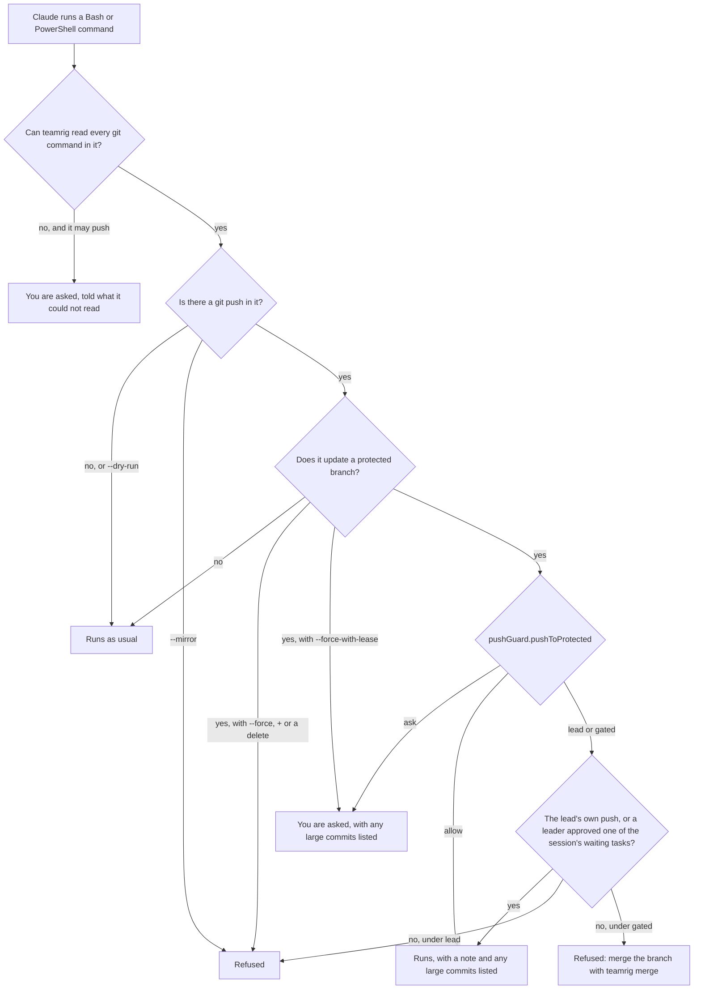

# Keep it safe

Your sessions run for hours while you are away, and a rule in their instructions can be missed. teamrig's guards
hold those rules on every line: before Claude runs a command, they read it and ask you, or refuse, when it would push
to a protected branch, skip the repository's git hooks, run a package nobody vetted or print a secret, and a
privileged command runs only once a reviewer approves it. Each guard's keys in the
[team config](../configuration.md) set what it does. The guards catch mistakes; they are not a sandbox, so protect
your main branch on your git host too.

- [Safe pushes](#safe-pushes)
- [Skipped hooks](#skipped-hooks)
- [Unvetted packages](#unvetted-packages)
- [Secrets kept out of the conversation](#secrets-kept-out-of-the-conversation)
- [Privileged commands on review](#privileged-commands-on-review)
- [Reads without a prompt](#reads-without-a-prompt)

Each hook, and every line it refuses with its fix, is in
[hooks and permissions](../../plugins/teamrig/skills/teamrig-guide/hooks.md).

## Safe pushes

Before Claude runs a `git push`, teamrig reads the command and asks you, or refuses, when it would change a
protected branch (by default `main` and `master`, set in `pushGuard.protectedBranches`; an empty list guards nothing).

- `pushGuard.pushToProtected` (since 0.11.0) is `ask` by default; set to `allow`, a normal push to a protected branch
  runs with a one-line note instead of a question, and Claude Code's own permissions still decide. Each question
  about a normal push ends by naming this switch.
- Set to `lead` (since 0.126.0), the lead approves pushes instead of the human: the lead's own runs with a note (a
  child team's lead's only while its parent team's lead's approval stands on one of its tasks); a
  session's runs with a note while the lead's `teamrig approve` stands on one of its tasks waiting `approval:<lead>`
  (until the task's next status), and is refused otherwise, with how to ask on the register. The human is never
  asked about a normal push, and the refusal holds whatever `prompts.hookAsks` says.
- Set to `gated` (since 0.218.0), a hand push is cleared as under `lead`, and refused otherwise with how to merge
  it: `teamrig merge`, which merges a change that holds the self-merge gates with no approval and holds one that
  misses a gate for a leader ([the self-merge gates](ship-from-many-sessions.md#the-self-merge-gates)).
- `--force-with-lease` is asked, not refused, under any setting. `commits.gate` set to `refuse` turns the ask (or
  the allowed push) into a refusal when a commit is over the size rule (400 changed lines or 15 files, tests not
  counted) with no `Large-commit:` reason.
- `--all` is asked, and refused with `--force` or `--prune`; large commits are those not yet on the last-fetched
  `origin/<branch>`.
- `teamrig commits check --base <ref>` runs the same size rule in a script or CI.
- Outside a project tied to a team, the guard stays silent.

The guard splits the command into words the way its shell does (bash, PowerShell or cmd quoting), so it finds a
push wherever it sits in the line:

- git's own options: `git -C <dir> push`, `--git-dir`, `-c key=value`, and `GIT_DIR` or `GIT_CONFIG*` variables;
- chained, piped and multi-line commands (`&&`, `||`, `;`, `|`), subshells, `$( )` and backticks;
- wrappers and other spellings of git: `env`, `command`, `sudo`, `nohup`, `timeout`, `xargs`, variable prefixes,
  `git.exe`, a full path to git, `git-push`, and PowerShell's `& git` or `& 'C:\...\git.exe'`;
- nested shells: `bash -c`, `sh -c`, `eval`, `pwsh -Command` (also `-EncodedCommand`), `Invoke-Expression`,
  `Start-Process`, `cmd /c` and `start`, and a heredoc or here-string a shell reads as its script (`bash <<EOF`,
  `cat <<EOF | bash`); one that any other command reads is that command's input, not commands;
- git aliases (from `-c alias.x=`, from a `git config alias.x` earlier in the line, or from git config, `!` shell
  aliases included) and the commands git runs itself (`submodule foreach`, `rebase --exec`, `bisect run`);
- folder and branch moves earlier in the line: `cd sub && git push`, `git checkout main && git push`;
- bash variables set earlier in the line: `B=feat; git push -u origin $B` reads as `git push -u origin feat`,
  and `B=main; git push origin $B` still asks. `NAME=value` or `export NAME=value` must run before the push,
  through `;`, `&&`, a newline, a `for`, `while` or `until` loop, an `if` or a `{ }` group, in the same shell or
  in a subshell started after it (`( )`, `$( )`), and the line must never give the name another value. The
  value may hold quoted text, blanks and variables set the same way before it; used unquoted, it splits into
  words as bash splits it, so `G="git -C /w"; $G push origin main` still asks. `$HOME`, and a value's leading
  `~` or `~/`, read as your home folder in the line's own shell, while the line gives HOME no value of its own;
  a script the line starts, such as `bash -c '...'`, may be handed another HOME, so there it stays unknown. A
  value with a substitution, any other tilde (`~bob`, `a:~/x`) or a file name pattern, a prefix
  (`B=x git push origin $B`), an assignment in a subshell, a loop, an
  `if` or a `{ }` group, a `for` loop's own variable, or anything else on the line that can set a variable unseen
  (a `${...}` that assigns or runs arithmetic, such as `${B:=x}` or `${B:1}`, or reads a name indirectly,
  `${!R}`; `case`, `select`, `[[ ]]`, functions, `read`, `source`, `eval`, `declare`, arithmetic, arrays, a
  heredoc that never closes) leaves it unknown. A `${...}` that only reads, such as `${B:-x}` or `${x%%|*}`, is
  fine.

When it cannot read part of a line with confidence, it asks and says why: a quote that never closes, a git
command, alias, folder, remote or refspec only known when the line runs, an alias git cannot read, scripts nested
too deep, a push held in quoted text as a command substitution (`x='a[$(git push origin main)]'`), which bash runs
if an expansion reads the text again (`${x@P}`, `${!x}`, `$((x))`, `let`, `[[ -eq ]]`, or `read`, `printf -v`,
`unset` or `declare` given it as a name), in this line or a later one. Some of these, such as `eval "$X"`,
`bash -c "$CMD"` or an unclosed quote, ask only when the line, or a script or alias it runs, names a push: a
word, or a piece of one between blanks, quotes, operators and path separators, that is `push`, `--push` or
`git-push`. A folder such as `src/push-guard`, a file `x-push.log`, a comment, a redirection target or a heredoc a
plain `cat` stores in a file does not count. Each command Claude runs starts in a fresh shell, so a push the line
never spells out would have to be built on purpose.

It is a guard against mistakes, not a sandbox; protect the branch on your git host too. It does not see:

- a push inside a script or program the command runs: `npm run deploy`, `./ship.sh`, `pwsh -File x.ps1`,
  `source x.sh`, `python` or `node`, `make`, `find -exec`, `ssh host git push`;
- a command line kept in a variable the line does not set as above, such as `bash -c "$CMD"`;
- variables, functions or aliases your shell's startup files set (a readonly or integer variable, an `IFS`, a
  function named like a command), as with a function named `git`;
- `gh pr merge` and other GitHub CLI commands that change a branch on the server;
- git extensions (`git town`, a `git-<name>` program that is not part of git), and a `remote.<name>.push`
  mapping in the repository's own config for a push that names only its source branch;
- commands from tools other than Bash and PowerShell, and pushes you run in your own terminal.

Many sessions merge their branches one at a time through the deploy coordinator: `teamrig merge` and
`teamrig deploy` run under the host lock `teamrig heavy` takes for builds and test runs
([Ship from many sessions](ship-from-many-sessions.md)).

## Skipped hooks

A repository's git hooks are its own checks, so a commit or push run without them ships what they would have
stopped. Before each Bash or PowerShell command, the push guard's hook also refuses a git command run without them:
`--no-verify` on `git commit`, `push`, `merge`, `pull`, `rebase`, `am` or `send-email` (and `-n` where it means the
same, on `commit` and `am`), a husky switch (`HUSKY=0`, `HUSKY_SKIP_HOOKS`), and a `core.hooksPath` override,
whether given for the run (`git -c`, `GIT_CONFIG_PARAMETERS`, `GIT_CONFIG_KEY_<n>`) or written with `git config`.
`commitGuard.skipHooks` (`deny` by default, `ask` or `allow`) sets what such a line gets; a missing or broken config
keeps `deny`. A rule in a team's instructions can be missed; the guard holds it on every line.

## Unvetted packages

A package runner can fetch a package and run it in one step, outside the project's lockfile, so nobody vetted the
version that runs (a helper's `npx eslint` once did). Before each Bash or PowerShell command, the package guard reads
the line with the push guard's parser and refuses `npx` of a tool not in `node_modules/.bin`, `npm create`,
`pnpm dlx`, `yarn dlx` and the like, naming the vetted route: pin the exact version as a devDependency, then run
its local bin. `packageGuard.adHocRunners` (`deny` by default, `ask` or `allow`) sets what such a line gets; a
missing or broken config keeps `deny`, so a config mistake never turns the guard off. It also refuses, whatever that
key says, `npx --no <bin> --flag`: npx takes the bin as `--no`'s value, so the flag goes to npm (`npx --no tsc
--version` prints npm's version, and a check run that way once ran nothing and passed); `npx --no -- <bin>` keeps it.

An install opens the same door: `npm i typescript` takes whatever was published a minute ago, and a hijacked
maintainer account publishes with valid provenance. So the guard reads each package an install names, asks the npm
registry for the version it resolves to, and refuses one published inside `packageGuard.cooldownDays` (14 days by
default) or with a known advisory, and any install it cannot vet: a range, a git or URL source, an update with no
exact version. A registry it cannot ask within 10 s vouches for nothing. `packageGuard.installs` (`deny` by default,
`ask` or `allow`) sets what such a line gets; a team on a private registry sets `ask` or `allow`.

A worktree's `node_modules` is often a link to the main checkout's (`teamrig worktree add` makes one), so an install
there rewrites the folder every checkout shares, and `npm ci` empties it first: one `npm ci` in a worktree once left a
main checkout without its packages for 49 minutes. The guard refuses, whatever its config says, an npm, pnpm, yarn or
bun call that would rewrite a `node_modules` that is a link, in the folder it installs into or one above it, and names
the two safe routes: remove the link itself (`rm <link>`, never a recursive delete, which empties its target), then
install a copy; or install in the checkout that owns the folder.

## Secrets kept out of the conversation

A secret printed into a session stays in its transcript and in every prompt after it. Before each Bash, PowerShell,
Read or Grep call, the secret guard reads the call (a shell line with the push guard's parser) and refuses one that
would print a secret file's content (`.env`, `~/.npmrc`, `~/.ssh/**`, `*.pem`...), the whole environment, a
secret variable's value (by name: `TOKEN`, `SECRET`, `PASSW`, `KEY`, a store's URL by its kind...) or a Kubernetes
secret's data, and reads the line a container or a host runs too. Output piped or redirected away from the screen
passes (`cat .env | wc -c`, `echo "$T" | docker login --password-stdin`), and the reason names the ways to use or
check a secret unprinted. `secretGuard.secretReads` (`deny` by default, `ask` or `allow`) sets what such a call
gets; `secretGuard.paths` and `secretGuard.envNames` add the team's own files and names, and a `!` entry keeps one
printable. The read-only allow never lets such a line skip the prompt
([what it cannot see](../../plugins/teamrig/skills/teamrig-guide/hooks.md#before-a-shell-command-or-a-read-the-secret-guard)).

A secret typed or pasted into a prompt goes the same way: the prompt hook stops a prompt that holds a token,
credentials in a URL, an Authorization or API key header, a quoted literal given to a secret-like name or a
`register.secretPatterns` match before Claude reads it, keeps it out of the transcript and removes the value from
Claude Code's prompt history and paste cache. A placeholder (`${TOKEN}`, `<token>`, `changeme`) passes, judged on the
value alone. The reason says to send the secret's name or the file it is kept in instead, and to rotate it
([Each prompt](../../plugins/teamrig/skills/teamrig-guide/hooks.md#each-prompt)).

## Privileged commands on review

Some commands are hard to undo: a write to a database, a call to a live route, a command in a running pod, a change
to a cluster or a write to an outside service. teamrig runs one only after a reviewer approves that one run. The
session writes a request file (the command and the commit it runs from, a dry run or a preview, its purpose, the
effect it expects and how to roll it back) and asks with `teamrig exec request`; `teamrig exec dry-run` runs the
read-only dry run for the reviewer to read. The security reviewer (the session `roles.securityReviewer` names; a
child team's may sit on a team above) or the owner then approves the run (`exec approve`), refuses it naming the safe
alternative (`exec refuse`) or hands it to the owner (`exec escalate`); a request marked owner-gated waits for the
owner alone. `teamrig exec run` runs it once, before the approval expires, and `teamrig exec status` shows each
request's stage.

A hook keeps the review honest: it refuses an approval given in another session's name or the owner's (the owner
reviews in their own terminal, or with `/teamrig exec approve` typed in a tab), and any `exec` call through a copy of
teamrig that is not the installed plugin or was changed after its build
([the exec guard](../../plugins/teamrig/skills/teamrig-guide/hooks.md#before-a-shell-command-the-exec-guard); every
field of a request: [exec request](../../plugins/teamrig/skills/teamrig-guide/commands.md#teamrig-exec-request)).

## Reads without a prompt

Claude Code asks before a shell line its settings do not allow, and a settings rule matches only a command's start,
so it cannot tell `grep x f` from `grep x f > out.txt`. With `readonlyShell.enabled`, a hook reads the whole line
(Bash with the push guard's parser) and allows it when every command in it provably only reads: known readers, git
and kubectl reading subcommands, the team's trusted prefixes (`readonlyShell.allowPrefixes`), and no write, file
redirection, command that runs code or variable a program reads. It only ever allows: any other line gets Claude
Code's own check, a guard's ask or refusal wins over its allow, and a line that prints a secret is never allowed
([what it cannot see](../../plugins/teamrig/skills/teamrig-guide/hooks.md#before-a-shell-command-the-read-only-allow)).
