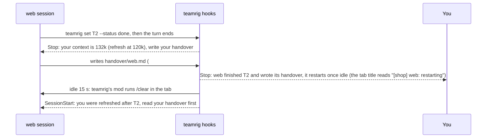

# Recover from a crash or a full context

A session's work outlives the session. Its tasks, notes and handover are files on disk, so a reboot that kills every
tab, or a context grown too long to work in, costs a restart, never the thread. This guide is how a session comes
back: reopened after a crash or a reboot, started fresh at a task boundary with its handover, and the turn log that
keeps what a tab showed. Each feature's keys in the [team config](../configuration.md) set what it does.

- [After a crash or a reboot](#after-a-crash-or-a-reboot)
- [A fresh context](#a-fresh-context)
- [The turn log](#the-turn-log)

Every command is in [commands](../../plugins/teamrig/skills/teamrig-guide/commands.md), and what each hook does in
[hooks and permissions](../../plugins/teamrig/skills/teamrig-guide/hooks.md).

## After a crash or a reboot

A shutdown, a reboot or a crash kills every Claude Code tab at once. teamrig puts them back: the `hook restore-track`
hook records every Claude Code session on the machine, in a team or not, and `teamrig restore run` reopens each one
the shutdown interrupted, in its folder (the worktree it went into, where Claude Code files its transcript) and at
the effort its team config sets (`launch.<id>.effort`, where an `/effort` you typed in it is written), else at the
one its last turn ran at.

```sh
teamrig restore          # what a restore would do now: RESTORE, KEEP or DISCARD for each session, and why
teamrig restore run      # reopen the sessions the last shutdown killed
```

- Which come back: a session killed without exiting. One that ended on purpose (`/exit`, `/clear`, `teamrig close`
  or the idle pass), still runs, was active since logon, was not a terminal session (`claude -p`, a background job
  Claude Code resumes itself), was continued in another session, has no transcript left, is too old or failed to
  resume too often stays closed. The entry of one the restore drops (`DISCARD`) is not deleted: it moves to
  `restore/archive/` in the kit home and is kept 7 days, so a session judged wrongly can still be found there.
- How they come back: `restore run` lists them and counts down 60 seconds (Enter starts at once, `i` reopens every
  one with no prompt, `q` cancels). A team session started by `teamrig open` comes back through `launch` as itself;
  any other resumes as it ran. One that was mid-turn, hit an API error or had background jobs, cron jobs or a
  wake-up live at the shutdown gets a prompt to re-check the state and carry on, and so does each lead, told how its
  team's sessions came back; the others reopen idle. The prompt names why it ended: the computer restarted only when
  it ended within the shutdown, else its Claude Code was killed (a power loss, a crash) or its tab closed, and a last
  turn that ended on a login error asks it to say so rather than retry, as only you can log in again. They open one by one within the host's memory, as `teamrig
  open` does: the lead opens whatever the room, any other waits up to `open.headroom.loadMinutes` (5) for room
  while the tabs before it load, else it is held back for the next run. Each step is written to
  `restore/restore.log` in the kit home,
  from a `run: started` line to a `run: done` line with the counts; a run whose tab was closed meanwhile ends with
  `run: interrupted by <signal>` and how far it got.
- After an expired login: a turn that ends on `Login expired` writes `login: expired` to the same log and marks its
  tab stuck in `restore/login.json`; each other tab it stops adds a line, and the first answer after it logs
  `login: works again`. Run `/login` in any tab: each stuck tab then carries on with its turn by itself, one tab
  first to test the new login and the rest once it answers, each with a `login: retried` line, and the day start
  wakes no one while the login stays expired. A tab still listed under `stranded` with no such line (one that does
  not load teamrig's mod) needs a prompt by hand. So you hear of it away from the screen, set `alerts.pageWebhookFile` (the path of a one-line file holding a chat webhook
  URL, or of a secrets file with `alerts.pageWebhookKey` naming its key) or `alerts.pageWebhookEnv` (the name of a variable holding it) in the team's config, or a parent team's: the
  first failure of each expiry posts one line to that chat, naming the tab and the time. Check it with
  `teamrig page test`, which posts one line marked TEST; `teamrig doctor` flags a webhook that gives no URL.
- After a passing API error: a turn that ends on `server_error` or `overloaded` (once Claude Code's own retries within
  the turn failed) is sent on by itself, 1 minute later, then 5 and 15 minutes after that, each with an
  `api-error: retried` line in the same log. A good turn ends the retries; if the turn fails a fourth time,
  `api-error: gave up on <tab>` says the tab waits for your prompt. A rate limit or any other error is not retried.
- Where they come back: with `open.teamWindow: true` in a team's config, its sessions reopen in a Windows Terminal
  window of the team's own (`teamrig-<team>`), so two teams' tabs never mix; without it, and for sessions outside a
  team, they open in the most recent window.
- By itself at logon: on Windows, `teamrig restore install --yes` has the system run `teamrig restore check` at
  each logon of this user, through a small launcher that finds the installed plugin each time, so a plugin update
  needs no new install. When the shutdown killed sessions, the check opens a tab titled `Restore Claude sessions`
  that runs the restore and closes by itself once they are open. `restore uninstall --yes` stops it. macOS and Linux
  have no logon entry yet: there you run `teamrig restore run` after a crash or reboot.
- By hand, from anywhere: the same install adds the Start-menu shortcut `Restore Claude Sessions` (pin it to the
  taskbar if you like). It opens a window running `teamrig restore run`, with its list and countdown, after a crash,
  a reboot or a window you closed, with no terminal or folder to pick first. An older shortcut of that name, pinned or
  not, is repointed in place on the next install.
- After a plugin update: the first session start of the newer teamrig brings up to date what the install left, so
  nothing stays old: the two launchers, the status line's launcher, the logon entry and each `Restore Claude
  Sessions` shortcut, pointed at the Node Claude Code runs teamrig's hooks with. It only changes what is there, so a
  machine that never ran the install, or ran `restore uninstall`, stays as it is. Each change is a `launchers: <old
  version> -> <new version>: <change>` line in `restore/restore.log`; a change that fails is logged there with
  `FAILED`, and the next session start tries again. An older teamrig still running beside the newer one changes
  nothing.

## A fresh context

A long session gets slow and costly, and what it was told early on fades. teamrig lets it start again at a task
boundary without losing the thread.



- The Stop hook reads the context size at every turn end, from the last reply in the session's transcript, so a
  long task refreshes before Claude Code compacts it; at a task end (`set <id> --status done`) it names the task.
  A session that goes on without its fresh start (you typed, or never typed `/clear`) is asked again at its next
  task end, or once its context grew a fifth of `refresh.contextTokens` more; a compaction or a `/clear` brings
  the ask back to the threshold. A fresh start (a `/clear`, a new process) only measures its context at its first
  turn end, asking nothing, and a size or task-count ask then waits until the context grew that fifth past the
  measure: a session whose fresh start already sits over the threshold (its system prompt, rules and handover) is
  not asked to refresh again before it did any work.
- A session busy in one long turn is asked within it: after each tool result teamrig's mod checks the context, and
  past the threshold it adds the ask to the result (finish the step, write the handover, end the turn). Until the
  fresh start, Claude Code's own compaction waits, up to `refresh.compactCeilingTokens` (185,000 by default, 15k
  under a 200k window), so the fresh start replaces it; past that it compacts, so the session never runs out of room.
- An owner's meeting is never cut off: while the daily meeting is open, the lead is not asked and not restarted,
  and while a booked one started with `teamrig meeting start M<n>` is on, neither are the session met and those
  joining, up to `refresh.compactCeilingTokens`; the end of the turn that runs `teamrig meeting end` asks at once.
- Two rules in the team config ask for it. `refresh.contextTokens` (120,000 by default) refreshes at that size,
  well before Claude Code compacts a 200k window at about 167k. `refresh.everyTasks` (3 by default) refreshes at
  every third finished task once the context is at `refresh.everyTasksMinTokens` (80,000) or more, so a session
  that grows slowly still gets a fresh start; a `/clear`, a new process or a compaction starts the count over.
- The lead can ask for a refresh at any size: `teamrig refresh web` applies at web's next turn end.
- It waits while work the session started in the background still runs (subagents, background commands,
  monitors, workflows): a fresh start would cut it off, so the hook asks for the handover at once, naming that work
  so the handover says what its results still need, but restarts the session only at a turn end after the last of
  it reported back or was stopped with TaskStop. The restart also waits while a turn still
  runs (a turn stopped with Escape counts as ended). Both read that from the transcript (work started within
  the last 6 hours); with teamrig's mod on, the tab also asks Claude Code itself before each `/clear`, so a refresh
  waits while the session still runs a helper the transcript no longer shows.
- The turn end takes the handover as ready by itself once it is written since the hook asked, with a `## State`
  and a `## Next steps` section; one that falls short (missing, blank, too long, or without a section) is asked to
  be fixed, once per version. `teamrig refresh --ready` still answers the ask, for a handover complete without a
  section.
- A hook cannot run `/clear`, but a plugin mod can (`refresh.autoRestart`, on for the lead by default: the user types `/clear` for any other session once done with the screen). A hidden
  `teamrig restart` waits until the session has been idle `refresh.restartDelaySeconds` (15) with nothing running,
  then leaves an ask for its tab. A session with no work it can start waits for work first (its tab title reads
  `waits for work`): the wake that brings it some starts the restart instead of waking the old context. teamrig's mod (`hooks/register.ts`) looks for it each second, claims it while
  the restart is still pending and runs `/clear` in the tab, so the tab and its process stay and Claude Code runs
  its own SessionEnd and SessionStart hooks. It holds the `/clear` for you first: while the prompt box holds a draft,
  for `refresh.holdAfterActivityMinutes` (30) after your last key or prompt, and 10 minutes after you press Hold; then
  a band above the prompt counts `refresh.countdownSeconds` (20) down with `1: Refresh now` and `2: Hold 10 min`.
  Before that the band shows each hold: what holds the `/clear` and, for your own, how long it has left.
  While Claude Code lists a live agent of the session (`$.agent.list()`:
  a helper or teammate not completed, failed or killed), or will not list them, the mod holds the ask instead
  (`hook clear-claim --hold --why <reason>`) and runs nothing: the restart ends nothing, waits for quiet and asks
  again, and an hour after it started gives up as it does for a busy session. Each hold's reason goes in
  `<session>.held` beside the ask's outcome, which stays the one word `held` that an older restart reads, and the
  give-up's why names the last one; a helper's hold names each live agent's type, status and task. A mod that held
  an ask of the run and then answers none (as one did after a `/reload-plugins`) counts as holding too: the restart
  ends nothing, and its give-up says the mod went silent. When no mod claims the ask within 10 s (a Claude Code that does not
  load mods), the restart ends the session's Claude Code and starts it again: in the same tab when `teamrig open`
  started it (`launch` starts it again), else in a new tab; if a turn ran meanwhile, it waits for quiet and asks
  again first. It never ends a Claude Code that still runs a background shell (a background command or a monitor),
  since the end would take that too: the session gets an inbox line to type `/clear`, which keeps it. A `/clear`
  keeps the effort level too, so a session that runs at another level than its `launch` entry asks is ended and
  started again at the config's level, once the mod claims its ask with `--end` after the same holds. A prompt you send first cancels it and keeps the context; text typed but not sent holds the mod's `/clear`, and is lost only where the restart ends the process. When it is off or cannot start, you type `/clear`. A restart whose own process was killed leaves its request behind: 70 minutes after it was asked, when no restart could still act on it, the tab's mod starts the restart again at its next wake check while the session still waits for its fresh start. On Windows an ended process runs no
  SessionEnd hooks, so `refresh.endCommand` can name a program to run in their place. A compact or a resume
  keeps the handover waiting for the next fresh start.
- The fresh session keeps who it is and carries on by itself. The restart starts it with a prompt to read its
  handover first; after a `/clear`, `hook refresh-wake` starts its first turn with the same ask, so it never sits
  idle. A `/clear` keeps its id by the tab's Claude Code title or, when the title names no session, by the
  Claude Code process it refreshed in (for 24 hours).
- The session-start note lists what the old session leaves, read from the last 64 MB of its transcript: its
  scheduled jobs (CronCreate), a pending wake-up (ScheduleWakeup) to make again, its scratchpad and its plan
  file. A `/clear` keeps the process and so its jobs: the note says they are still scheduled, and lists them to
  make again only after a new process. A job made before the last compaction is missed, and a wake-up can fire
  twice after a `/clear`.
- `refresh.enabled: false` turns it off, `refresh.tabTitle: false` leaves the tab title alone and
  `refresh.handoverDir` moves the handovers. With `tabStatus.enabled`, the tab's state circle goes before that
  title ([tab status](../../plugins/teamrig/skills/teamrig-guide/hooks.md#every-event-tab-status)).

## The turn log

A refresh, by hand or automatic, wipes what the tab showed. So teamrig keeps each session's prompts and replies
for a day, for the task pane to show: one file per session and UTC hour,
`state/turn-log/<session>/<YYYY-MM-DDTHH>.jsonl`, one JSON line per prompt you sent, per reply the session wrote
(every text it showed in the turn, not only the last) and per /clear or compaction. A prompt teamrig had the tab
submit itself, a [wake](run-your-day.md#waking-on-urgent-work), is marked `from: "teamrig"`, so it never reads as yours. Secret shapes are masked as
in the register, and an entry keeps at most 64,000 characters, the end of a longer one. Entries are only appended,
and each session start removes the hour files wholly past `turnLog.keepHours` (24 by default, 1 to 168), so a
busy session keeps a day's worth and no file is ever rewritten. `turnLog.enabled: false` writes nothing. A reader
parses each line with teamrig's own `parseEntry` (from `src/read/index.ts`, in
[room for other tools](../how-it-works.md#room-for-other-tools)).
