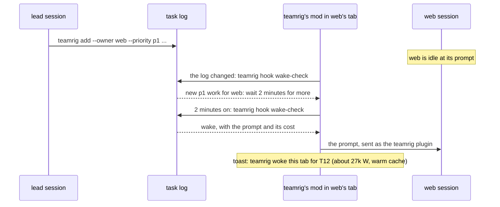

# Run your day

Your sessions work while you are away, and you meet the team once a day. This guide is that day: the morning
meeting where the lead brings what got done, what is late and each decision as a card; how a session that needs your
answer records it and goes on with its next task instead of stopping at a prompt; and how sessions reach each other
meanwhile, a note waiting for the receiver's next prompt and urgent work waking an idle session. Each feature's keys
in the [team config](../configuration.md) set what it does.

- [The daily meeting](#the-daily-meeting)
- [Never stuck on a question](#never-stuck-on-a-question)
- [No prompt while nobody answers](#no-prompt-while-nobody-answers)
- [Notes between sessions](#notes-between-sessions)
- [Waking on urgent work](#waking-on-urgent-work)

Every command is in [commands](../../plugins/teamrig/skills/teamrig-guide/commands.md), and the lead's steps for the
meeting in the [daily-meeting skill](../../plugins/teamrig/skills/daily-meeting/SKILL.md).

## The daily meeting

Once a day the lead meets you: what got done, what is late, and each decision that waits on you, as a card you can
decide from alone. At your first message of the day, or when you ask, the lead runs
`teamrig meeting start --session lead`, which prints the agenda in one call:

- `GOALS`: the scoreboard of the ranked goals, best rank first: done against total, spend against size, how often the
  target slipped, what is overdue and which tasks wait;
- `DECISIONS`: each task waiting on your decision or approval, with its card facts, ranked by what it unblocks: an
  expedite first, then those that free Roadmap work, then by best score. A decision that frees only Improvements work
  waits for the weekly batch, after the daily cards on the `focus.improvementsDay` weekday and shown on no other day;
- `INCIDENTS`: the active Maintenance bugs and critical tasks, the lead's team first, then each team under it;
- `UNGATED`: the waits on you whose card names no owner gate or business decision; the lead decides those itself,
  sends each owner its answer and never reads them out;
- `LATE`: the active tasks past their due date, their own or the earlier one of a task that needs them;
- `DONE`: what finished since the last meeting;
- `HEALTH` and `FLOW`: the last week's numbers, as `teamrig stats` prints them, and `LIMIT`, the days the week sat
  at its usage limit;
- the lead's unread inbox lines, and the week's use with what of the planned week fits the weekly limit.

While the meeting is open the team keeps working and leaves the lead inbox lines: the `cold-send` hook holds every
message to the lead but one starting `CRITICAL` and tells its sender to leave a line instead, so no session is told
of the meeting and none is woken. Urgent work does not wake the lead either; it waits for the first check after the
meeting. The lead's context refresh waits for the meeting's end, unless its context reaches
`refresh.compactCeilingTokens`.

Each card says what the decision is and why it matters to you, the owner gate or business reason that makes it
yours, the options with their numbers, the lead's pick and why, and the exact action. The lead reads the cards in
plain text and you answer in your own words; a team that sets `decisions.askWith: picker` asks with Claude Code's
question picker instead. The lead records each answer on its task in the same turn (`update <id> --decided`), which
takes the card off your next agenda at once, even when the session that asked has closed, and
`teamrig meeting end --session lead` sends each session one inbox line with the decisions on its tasks, and none to a
session with none.

The start counts as asking you every decision it lists. Between meetings the lead asks the new ones in batches:
`teamrig decisions` lists the waits not yet asked and the asked ones past due, and the lead's `start` and `check` say
when a batch is due (`decisions.batchTimesUtc`, `decisions.batchAt`); a wait due before the next batch is asked at
once. In a tree of teams only the root team's lead holds the meeting, and its `DECISIONS` lists the waits of every
team under it as `<team>/<id>`.

## Never stuck on a question

Claude Code's question picker stops a session until the person answers, and the owner may be away for hours, so a
session waiting on one task's decision moves none of its other tasks. With `pickerGuard.enabled`, a hook refuses the
picker to every session and helper, and its reason says to decide it when it is the session's own, else record it on
its task (a waiting status with its decision card and default, which the lead brings to the owner) and go on with the
next task; only with none left does the turn end on the question. A helper ends its report with the decision instead.
The lead's own thread keeps the picker only while the owner's daily meeting is open and the team asks with it
(`decisions.askWith: picker`); by default the meeting asks the cards in plain text. Plan mode's `ExitPlanMode`
stays allowed
([the picker guard](../../plugins/teamrig/skills/teamrig-guide/hooks.md#before-a-question-the-picker-guard)).

## No prompt while nobody answers

A permission prompt holds a session until a human answers it; overnight that is hours of a session doing nothing.
`prompts.hookAsks` (since 0.98.0, `ask` by default) set to `refuse` turns every question a teamrig hook would
raise (the push guard, the commit, package and secret guards under `ask`, the helper gate) into a refusal whose reason tells
the session to record the step as waiting for the owner's approval and take its next task, so the work queues for the
owner instead of a session waiting on them. Refusals stay as they were. A prompt Claude Code raises on its own gets
an answer for its case from a `PermissionRequest` hook (since 0.151.0): a line that runs one of the session's own
jobs (a merge, a deploy, an exec request, a worktree removal, the register, a commit with its hooks, a push of its own
task branch; since 0.268.0, and the first five run even where auto mode would refuse them, `prompts.routeAllow`) or
provably only reads runs, a Bash
line with a rerun form (after a leading `cd D &&`, or a plain `git worktree remove`) is refused quoting the line to
run instead, and anything else gets the same refusal; all but the question picker and plan mode's exit, which a person
answers. The core pack's push rule says the same: under `refuse` a refused or blocked route waits for the owner
instead of being reported to the lead, and its budget spec tries every `pushToProtected` and `hookAsks` pair, as
each words the rule differently.

## Notes between sessions

A note is one line added to the receiver's inbox file; the receiver hears of it at its next prompt.

```mermaid
sequenceDiagram
  participant L as lead session
  participant F as inbox file of web
  participant Y as You
  participant W as web session
  L->>F: teamrig inbox add --to web --text "T2 is ready"
  Note over W: web is idle, and a note without --wake now does not wake it
  Y->>W: your next prompt to web
  W->>F: the UserPromptSubmit hook reads the lines it has not shown this session
  F-->>W: INBOX web, new in ... (each line is shown once; reading marks them read)
  W->>F: teamrig inbox read marks it read, without printing it again
```

- The inbox file is never edited: `inbox read` adds a mark to `state/inbox-marks.jsonl`.
- The prompt hook shows at most 5 new lines and 1,500 characters at a time, cuts a longer line, and says how many
  wait. It records what it showed each Claude Code session in `state/inbox-shown.jsonl`; that is not a read, so
  `inbox status` counts those lines unread and says how many of them a prompt showed. Its records over 7 days old, and
  those of the hooks' hints in `state/bind-hints.jsonl`, move to `state/archive/`.
- You may trim an inbox file by hand; the read mark notices, and if the last line read is gone, the whole file
  counts as unread.
- A note is one line; an empty line, several lines or a line that looks like a secret is refused. A secret here is
  a GitHub, AWS, Slack, Anthropic, Google or Stripe live key, an `sk-` API key, a private key block, a JSON web
  token, credentials in a URL or an Authorization header, a `password=`-style assignment, plus your
  `register.secretPatterns`. The
  refusal names the kind, never the value. Task titles, refs, notes and evidence get the same check.
- In a tree of teams, `--to web/lead` writes to a session of another team, within the rights in
  [Who is on the team](grow-the-team.md#who-is-on-the-team); the note names its sender as `your-team/lead`.
- A note wakes no one unless sent with `inbox add --wake now`, or `--wake-by <time>` (at that time, if the
  receiver has not seen it by then); urgent work handed as a task does
  ([Waking on urgent work](#waking-on-urgent-work)). A task
  that wakes no one, a p2 one by default, waits for its owner's next prompt, which is why `teamrig check` reports
  a task not picked up.

## Waking on urgent work

An idle session sees new work only at its next prompt. When urgent work is handed to one, teamrig's mod wakes it: it
sends the session a prompt through Claude Code's own call for one, as the teamrig plugin, and the session takes a
turn of its own. Nothing is typed into the terminal, and the prompt box and any draft in it are left alone.



- What wakes a session: a task it owns that another session handed to it, raised, reopened or freed by finishing a
  task it comes after or waits on, whose waited-for time came, or whose approval its giver answered (its own changes
  are not news), that it can go on with: open or in-progress, or waiting (a verifying task's proof waits) with every
  wait cleared, as `teamrig check` flags READY, an approval it waits on answered either way (a decline sends it back
  to work); a task never started also has every task it comes `--after` finished. At `wake.priority` or more
  urgent (p1 by default). Held by its budget (past its daily budget
  while the team has no room today), or in the budget's quiet hours unless a lift of the session exempts it (a group's lift does not), only p0 and p1 wake it, whatever `wake.priority` says. While the owner's
  daily meeting is open the lead is not woken; the work waits for the first check after the meeting.
- How often: each task wakes a session once. The first new task starts a batch of `wake.batchSeconds` (120 s), and
  one wake names every task handed meanwhile; wakes of one session are at least `wake.minGapMinutes` (15) apart.
  Work that was there when the tab started, or before a `/clear`, is seen at its first prompt, as before. A closed
  session that `teamrig open` (or the idle pass) resumes counts that open as its wake: only work handed after it
  wakes it.
- The day start: a session idle since the night is not woken by work already on its list, so with
  `wake.dayStartUtc` set (an `HH:MM` UTC outside the budget's quiet hours; unset by default) each session with work
  it can go on with (its own, of any priority, as above) and no turn since
  that time gets one wake that day, and so does each session in a burst once the lead starts it. A session that had
  a turn since is not woken; one in quiet hours or held by its budget, or with nothing it can start, is woken
  once that changes. The wake log marks these wakes with `moments` (`day-start`, `burst`). Each moment wakes one
  tab first, to test the Claude login, and the others once it answers; while the login is expired, the moment waits
  for a `/login` in any tab.
- What it costs: a wake is a model turn whose first call re-reads the session's context, about 27k W while Claude
  Code's cache is warm and about 210k W once the session has been idle `messages.coldAfterMinutes` (60) or more, or
  when its transcript is not found. The prompt and a toast give the cost and its share of the week
  (`budget.weeklyLimitW`). Each wake is a line in `state/wakes.jsonl` (session, tab, tasks, W, cold or not); a wake
  a prompt hook refused is logged there with its reason.
- When it looks: every 15 s while no turn runs (a subagent's included), the mod runs `teamrig hook wake-check` once
  the task log (`state/events.jsonl`) or the session's asks folder (`state/wake-asks/<id>`, where an urgent or
  `inbox add --wake now` line posts) changed, a batch fell due, or 10 minutes passed. Each check holds a lock of the
  session's, so two tabs never wake it twice; a session open in two tabs at once is not woken, since each tab's first
  check starts the count over.
- A busy session: an urgent or `inbox add --wake now` line does not wait for its turn to end. At its next tool call's
  end the `hook tool-end` hook shows it its new inbox lines and takes the asks, so the turn's end wakes nothing for a
  line it already saw.
- `wake.enabled: false` turns it off. A headless `claude -p` or a Claude Code that does not load mods is never woken.
