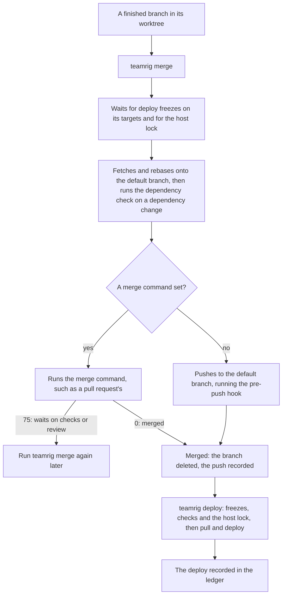
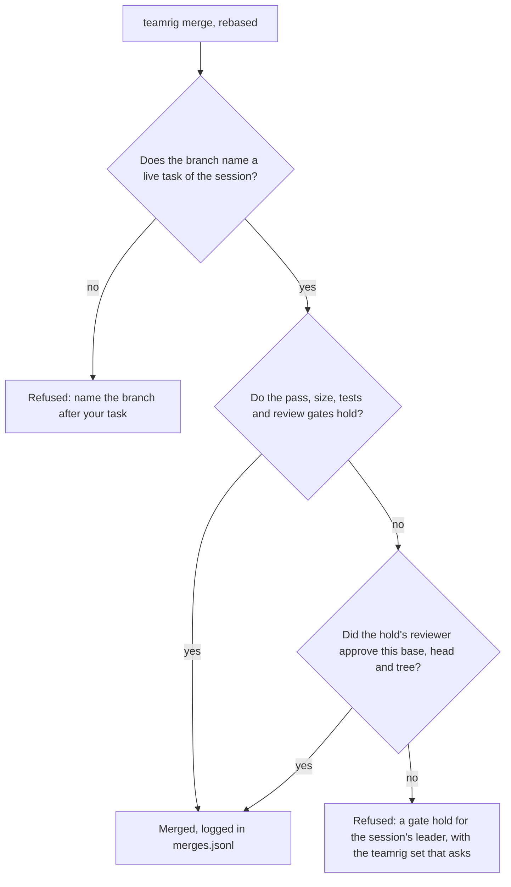

# Ship from many sessions

Many sessions on one host each build, run tests and deploy whenever their change is ready. Left alone, two full test
suites starve each other of memory, a deploy lands in the middle of another session's measurement, and each session
ships its own way. teamrig's delivery commands put these steps in one line: queued steps take turns under a host
lock, every branch merges and deploys the same checked way, and each step goes to a ledger, so a session can find
the stretches no change touched. The `delivery` keys in the [team config](../configuration.md) set it.

- [One host lock](#one-host-lock)
- [Merging a branch](#merging-a-branch)
- [The self-merge gates](#the-self-merge-gates)
- [Deploying it](#deploying-it)
- [When a step holds back](#when-a-step-holds-back)
- [Clean measurements](#clean-measurements)
- [The deploy state in one read](#the-deploy-state-in-one-read)

Every command is in [commands](../../plugins/teamrig/skills/teamrig-guide/commands.md), and the order a change ships
in, from its worktree to the task's proof, in
[workflows](../../plugins/teamrig/skills/teamrig-guide/workflows.md#ship-a-change).

## One host lock

`teamrig queue` runs one queued step, such as a build, a test run or a database script, in its turn under the host
lock, so the host runs only as many queued steps at once as its memory allows instead of letting them compete for its
CPU and memory:

```sh
teamrig queue --session api --what "build api" -- npm run build
teamrig queue --session api --what "test api" -- teamrig test -- npm test
```

```text
2030-01-08 12:00:00 IST waiting for the host lock: web (heavy: test web) since 2030-01-08 11:52 IST
2030-01-08 12:04:30 IST running: build api (killed after 45m)
DONE exit 0
```

Waiting steps go in admission order, each told its place in line: an incident's (p0) step first, then the
work class whose turn it is, so each class gets its `focus.allocation` share of the host's run time, then the task's
priority, raised a level for each `delivery.queue.agingMinutes` (15) waited, then arrival. A session runs at most
`delivery.queue.perSessionRunning` (2) steps at once while later steps of other sessions pass it.
`delivery.queue.admission: serial` keeps the line in arrival order with no cap and one heavy step at a time. A step is refused once its line has not
moved for `delivery.queue.waitMinutes` (60), and one that runs is killed, with every process it started, after
`delivery.queue.maxRunMinutes` (45; `--max-minutes` for one step). A test run wrapped in `teamrig test`, as
above, gets both the lock and the short summary. The lock is `host.lock` in the kit home, one for every team on the
host, unless `delivery.queue.lockPath` names another; a lock past `lockTtlMinutes` (150), or whose process is
gone, is taken over by the next step that takes the lock (a step that shares the host leaves it).

A step runs at below-normal CPU priority (nice 10 on POSIX), and every process it starts inherits it, as do a merge's
and a deploy's commands and checks: your terminal and apps win the CPU while it runs, and it takes what they leave,
so a build on a busy host no longer freezes your screen.

Every step, merge and deploy waits in its turn for host memory: it starts only while the host's free memory, less
what the steps sharing the host and the tabs still loading hold, leaves `delivery.queue.memoryFloorMb` (4096) plus its
own, and the commit charge stays under `open.headroom.commitMaxPct` (92) with its own counted, so a build no longer
starts on a host about to run out of memory, nor just as a tab opened. A step's own is the most its process tree held in its latest 20 runs under the same session and
`--what`, plus a quarter: at least `heavyReserveMb` (2048) for a heavy step, else `smallReserveMb` (2048) before it
has a run.

A small step, such as a spec run or a lint, runs with `--small`: it shares the host with other small steps instead
of taking the lock. A small step is killed after `smallMaxRunMinutes` (10), since a hung one holds back every step
waiting for the lock. A heavy step (one without `--small`, such as a build or a full suite) takes the lock and waits
for every step sharing the host to end, so it runs alone, as a merge and a deploy do. With `admission: pipeline` a
heavy step shares the host too, at most `delivery.queue.maxHeavyParallel` (2) at once, so two builds that fit in
memory no longer wait for each other, while a merge, a deploy and a step queued with `--exclusive` still take the
lock. `serial` stays the default while a team's own deploy tool may take the lock file without reading the shares.

A repository's git hooks can wrap their checks in `teamrig queue`, so a plain `git commit` takes the host lock for
its hook. A step started under the lock (a hook run by a merge's push, say) runs at once, as part of its
parent, instead of waiting on itself. A pre-push hook's `queue` takes `--pre-push`: git opens the push's connection
before the hook runs, and a host such as GitHub drops it once it sits idle for about 6 minutes while the checks wait
or run. With it, the checks' pass on a clean tree is recorded, and a push of the same tree with the same command line
reuses it at once, with no lock. When the checks waited over a minute for the lock, it declines the push once they
pass, since its connection may have closed: push again, and it reuses their pass.

Checks that run long idle the connection too. `teamrig merge` keeps its push's connection open with an ssh keepalive
every 30 seconds, unless `GIT_SSH_COMMAND`, `GIT_SSH` or the repository's `core.sshCommand` sets an ssh command of
your own. For a plain `git push`, add `ServerAliveInterval 30` under `Host github.com` in `~/.ssh/config`. A remote
over https uses no ssh, so neither applies to it.

Each step's start and end go to the ledger, `ledger.jsonl` in `delivery.dir` (by default `deploys` in the team's
state folder), with how long it waited, the most memory its processes held at once and the least free memory the
host had.

## Merging a branch

`teamrig merge`, run in a branch's worktree, merges the branch into origin's default branch, so every session merges
its work one way: checked, pushed under the host lock and recorded. `teamrig deploy` then brings it to the running
system.



```sh
teamrig merge --session api
```

```text
2030-01-08 12:00:00 IST pushing t12-parser (4f1c2a9e) to main; the pre-push hook runs now
2030-01-08 12:03:10 IST deleted t12-parser on origin
2030-01-08 12:03:10 IST deleted the local t12-parser
2030-01-08 12:03:10 IST next: teamrig worktree remove "/home/you/api-t12"
DONE pushed 9a0b1c2d..4f1c2a9e to main; cloud-api deploy on push
```

It is refused before any change in a detached HEAD, with uncommitted changes, on the default branch itself, for a
branch with nothing new and, under `decisionRecordGate`, for a branch whose task has a design note and no decision
record. Otherwise it waits up to `delivery.wait.maxMinutes` (60) for the freezes and the lock
(longer while its line moves), fetches, rebases and pushes, the push a queued step that runs the pre-push hook. When
origin moved meanwhile, it rebases and pushes again, 3 times in all. Once merged, it deletes the branch on origin and
here (`--keep-remote` and `--no-delete-local` keep them) and prints the `teamrig worktree remove` that ends the
worktree. Exit 0 merged, 1 failed with the branch kept, 2 when the dependency check or the decision record gate
refused it, 75 when the merge command waits.

Each repository is an entry of `delivery.repos`, found by its main checkout; one not listed gets a NOTE and none
of these:

```json
"delivery": {
  "repos": {
    "api": {
      "mainCheckout": "../api",
      "deploysOnPush": ["cloud-api"],
      "dependencyGate": true,
      "dependencyCheck": ["node", "tools/check-change.ts"],
      "updateMainCheckout": true,
      "merge": { "command": ["node", "tools/merge.ts"] }
    }
  }
}
```

- `deploysOnPush`: what a push to the default branch deploys by itself, on a host that builds on push. `teamrig merge`
  waits for deploy freezes on these targets and records the push as their deploy, which teamrig does not watch.
- `dependencyGate`: refuses a branch that changes `package-lock.json`, or a `package.json` field an install reads,
  since merging it changes, unreviewed, the `node_modules` every worktree links to. `dependencyCheck` is the check
  that clears one, run under the lock after each rebase and before the push.
- `decisionRecordGate`: refuses a branch whose task (`t<n>-…`) has a design note in its task folder, such as
  `design.md`, until the branch adds a decision record to `<docsFolder>/decisions/` (`docsFolder` defaults to
  `docs`), since a design settled in a session's notes is lost to every reader of the code unless it lands in the
  repository. [commands](../../plugins/teamrig/skills/teamrig-guide/commands.md#teamrig-merge) gives the record's
  format.
- `updateMainCheckout`: after a merge from a worktree, fast-forwards the main checkout too, when it is on the
  default branch with no uncommitted changes.
- `merge`: a command run in place of the push, for a repository that merges through pull requests. Exit 0: it merged,
  and `teamrig merge` confirms it on origin. 75: the merge waits, say on the pull request's checks or review; the
  branch is kept and the lock freed, and `teamrig merge` run again later finishes it once origin holds the merge. Anything else
  fails. `merge.remote: "upstream"` merges into the project's repository where origin is your fork.
  [commands](../../plugins/teamrig/skills/teamrig-guide/commands.md#teamrig-merge) has a sketch of one for
  GitHub pull requests.

## The self-merge gates

Under `pushGuard.pushToProtected: gated`, `teamrig merge` checks five self-merge gates after the rebase, in order:

- task: the branch is named `t<n>-…` after a live task (open, in progress, verifying or waiting) of the session
  that merges it;
- pass: the repo's own local runner wrote a pass record for the rebased tree (`<git common dir>/local-ci/<tree>.json`),
  so run the checks on the rebased branch first; `teamrig queue --pre-push` keeps its passes elsewhere and does not
  count;
- size: no commit is over the size rule without a `Large-commit:` line;
- tests: a change of source (`commits.sourcePatterns`) changes a test too;
- review: the repo's `delivery.repos` entry sets `reviewGate` (a repo not listed there always misses it).

A change that holds every gate merges with no approval. A task miss is refused and writes no hold: name the branch
after your task first. Any other miss writes a gate hold (`gate-holds/` in `delivery.dir`) for the session's
nearest leader, or for `roles.securityReviewer` on the lead's own change, and is refused with the `teamrig set`
command that asks. The reviewer answers with `teamrig approve`, and `teamrig merge` again merges it, but only for the
gates the hold named. A hold binds the base, the head and the tree, so a new commit or any rebase onto a moved
default branch, the push's own retry included, needs a new hold. Each merge, with an approval or not, is a line in
`merges.jsonl` in `delivery.dir`, and the meeting agenda lists those merged with no approval (`MERGES`).



## Deploying it

`teamrig deploy` brings what was pushed to a repository's default branch to the running system, one deploy on the host
at a time: checked, pulled under the host lock, deployed and recorded. A repository gets a deploy block:

```json
"delivery": {
  "repos": {
    "pipeline": {
      "mainCheckout": "../pipeline",
      "deploy": {
        "targets": ["api", "workers"],
        "checks": [{ "name": "flow", "command": ["node", "tools/flow-check.js"] }],
        "dependencyInstall": ["npm", "ci", "--ignore-scripts"],
        "afterPull": [["npm", "run", "build"]],
        "command": ["node", "tools/deploy.js"]
      }
    }
  }
}
```

- `targets`: what the deploy restarts; deploy freezes on them hold it.
- `checks`: up to 16 checks your own tools answer, such as "is a batch run open?". Exit 0 lets the deploy go, 75 holds
  it and 2 refuses it; anything else, or no answer within `delivery.checkTimeoutSeconds` (20), holds it, its last
  line the reason.
- `dependencyInstall`: the install a pulled dependency change needs, run right after the pull. A failed install
  moves the main checkout back and installs again, so the `node_modules` every worktree links to matches it.
- `afterPull`: up to 16 commands run after the pull and before the deploy command, such as a build it needs.
- `command`: the deploy itself. A line `no-deploy` means nothing needed deploying; otherwise its last line is the deploy
  record's note.

```sh
teamrig deploy --session api
```

```text
2030-01-08 12:00:00 IST 2 commits pending in pipeline (4f1c2a9e..9a0b1c2d)
2030-01-08 12:00:00 IST waiting: check flow holds the deploy: a batch run is open
2030-01-08 12:00:30 IST clear; pulling 2 commits (4f1c2a9e..9a0b1c2d) into /home/you/pipeline
2030-01-08 12:00:30 IST pulled /home/you/pipeline to 9a0b1c2d
2030-01-08 12:00:30 IST afterPull: npm run build
2030-01-08 12:01:10 IST deploy: node tools/deploy.js
2030-01-08 12:03:40 IST   deployed api, workers on sha-9a0b1c2d
DONE 4f1c2a9e..9a0b1c2d deployed: deployed api, workers on sha-9a0b1c2d
```

deploy is refused before any check or lock when the main checkout is off its default branch, has uncommitted changes or
holds commits origin lacks. With nothing pending it is DONE and runs nothing. Otherwise it waits for the freezes, the
checks and the lock, reads origin again under the lock and asks the checks again, then pulls to the commit they judged
and runs the dependency steps a dependency change needs, the afterPull commands and the deploy command, each killed after `delivery.queue.maxRunMinutes`, all
one queued step in the ledger. A failed deploy is recorded too, and its owners fix forward or roll back; the pull stays,
so run the deploy command by hand once it is fixed.

A deploy that pulls nothing, such as a restart that makes services read a rotated secret on the same image, names its
targets and its own command:

```sh
teamrig deploy --session sec --targets api,workers --what "rotate the db credential" -- node tools/restart.js api workers
```

It keeps the repository's checks and deploy freezes for the targets it names, and is refused for a target not in
`deploy.targets`, since a typo would slip past the deploy freezes. A deploy freeze of your own on a target holds it
too, so unfreeze it first.

## When a step holds back

- **The queue cutoff:** no queued step, merge or deploy starts from `delivery.schedule.queueCutoffUtc` until
  midnight UTC, nor runs a queued step whose wait for the lock ran past it; set it to keep a nightly stretch free of
  builds.
- **The reset blackout:** no merge or deploy starts in the `delivery.schedule.resetBlackoutHours` before the
  weekly token reset, the one the status line last reported, else the one `budget.reset` sets; unset, there is none.
- **A wait that ran out:** a queued step is refused once its line has not moved for `waitMinutes`, a merge or a
  deploy after `delivery.wait.maxMinutes`, unless its line keeps moving.
- **A step taken out of line:** `teamrig withdraw` takes a session's steps still waiting for the lock out of the line,
  so a re-ordered or abandoned step never runs:

  ```sh
  teamrig withdraw --session api --what "build api"
  ```

  ```text
  WITHDRAWN heavy: build api, waiting since 2030-01-08 11:58 IST: it stops at its next look
  ```

- **A shell that ended:** each step watches the processes that started it, up to the tab's Claude Code. Once one
  ends, a waiting step runs nothing, and a running one is killed with every process it started, recorded as exit 129,
  and frees the lock.

## Clean measurements

A session measuring a change, say its effect on latency, needs a stretch no deploy or build disturbed. A deploy freeze
holds the merges and deploys of its targets while it measures:

```sh
teamrig freeze --session api --targets api,workers --metric "p95 latency" --why "cache probe" --for 45m
```

```text
FROZEN api, workers until 2030-01-08 12:45 IST
```

A freeze lasts at most `delivery.freezes.maxMinutes` (120), one per session, on targets a repository deploys. It
ends at its time, or early with `teamrig unfreeze`. Freezes are shared files, so a secret in the metric or reason is
refused. Nothing else holds a deploy: a measurement without a freeze adapts to the deploys.

Afterwards, `teamrig stable-periods` lists each target's stable periods, so a session compares a metric over
stretches no change touched:

```sh
teamrig stable-periods --targets api --since 08:00
```

```text
api (settle 30m): 2 stable periods of at least 15m
  2030-01-08 08:00 IST to 2030-01-08 08:40 IST (40m)
  2030-01-08 10:20 IST to 2030-01-08 12:00 IST (1h40m)
    under job 3f9c1a7e by data: backfill prices (from 2030-01-08 10:30 IST, still running)
```

A deploy disturbs its repository's targets, or only those a `deploy --targets` run named, from its start until they
settled: `delivery.stablePeriods.settleMinutes` (30), a target's own in `targetSettleMinutes`, or `--settle` for one
run. A deploy line a session wrote by hand in `ledger.md` counts too; one with no record of its start is taken to
have run for `assumedDeployMinutes` (20) before its line. A queued step disturbs the whole host. A stable period
shorter than `minMinutes` (15) is left out.

A background job, such as a long data script or a backfill, is declared with `teamrig job` (`teamrig job end` ends
it). A job never cuts a stable period, since two periods under the same job still compare: each period names the
jobs it overlaps.

```sh
teamrig job --session data --what "backfill prices" --at 10:30
```

```text
JOB 3f9c1a7e on the whole host from 2030-01-08 10:30 IST (end it: teamrig job end --id 3f9c1a7e)
```

## The deploy state in one read

`teamrig deploy-status` prints the state now: who holds the host lock and which steps share the host, heavy ones first, the queue
cutoff (its `heavy cutoff:` line) and the reset blackout (each marked IN FORCE while it holds), the deploy freezes
and background jobs still open (its `claims:` and `loads:` lines), and what each repository with a deploy block has
pushed but not deployed, with why a deploy would refuse it.

```sh
teamrig deploy-status
```

```text
host lock: po (heavy: build api) since 2030-01-08 11:50 IST
heavy cutoff: 00:30-02:00 IST (no heavy step starts)
deploy blackout: Tue 01-08 23:00 IST until Wed 01-09 03:00 IST (no merge or deploy; reset from the status line)
claims: 1
  quiet claim by data on cloud-api until 2030-01-08 12:30 IST (p95 latency)
loads: none
app: 2 commits pushed, not deployed (c1a2b3c4..d5e6f7a8)
```
