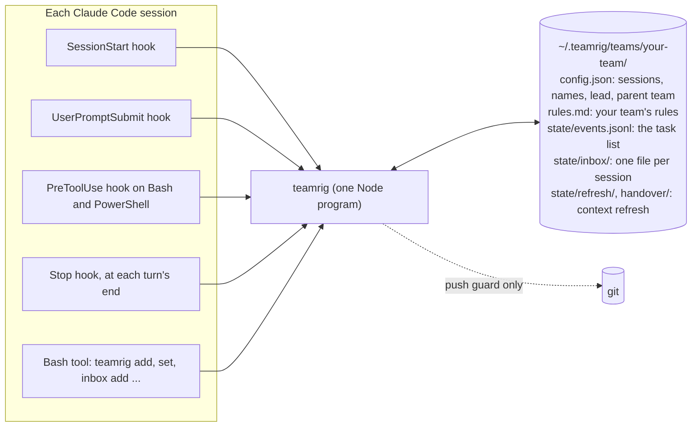
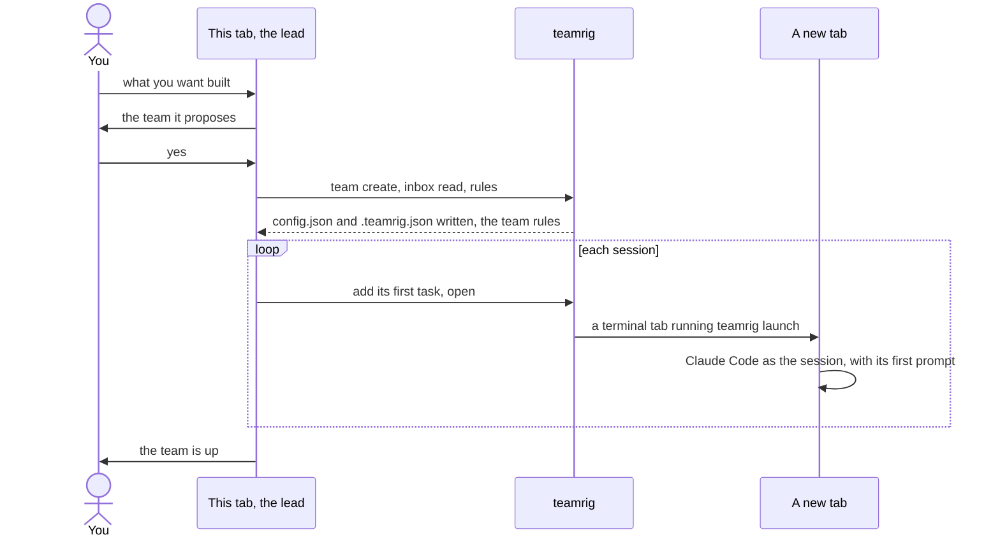
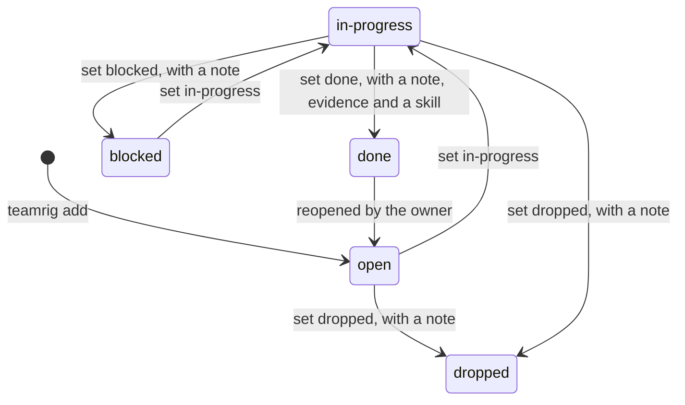
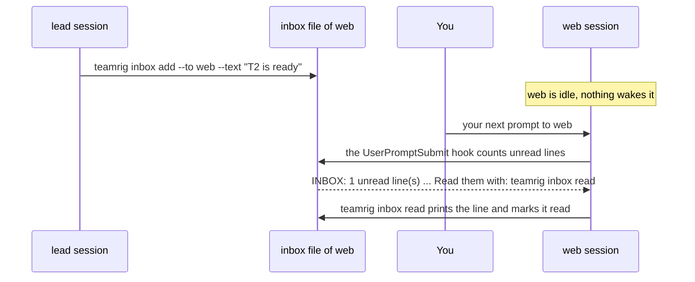
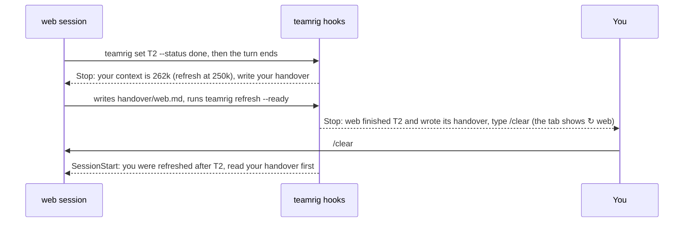
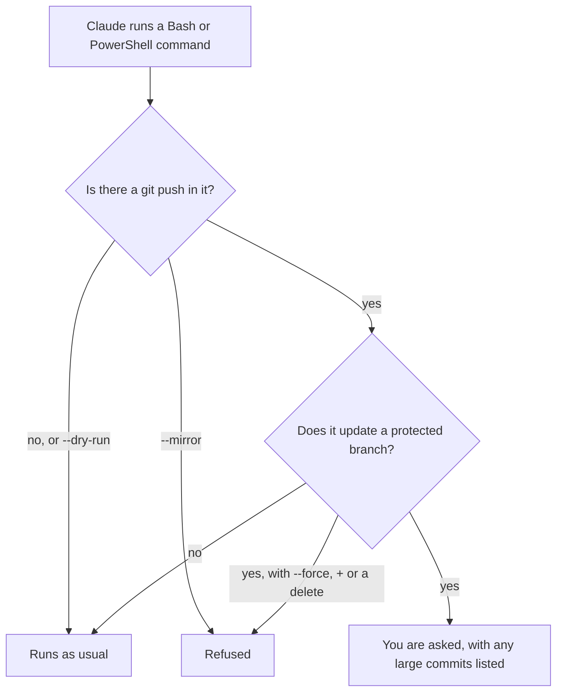
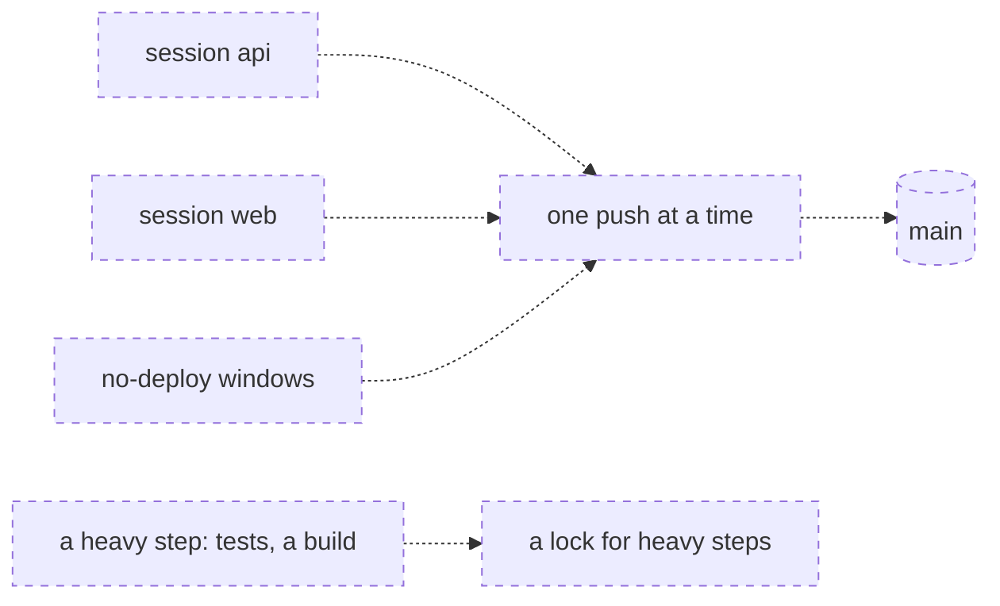
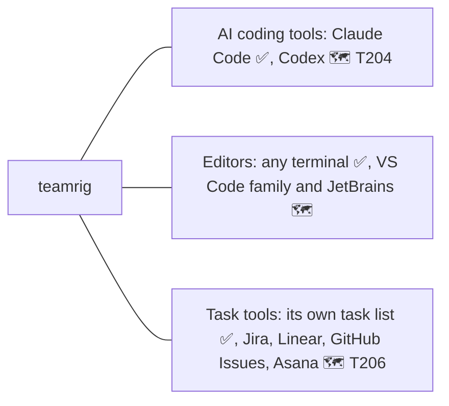

# How teamrig works

teamrig is one small Node program, four Claude Code hooks and a folder of plain files. Nothing runs between
sessions: no server, no daemon, no network. Status marks, as in the [README](../README.md): ✅ works today ·
🚧 being built (task id) · 🗺 planned. Parts not built yet are drawn dashed.

- [The parts](#the-parts)
- [Who is on the team](#who-is-on-the-team)
- [Setting up a team](#setting-up-a-team)
- [A task's life](#a-tasks-life)
- [Notes between sessions](#notes-between-sessions)
- [A fresh context](#a-fresh-context)
- [Safe pushes](#safe-pushes)
- [Room for other tools](#room-for-other-tools)

## The parts

Each Claude Code session runs the same `teamrig` program, from its hooks and from its Bash tool, and that program
reads and writes your team's folder.

| Part | When it runs | What it does |
| --- | --- | --- |
| SessionStart hook | a session starts, resumes, is cleared or is compacted | gives the session the core rules, its name, the lead's name, where its team sits in a tree of teams and your team's `rules.md` |
| UserPromptSubmit hook | you send a prompt | one `INBOX:` line when the session has unread notes, nothing otherwise |
| PreToolUse hook | Claude runs a Bash or PowerShell command | reads a `git push` in it and asks you or refuses ([Safe pushes](#safe-pushes)) |
| Stop hook | a turn ends | after a task is marked done, asks for a handover when a refresh is due, then tells you once ([A fresh context](#a-fresh-context)); nothing otherwise |
| `teamrig` commands | Claude runs them in its Bash tool | the task list, the inbox, names, settings, checks (`teamrig help`) |

A session finds its team through `$TEAMRIG_TEAM`, else the nearest `.teamrig.json` above its folder
(`{"team": "your-team"}`). The folder is `~/.teamrig` unless `$TEAMRIG_HOME` says otherwise. The task list and the
name log change only under a lock, and the inboxes and read marks only ever grow by a line, so parallel sessions
never overwrite each other.

## Who is on the team

A team is a list of sessions with one lead, and a lead may also lead sub-teams; each session learns at start who it
is and whom to message.

You ask one tab for the team in plain words, and it opens a tab for each other session
([Setting up a team](#setting-up-a-team)). At start the session reads "You are the `web` session of team
`your-team` … Message the lead as `lead`." `teamrig who` prints every session's name, and `teamrig rename` gives a
session a new name while every old name keeps working.

A team grows into a tree of teams when a lead hires sub-team leads, each running its own sessions, and you still
talk to one lead: the root team's.

- Each team keeps its own folder, config, task list and inboxes. Its config names its parent team
  (`"team": {"id": "web", "parent": "your-team"}`), so the tree is read from the configs, with no other file to keep
  in step. A tree has at most 3 levels and a team at most 8 child teams.
- A member writes notes to its own team only. A lead also writes to its parent team's lead and to its child teams'
  leads, so a question for you goes up lead by lead to the root. Anything else is refused: escalate through your lead.
- Claude Code session names are machine-wide, so two teams never share one: `team create` refuses a clash and
  `teamrig doctor` names one, along with a broken link in the tree.
- `teamrig team tree` prints the tree with each team's lead and sessions.

## Setting up a team

You tell Claude in any tab what you want built, for example "Build the signup flow: one session on the API, one on
the web form, one on tests." The plugin's `team-setup` skill proposes a team in a few lines, and on your yes:

- `teamrig team create signup --sessions api,web,tests` writes the team's `config.json` and ties the project folder
  to it with `.teamrig.json`. It refuses another team with the same id and a project tied to another team, a repeat
  changes nothing, and `--dry-run` prints what it would write. `--parent your-team` hangs the new team under that
  team's lead; it refuses a parent with no config, a tree deeper than 3 levels, a team's 9th child team and a
  session name another team uses.
- The tab that ran the setup becomes the lead without a restart. `teamrig inbox read --session lead` ties its Claude
  Code session to the lead, so the hooks still know it after a compact or a resume, and `teamrig rules --session lead`
  gives it the rules it missed at start. After a `/clear` it runs `inbox read` once more.
- `teamrig open <session>` opens a tab in tmux (when run inside tmux), Windows Terminal, macOS Terminal, GNOME
  Terminal, Konsole or x-terminal-emulator, in that order; `open.terminal` in the config or `--terminal` picks one.
  The tab runs `teamrig launch`, which sets `$TEAMRIG_SESSION` and starts `claude --name <name> "<first prompt>"`.
  When no terminal opens, it prints the command to paste and exits 3. `teamrig open web/lead` opens a session of
  another team in the same tree.

## A task's life

Every task has one owner, and only the owner moves it; these are the usual moves.

- The owner may move a task from any status to any other; the register keeps every move.
- `teamrig update` changes the owner, priority tier, due date or week, never the status; the lead may run it on any
  task.
- `teamrig check` reports tasks past due, not picked up 24 hours after they were handed out, untouched for 72 hours,
  or due this week but left out of the week's plan. It reports and never blocks.
- A lead hands a child team work with `teamrig add --team web --title "..." --tier 2`: the task lands in `web`'s own
  list, owned by `web`'s lead and marked as from `your-team/lead`, and `web`'s lead splits it among its sessions
  and opens them. Only the parent team's lead may do this.
- `teamrig list --tree`, `check --tree` and `plan --tree` give a lead its team's tasks and those of every team
  under it, with ids like `web/T4`. They only read the other teams' lists. With `--tree`, `--session` names the
  lead asking, so a tab without `$TEAMRIG_SESSION` passes `--session lead`.
- Being built: dependencies and parent/child tasks 🚧 T205; planned start, ETA, history and token estimates
  🚧 T209–T211.

## Notes between sessions

A note is one line added to the receiver's inbox file; the receiver hears of it at its next prompt.

- The inbox file is never edited: `inbox read` adds a mark to `state/inbox-marks.jsonl`.
- A note is one line; an empty line, several lines or a line that looks like a secret is refused.
- In a tree of teams, `--to web/lead` writes to a session of another team, within the rights in
  [Who is on the team](#who-is-on-the-team); the note names its sender as `your-team/lead`.
- Nothing wakes an idle session, which is why `teamrig check` reports a task not picked up.

## A fresh context

A long session gets slow and costly, and what it was told early on fades. teamrig lets it start again at a task
boundary without losing the thread.

- Only a finished task counts: the Stop hook judges the size once, after `set <id> --status done`, from the last
  reply in the session's transcript, and says nothing on any other turn.
- The threshold is `refresh.contextTokens` in the team config (250,000 by default). The lead can ask for a refresh
  at any size: `teamrig refresh web` applies at web's next finished task.
- `refresh --ready` is refused until the handover is written: missing, blank or unchanged since the hook asked.
- A hook cannot clear a session, so you type `/clear`. A compact or a resume keeps the handover waiting for the next
  fresh start. Restarting the tab for you is planned 🗺 T201, T212.
- `refresh.enabled: false` turns it off, `refresh.tabTitle: false` leaves the tab title alone and
  `refresh.handoverDir` moves the handovers.

## Safe pushes

Before Claude runs a `git push`, teamrig reads the command and asks you, or refuses, when it would change a
protected branch (by default `main` and `master`).

- `--force-with-lease` is asked, not refused. `commits.gate` set to `refuse` turns the ask into a refusal when a
  commit is over the size rule (400 changed lines or 15 files, tests not counted) with no `Large-commit:` reason.
- `teamrig commits check --base <ref>` runs the same size rule in a script or CI.
- Outside a project tied to a team, the guard stays silent.

Planned 🗺 T228: a deploy coordinator.

## Room for other tools

Today teamrig works with Claude Code, any terminal and its own task list; other tools come through one small
interface per kind of tool.

There is no adapter interface in the code yet: what teamrig knows about Claude Code (its hook fields, its
environment variables, `~/.claude/skills`) is built in. The interface comes with the second AI tool (T204), so it is
shaped by two real tools instead of one.
