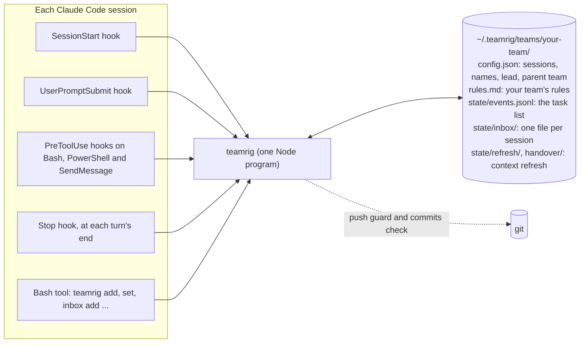
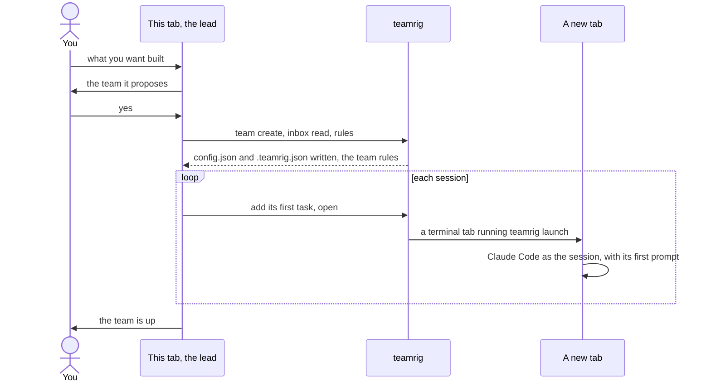
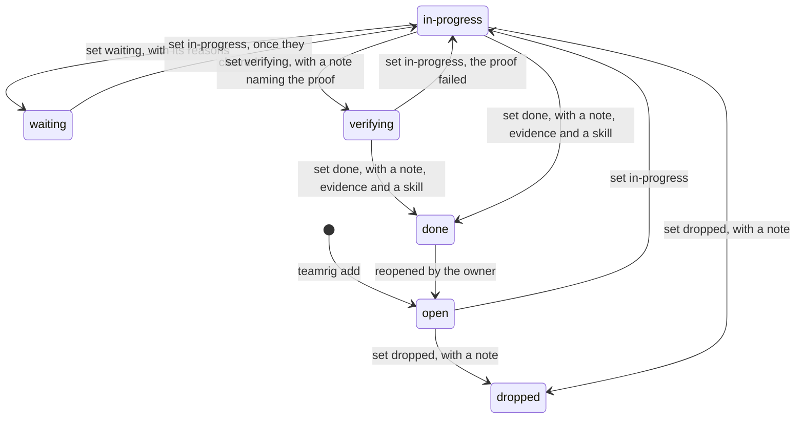
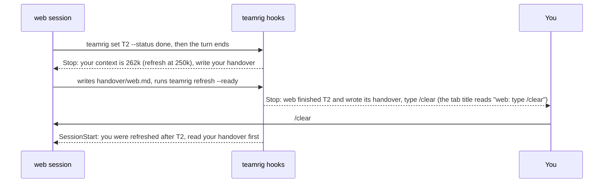
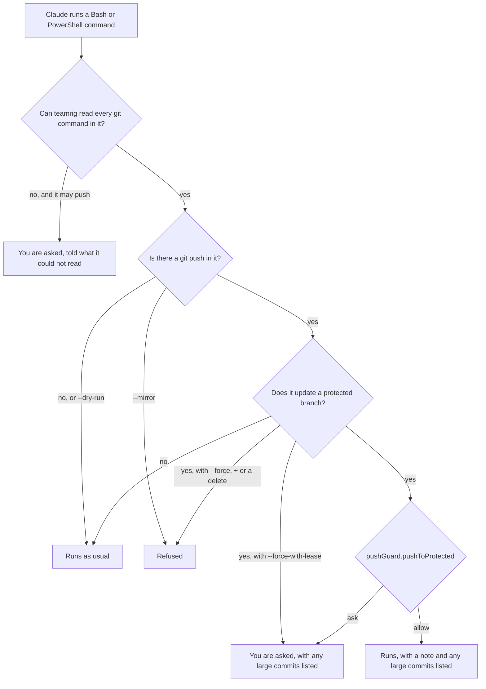
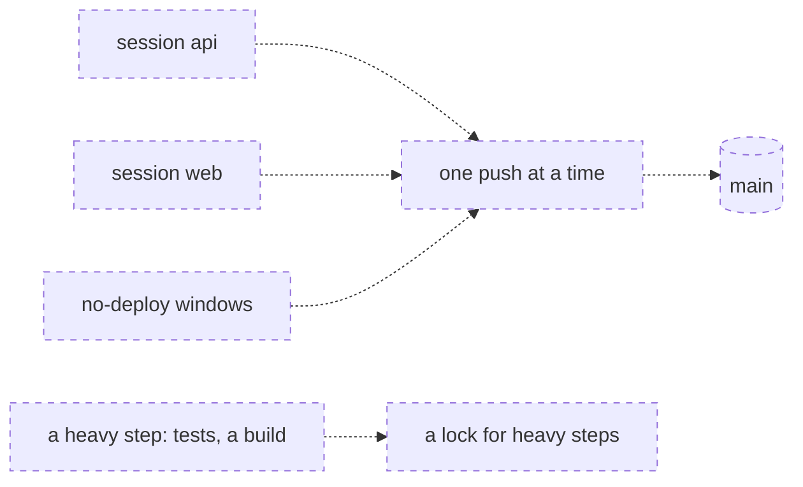
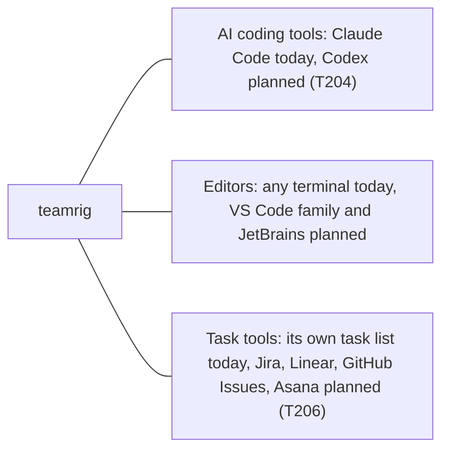

# How teamrig works

teamrig is one small Node program, four Claude Code hooks and a folder of plain files. Nothing runs between
sessions: no server, no daemon, no network. Each part says, as in [what teamrig does](features.md),
whether it works today, is being built (with its task id) or is planned. Parts not built yet are drawn dashed.

- [The parts](#the-parts)
- [Who is on the team](#who-is-on-the-team)
- [Setting up a team](#setting-up-a-team)
- [Updating the plugin](#updating-the-plugin)
- [A task's life](#a-tasks-life)
- [Notes between sessions](#notes-between-sessions)
- [A fresh context](#a-fresh-context)
- [Safe pushes](#safe-pushes)
- [Room for other tools](#room-for-other-tools)

## The parts

Each Claude Code session runs the same `teamrig` program, from its hooks and from its Bash tool, and that program
reads and writes your team's folder.



| Part | When it runs | What it does |
| --- | --- | --- |
| SessionStart hook | a session starts, resumes, is cleared or is compacted | gives the session the core rules, its name, the lead's name, where its team sits in a tree of teams and your team's `rules.md`; tells you and the session, in one MODEL line, when it runs on another model than its `launch` entry asks, with the `/model` to type |
| UserPromptSubmit hook | you send a prompt | the session's new inbox lines, each shown once; a line when it binds a hand-started tab by its title, once per cause when it cannot, when it records a Claude Code rename of the session as its team name, or when `.teamrig.json` is broken; nothing otherwise |
| PreToolUse hook on Bash and PowerShell | Claude runs a Bash or PowerShell command | finds every `git push` in it, through wrappers, nested shells and git aliases, and asks you or refuses; asks when it cannot read the command ([Safe pushes](#safe-pushes)) |
| PreToolUse hook on SendMessage | Claude messages another session of the team | when the receiver has been idle `messages.coldAfterMinutes` (60 by default) or longer, the message would wake it cold: its first call re-reads its whole context at full price, about 8 times a warm wake. It holds the message once with a note: an inbox line if the receiver need not act now, else every ask for it in one message, sent again; the same tab's next send to it within 15 minutes goes through. Idle time runs from the receiver's last write to its own transcript; a helper, a receiver off the team or one with no transcript yet is never held |
| Stop hook | a turn ends | after a task is marked done, asks for a handover when a refresh is due, then tells you once ([A fresh context](#a-fresh-context)); tells you once, in a MODEL line, when the session runs at another effort than its `launch` entry asks, or when Claude Code switched it to another model after its safeguards stopped a reply, with the `/effort` or `/model` to type; nothing otherwise |
| `teamrig` commands | Claude runs them in its Bash tool | the task list, the inbox, names, settings, checks (`teamrig help`) |

A session finds its team through `$TEAMRIG_TEAM`, else the nearest `.teamrig.json` above its folder
(`{"team": "your-team"}`), else the nearest one above `$CLAUDE_PROJECT_DIR`. The folder is `~/.teamrig` unless
`$TEAMRIG_HOME` says otherwise. The task list and the name log change only under a lock, and the inboxes and read
marks only ever grow by a line, so parallel sessions never overwrite each other.

## Who is on the team

A team is a list of sessions with one lead, and a lead may also lead sub-teams; each session learns at start who it
is and whom to message.


You ask one tab for the team in plain words, and it opens a tab for each other session
([Setting up a team](#setting-up-a-team)). At start the session reads "You are the `web` session of team
`your-team` (name `your-team-web`). Message the lead as `your-team-lead`." A session the config gives no name is
called `<team>-<id>`. `teamrig who` prints every session's name, and `teamrig rename` gives a session a new name
while its old names keep finding it until another session takes one. A Claude Code rename of the session
(`/rename`, `claude --name`) is recorded the same way at its next prompt or start, as if it ran `teamrig rename`.

A team grows into a tree of teams when a lead hires sub-team leads, each running its own sessions, and you still
talk to one lead: the root team's.

- Each team keeps its own folder, config, task list and inboxes. Its config names its parent team
  (`"team": {"id": "web", "parent": "your-team"}`), so the tree is read from the configs, with no other file to keep
  in step. A tree has at most 3 levels and a team at most 8 child teams.
- A member writes notes to its own team only. A lead also writes to its parent team's lead and to its child teams'
  leads, so a question for you goes up lead by lead to the root. Anything else is refused: escalate through your lead.
- Claude Code session names are machine-wide, so two teams never share one: `team create` refuses a clash and
  `teamrig doctor` names one, along with a broken link in the tree.
- `teamrig team tree` prints the tree with each team's lead and sessions.

## Setting up a team

You tell Claude in any tab what you want built, for example "Build the signup flow: one session on the API, one on
the web form, one on tests." The plugin's `team-setup` skill proposes a team in a few lines, and on your yes:



- `teamrig team create signup --sessions api,web,tests` writes the team's `config.json` and ties the project folder
  to it with `.teamrig.json`. It refuses another team with the same id and a project tied to another team, a repeat
  changes nothing, and `--dry-run` prints what it would write. `--parent your-team` hangs the new team under that
  team's lead; it refuses a parent with no config, a tree deeper than 3 levels, a team's 9th child team and a
  session name another team uses.
- The tab that ran the setup becomes the lead without a restart. `teamrig inbox read --session lead` ties its Claude
  Code session to the lead, so the hooks still know it after a compact or a resume, and `teamrig rules --session lead`
  gives it the rules it missed at start. After a `/clear` it runs `inbox read` once more.
- A tab you start by hand binds itself when its Claude Code title (`claude --name`, `/rename`) is a session's id or
  current name on the team of the folder it started in, and on no other team of the tree. The hooks then know it as
  `inbox read` would, but nothing is marked read. A title that names no session, or sessions of two teams, binds
  nothing, and the prompt hook says once how to bind the tab. `$TEAMRIG_SESSION` and an earlier binding always win.
- `teamrig open <session>` opens a tab in tmux (when run inside tmux), Windows Terminal, macOS Terminal, GNOME
  Terminal, Konsole or x-terminal-emulator, in that order; `open.terminal` in the config or `--terminal` picks one.
  The tab runs `teamrig launch`, which sets `$TEAMRIG_SESSION` and starts `claude --name <name> "<first prompt>"`,
  with `--model` and `--effort` from the session's `launch` entry in the config. The lead, for each it leaves unset,
  starts on `opus` (Claude Code's newest Opus) at `xhigh` effort; the others on Claude Code's own. The `OPENED` and
  `Starting` lines name the model and effort a tab starts on, and `launch.<id>` in the config changes either one.
  When no terminal opens, it prints the command to paste and exits 3. `teamrig open web/lead` opens a session of
  another team in the same tree.

## Updating the plugin

Claude Code installs the version that the plugin's `plugin.json` gives and moves an install only when that version
rises, so every change to the plugin raises it. To take the newest one:

```sh
claude plugin marketplace update teamrig
claude plugin update teamrig@teamrig
```

Then run `/reload-plugins` in each open session, or restart it. Claude Code does not check this marketplace for updates
by itself unless you turn on its auto-update in `/plugin`, under Marketplaces.

## A task's life

Every task has one owner, and only the owner moves it; these are the usual moves.



- The owner may move a task from any status to any other; the register keeps every move.
- `done` takes `--skill none` or the name of a skill in your Claude Code skills folder; setting a task to its own
  status again needs `--note`; `add` refuses a title an open, in-progress, verifying or waiting task already has.
- `verifying` is a change that has shipped and waits for what proves it: a test run, a night's flow, a number.
  Its note names that proof, and its due date is the date to verify it by. It stays active, so `list` and
  `check` keep it in view until the owner sets it `done` with the proof as evidence.
- `waiting` is a started task that cannot go on, with every reason it waits for (`--waits`): a decision or an
  approval (a session's or the owner's), another task to finish first, or a time. It stays waiting until all of
  them have cleared: a task when it is done or dropped, a time when it passes, a decision or an approval only when
  the owner sets the next status. A task not started that needs another first is not waiting: it stays `open`,
  planned after it (`teamrig update T3 --after T2`), and its line shows `after T2`. A `blocked` written by an
  older teamrig reads as `waiting` with no reasons.
- `teamrig update` changes a task's title, owner, priority, ref, due date, goals, week or the tasks it comes after
  (`none` clears the last five), never the status; on a task it does not own, the lead may change the owner, priority, due date or week.
- `teamrig check` reports tasks past due, not picked up 24 hours after they were handed out, untouched for 72 hours,
  or due this week but left out of the week's plan, and owner orders left out of it. A verifying task past its due
  date is `VERIFY-OVERDUE`: it was not verified by then. One with a due date is not called stale while it waits. A waiting task whose every reason has cleared is `READY`. It also reports a session that
  skips its own priorities: `PRIORITY-SKIP` is a task in progress for over 24 hours
  (`register.check.prioritySkipAfterHours`) while the same session has an open p1 free to start (every task it comes after finished), counted from the latest change of
  owner, status or priority on either task. `OFF-GOAL` is a task in progress with no goal outside the week's plan:
  work nothing in the plan asked for. teamrig has no parent tasks yet, so a goal tag or the week is what ties a task
  to the plan. Then it flags skills in your Claude Code skills folder that break the skill rules. It reports and never
  blocks.
- `teamrig list` and `teamrig check` print a short form within 3,000 characters by default, since a session reads
  them at every work block: counts, short rows and `+N more`. `--all` prints every field of every task or flag.
  A command line teamrig cannot read prints only that command's usage lines; `teamrig <command> --help` shows them.
- A lead hands a child team work with `teamrig add --team web --title "..." --priority p2`: the task lands in `web`'s own
  list, owned by `web`'s lead and marked as from `your-team/lead`, and `web`'s lead splits it among its sessions
  and opens them. Only the parent team's lead may do this.
- `teamrig list --tree`, `check --tree` and `plan --tree` give a lead its team's tasks and those of every team
  under it, with ids like `web/T4`. They only read the other teams' lists. With `--tree`, `--session` names the
  lead asking, so a tab without `$TEAMRIG_SESSION` passes `--session lead`.
- The task list is one log that only grows, a line for every move. `teamrig compact` archives it: the log becomes
the next file in `state/archive/` byte for byte and is never deleted, a fresh log starts with a line naming it,
and `state/snapshot.jsonl` holds every task as it stood, so commands and the task pane read the snapshot and the
recent lines instead of the whole history. Tasks done or dropped over 8 days ago, in no week plan from the current
one on, leave the snapshot: `show`, `list --status done` and the plan of a past week still read them from the
archive, and a task that left cannot be changed. `compact --dry-run` prints what it would archive and write, and writes nothing; a real run first
reads the new files back and holds every task against the whole history, and writes nothing on any difference.
After that first `compact`, a write that leaves the log over 512 KiB archives it again and says so in a NOTE line,
or keeps the write and warns when archiving fails (the next write tries again). Both lines name the switch that
turns this off: `register.autoArchive: false` in the team's `config.json`, after which only `compact` archives. Every session must run teamrig
0.3.1 or later before the first `compact`: an older one refuses to write to an archived task list.
- Move every session to teamrig 0.7.0 or later before anyone sets a task `verifying`. An older teamrig skips that
  line with a warning (`1 unreadable line(s)`) and shows the task at its status before it, though it still writes;
  and its `compact` would leave the line out of the new snapshot, so never run `compact` from a teamrig older than
  0.7.0 on a task list that holds one. The default `register.requireNoteOn` already names `verifying`: list it in
  a `config.json` of your own only once every session runs 0.7.0, as an older one reports it as a config problem.
  From 0.7.0 on, a status a later teamrig adds reads as a line from a newer teamrig: the task keeps its last
  status, writes go on, and archiving waits until this teamrig is updated.
- Being built: dependencies and parent/child tasks (T205); planned start, ETA, history and token estimates
  (T209–T211).
- Token use: `teamrig budget` reads each session's use from the Claude Code transcripts (only the lines added
  since its last run, kept per session and day for 8 days in `state/usage/`) and shows it against the week's pace
  line: what is left to the target at 00:00 UTC, spread over the days to the reset and split among the sessions.
  The week's use in percent comes from status line snapshots, else from `budget.weeklyLimitW`. It measures and
  shows only; warnings when a session passes its daily budget are coming.

## Notes between sessions

A note is one line added to the receiver's inbox file; the receiver hears of it at its next prompt.

```mermaid
sequenceDiagram
  participant L as lead session
  participant F as inbox file of web
  participant Y as You
  participant W as web session
  L->>F: teamrig inbox add --to web --text "T2 is ready"
  Note over W: web is idle, nothing wakes it
  Y->>W: your next prompt to web
  W->>F: the UserPromptSubmit hook reads the lines it has not shown this session
  F-->>W: INBOX web, new in ... (each line is shown once; reading marks them read)
  W->>F: teamrig inbox read marks it read, without printing it again
```

- The inbox file is never edited: `inbox read` adds a mark to `state/inbox-marks.jsonl`.
- The prompt hook shows at most 5 new lines and 1,500 characters at a time, cuts a longer line, and says how many
  wait. It records what it showed each Claude Code session in `state/inbox-shown.jsonl`; that is not a read.
- You may trim an inbox file by hand; the read mark notices, and if the last line read is gone, the whole file
  counts as unread.
- A note is one line; an empty line, several lines or a line that looks like a secret is refused. A secret here is
  a GitHub, AWS, Slack, Anthropic, Google or Stripe live key, an `sk-` API key, a private key block, a JSON web
  token, credentials in a URL or a `password=`-style assignment, plus your `register.secretPatterns`. The
  refusal names the kind, never the value. Task titles, refs, notes and evidence get the same check.
- In a tree of teams, `--to web/lead` writes to a session of another team, within the rights in
  [Who is on the team](#who-is-on-the-team); the note names its sender as `your-team/lead`.
- Nothing wakes an idle session, which is why `teamrig check` reports a task not picked up.

## A fresh context

A long session gets slow and costly, and what it was told early on fades. teamrig lets it start again at a task
boundary without losing the thread.



- Only a finished task counts: the Stop hook judges the size once, after `set <id> --status done`, from the last
  reply in the session's transcript, and says nothing on any other turn.
- The threshold is `refresh.contextTokens` in the team config (250,000 by default). The lead can ask for a refresh
  at any size: `teamrig refresh web` applies at web's next finished task.
- `refresh --ready` is refused until the handover is written: missing, blank or unchanged since the hook asked.
- A hook cannot clear a session, so you type `/clear`. A compact or a resume keeps the handover waiting for the next
  fresh start. Restarting the tab for you is planned (T201, T212).
- `refresh.enabled: false` turns it off, `refresh.tabTitle: false` leaves the tab title alone and
  `refresh.handoverDir` moves the handovers.

## Safe pushes

Before Claude runs a `git push`, teamrig reads the command and asks you, or refuses, when it would change a
protected branch (by default `main` and `master`, set in `pushGuard.protectedBranches`; an empty list guards nothing).



- `pushGuard.pushToProtected` (since 0.11.0) is `ask` by default; set to `allow`, a normal push to a protected branch
  runs with a one-line note instead of a question, and Claude Code's own permissions still decide. Each question
  about a normal push ends by naming this switch.
- `--force-with-lease` is asked, not refused, under either setting. `commits.gate` set to `refuse` turns the ask (or
  the allowed push) into a refusal when a commit is over the size rule (400 changed lines or 15 files, tests not
  counted) with no `Large-commit:` reason.
- `--all` is asked, and refused with `--force` or `--prune`; large commits are those not yet on the last-fetched
  `origin/<branch>`.
- `teamrig commits check --base <ref>` runs the same size rule in a script or CI.
- Outside a project tied to a team, the guard stays silent.

The guard splits the command into words the way its shell does (bash, PowerShell or cmd quoting), so it finds a
push wherever it sits in the line:

- git's own options: `git -C <dir> push`, `--git-dir`, `-c key=value`, and `GIT_DIR` or `GIT_CONFIG*` variables;
- chained, piped and multi-line commands (`&&`, `||`, `;`, `|`), subshells, `$( )` and backticks;
- wrappers and other spellings of git: `env`, `command`, `sudo`, `nohup`, `timeout`, `xargs`, variable prefixes,
  `git.exe`, a full path to git, `git-push`, and PowerShell's `& git` or `& 'C:\...\git.exe'`;
- nested shells: `bash -c`, `sh -c`, `eval`, `pwsh -Command` (also `-EncodedCommand`), `Invoke-Expression`,
  `Start-Process`, `cmd /c` and `start`, and a heredoc or here-string a shell reads as its script (`bash <<EOF`,
  `cat <<EOF | bash`); one that any other command reads is that command's input, not commands;
- git aliases (from `-c alias.x=`, from a `git config alias.x` earlier in the line, or from git config, `!` shell
  aliases included) and the commands git runs itself (`submodule foreach`, `rebase --exec`, `bisect run`);
- folder and branch moves earlier in the line: `cd sub && git push`, `git checkout main && git push`;
- bash variables set earlier in the line: `B=feat; git push -u origin $B` reads as `git push -u origin feat`,
  and `B=main; git push origin $B` still asks. `NAME=value` or `export NAME=value` must run before the push in
  the same shell, through `;`, `&&`, a newline or a `for` loop, and the line must never give the name another
  value. The value may hold quoted text, blanks and variables set the same way before it; used unquoted, it
  splits into words as bash splits it, so `G="git -C /w"; $G push origin main` still asks. A value with a
  substitution, a tilde or a file name pattern, a prefix (`B=x git push origin $B`), an assignment in a subshell
  or a loop body, a `for` loop's own variable, a `${B:-x}`, or anything else on the line that can set a variable
  unseen (`if`, `while` and other loops, functions, `read`, `source`, `eval`, `declare`, arithmetic, arrays, a
  heredoc that never closes) leaves it unknown.

When it cannot read part of a line with confidence, it asks and says why: a quote that never closes, a git
command, alias, folder, remote or refspec only known when the line runs, an alias git cannot read, scripts nested
too deep. Some of these, such as `eval "$X"`, `bash -c "$CMD"` or an unclosed quote, ask only when the line, or a
script or alias it runs, names a push: a word, or a piece of one between blanks, quotes, operators and path
separators, that is `push`, `--push` or `git-push`. A folder such as `src/push-guard`, a file `x-push.log`, a
comment, a redirection target or a heredoc a plain `cat` stores in a file does not count. Each command Claude
runs starts in a fresh shell, so a push the line never spells out would have to be built on purpose.

It is a guard against mistakes, not a sandbox; protect the branch on your git host too. It does not see:

- a push inside a script or program the command runs: `npm run deploy`, `./ship.sh`, `pwsh -File x.ps1`,
  `source x.sh`, `python` or `node`, `make`, `find -exec`, `ssh host git push`;
- a command line kept in a variable the line does not set as above, such as `bash -c "$CMD"`;
- variables, functions or aliases your shell's startup files set (a readonly or integer variable, an `IFS`, a
  function named like a command), as with a function named `git`;
- `gh pr merge` and other GitHub CLI commands that change a branch on the server;
- git extensions (`git town`, a `git-<name>` program that is not part of git), and a `remote.<name>.push`
  mapping in the repository's own config for a push that names only its source branch;
- commands from tools other than Bash and PowerShell, and pushes you run in your own terminal.

Planned (T228): a deploy coordinator.



## Room for other tools

Today teamrig works with Claude Code, any terminal and its own task list; other tools will come through one small
interface per kind of tool.



There is no adapter interface in the code yet: what teamrig knows about Claude Code (its hook fields, its
environment variables, `~/.claude/skills`) is built in. The interface comes with the second AI tool (T204), so it is
shaped by two real tools instead of one.

A program that only shows the team's files, such as the [teamrig-pane](https://github.com/GeneralA6/teamrig-pane)
task pane, reads them through `src/read/index.ts`: the same parse and replay every teamrig command uses, with no
`node:` import anywhere behind it, so it runs where Node's built-in modules do not. It takes the text of the task
list, an inbox, the inbox read marks and the config, and gives back the tasks, the unread lines and the counts
`teamrig list` warns about. A task list that was rotated keeps a snapshot of its working set beside it and its older
lines in archive segments: the reader reads the snapshot first (`readSnapshotText`), then the task list, asks
`workingSetPlan` which segments it still needs (none, unless the snapshot is damaged or missing) and folds them with
`assemble`, so its cost follows the recent lines, never the whole history. A task list never rotated reads as
before. A rotation (`src/register/rotate.ts`, run by `teamrig compact` and by a write on a long log, under the task
list's lock) writes in an order every reader survives: the archive segment first, created whole, then the task
list replaced by the marker, then the snapshot. A rotation stopped at any step reads as before, and the next one
completes it. The reader hands `unreadOf` its own line hash: the first 16 hex digits of the SHA-256 of
the line. With no config to read, it names priorities from `DEFAULT_REGISTER`, the register settings a config that
sets none gets.
