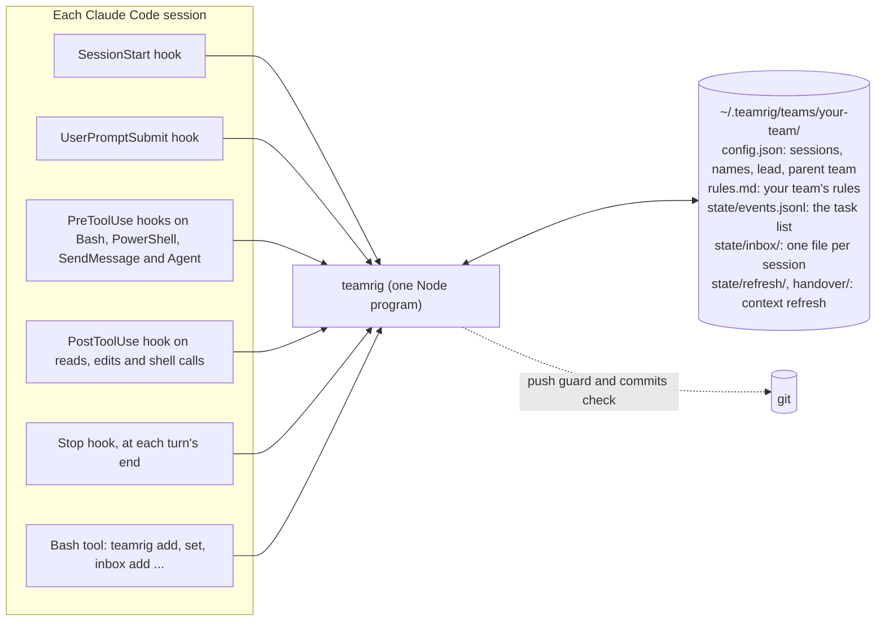
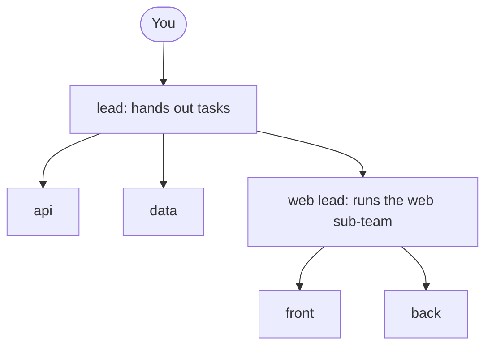
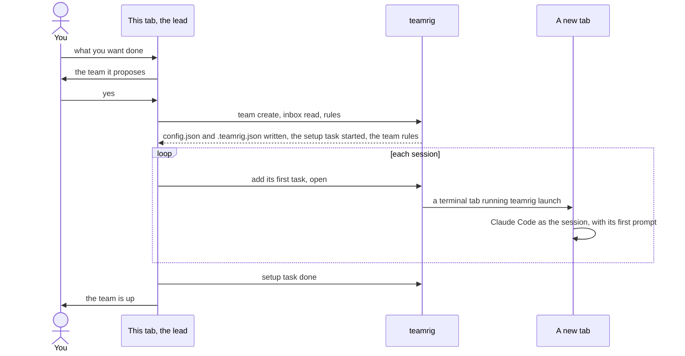
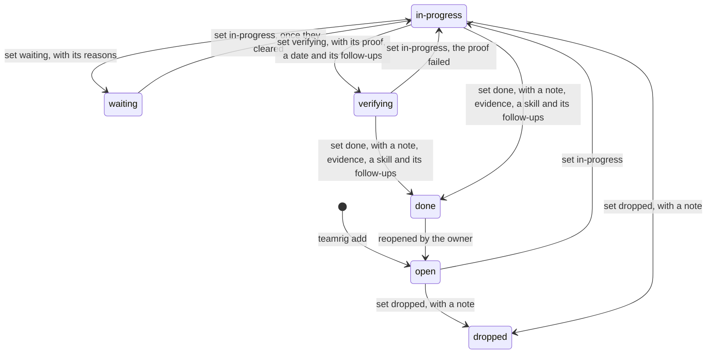
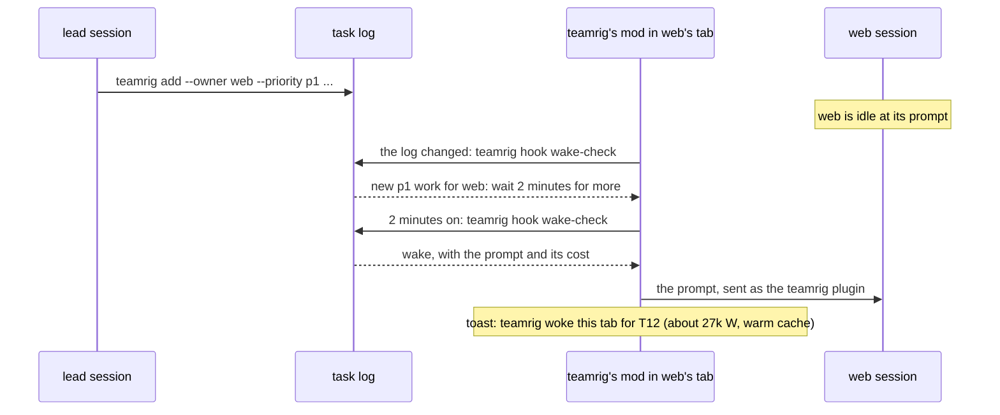
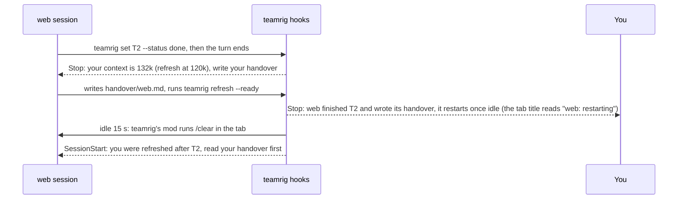
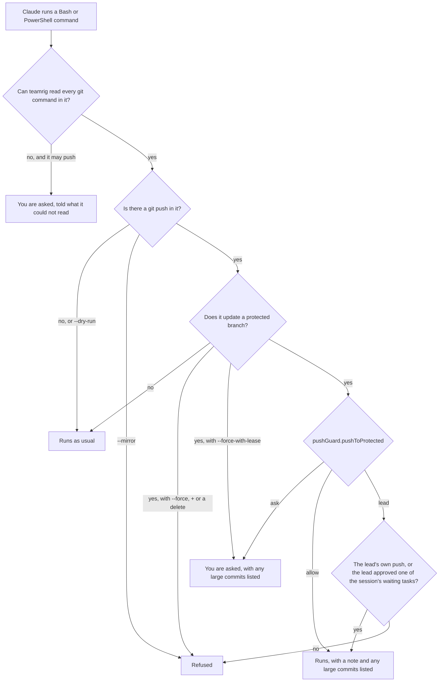
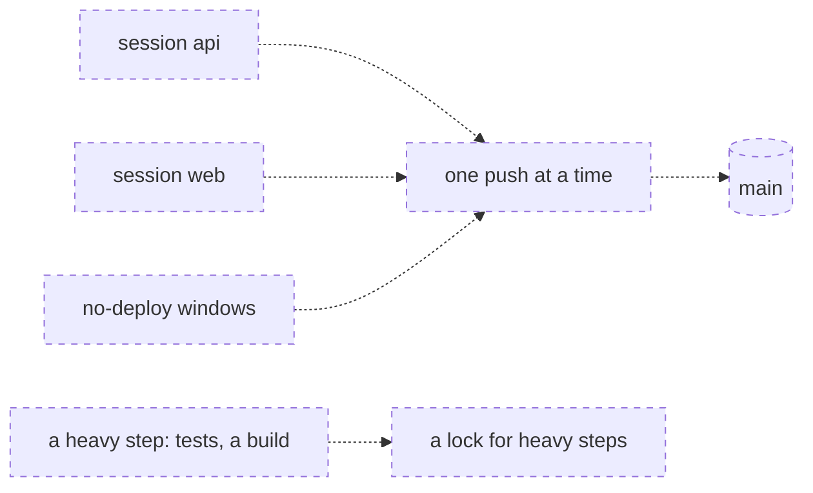
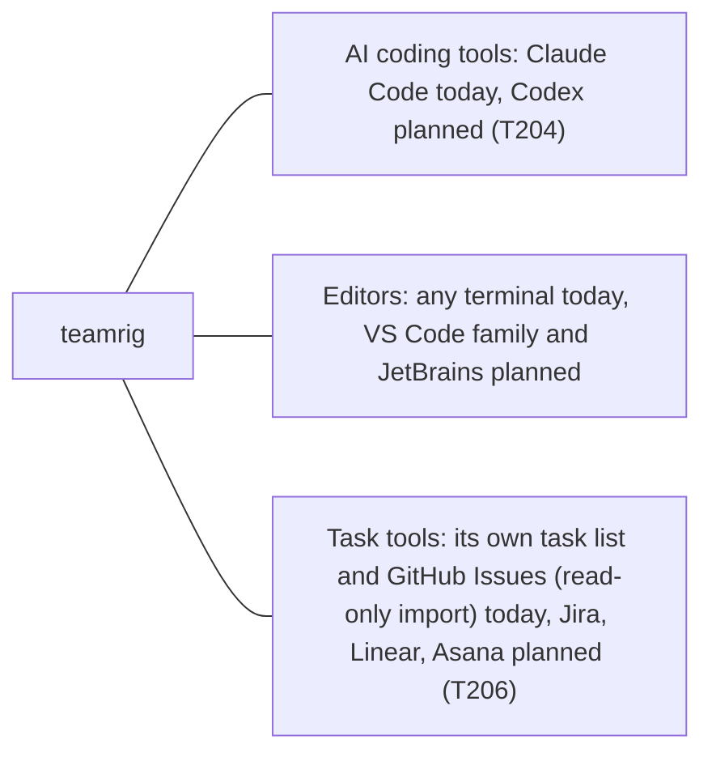

# How teamrig works

teamrig is one small Node program, four Claude Code hooks and a folder of plain files. Nothing runs between
sessions: no server, no daemon, no network. Each part says, as in [what teamrig does](features.md),
whether it works today, is being built (with its task id) or is planned. Parts not built yet are drawn dashed.

- [The parts](#the-parts)
- [Who is on the team](#who-is-on-the-team)
- [Setting up a team](#setting-up-a-team)
- [Updating the plugin](#updating-the-plugin)
- [A task's life](#a-tasks-life)
- [Notes between sessions](#notes-between-sessions)
- [A fresh context](#a-fresh-context)
- [Safe pushes](#safe-pushes)
- [Room for other tools](#room-for-other-tools)

## The parts

Each Claude Code session runs the same `teamrig` program, from its hooks and from its Bash tool, and that program
reads and writes your team's folder.



| Part | When it runs | What it does |
| --- | --- | --- |
| SessionStart hook | a session starts, resumes, is cleared or is compacted | gives the session the core rules, its name, the lead's name, where its team sits in a tree of teams and your team's `rules.md`; tells you and the session, in one MODEL line, when it runs on another model than its `launch` entry asks, with the `/model` to type. It also marks a /clear or a compaction in the session's [turn log](#the-turn-log) and removes the log's hours past `turnLog.keepHours` |
| SubagentStart hook | a session starts a helper | gives the helper the same core rules and your team's `rules.md`, and says whose helper it is: the session, not the helper, sets task statuses, adds register entries and sends messages unless the helper's brief asks for them; a compaction inside a helper gets the same context ([A helper's start](../plugins/teamrig/skills/teamrig-guide/hooks.md#a-helpers-start)) |
| UserPromptSubmit hook | you send a prompt | the session's new inbox lines, each shown once; a line when it binds a hand-started tab by its title, once per cause when it cannot, when it records a Claude Code rename of the session as its team name, or when `.teamrig.json` is broken; once per level, a line telling the session it is past its daily budget while the team has no room today and, by default, is ahead of its pace line; once each, a line when a burst the session is in starts (how to work in it) and when it ends (wind down), and on the lead's tab, once a week, a line when the week's projected surplus is worth a burst ([Bursts](#bursts)); nothing otherwise. It writes the prompt to the session's [turn log](#the-turn-log) |
| PreToolUse hook on Bash and PowerShell | Claude runs a Bash or PowerShell command | finds every `git push` in it, through wrappers, nested shells and git aliases, and asks you or refuses; asks when it cannot read the command ([Safe pushes](#safe-pushes)) |
| PreToolUse hook on SendMessage | Claude messages another session of the team | when the receiver has been idle `messages.coldAfterMinutes` (60 by default) or longer, the message would wake it cold: its first call re-reads its whole context at full price, about 8 times a warm wake. It holds the message once with a note: an inbox line if the receiver need not act now, else every ask for it in one message, sent again; the same tab's next send to it within 15 minutes goes through. Idle time runs from the receiver's last write to its own transcript; a helper, a receiver off the team or one with no transcript yet is never held |
| PreToolUse hook on Agent and Task | Claude launches a helper | with the budget on, asks you or refuses when the session is past its daily budget while the team has no room today and, by default, is ahead of its pace line, or in quiet hours, as `budget.overAction` and `budget.quietHours` say; the lead's helpers and a lifted session's always go |
| PostToolUse hook on reads, edits, shell calls and web lookups | a Read, Grep, Glob, Bash, PowerShell, Edit, Write, MultiEdit, NotebookEdit, WebFetch or WebSearch call returns | counts the calls in a row since the last prompt that each ran one step (a read, a lookup, an edit, a test, a build); when the run reaches `loops.chainNudgeAt` (6 by default; 0 turns it off), gives the model one line asking it to put independent reads, and an edit with its re-test, in one message, priced in context re-reads. Once per run; a helper's calls are not counted. On the lead's tab, also one line at the lead's first edit outside its own files, first test or build, first research (a web lookup, or a search of another session's notes, naming the session to ask) and `leadBoundary.searchNudgeAt`-th code search (3 by default), asking it to hand such work off |
| Mod (`hooks/register.ts`) | in each interactive tab, while it runs; `/teamrig` in every session | runs `/teamrig <command>` in the tab with no model turn: a read at once, a command that changes the team's files only when you typed it, asking first when it adds the tab's session ([the /teamrig command](../plugins/teamrig/skills/teamrig-guide/hooks.md#the-mod-the-teamrig-command)); runs the refresh's `/clear` when the automatic restart asks ([A fresh context](#a-fresh-context)); runs `/reload-plugins` once an installed plugin changed and no turn runs ([Updating the plugin](#updating-the-plugin)); wakes an idle tab when urgent work is handed to its session ([Waking on urgent work](#waking-on-urgent-work)) |
| Stop hook | a turn ends | after a task is marked done, asks for a handover when a refresh is due, then tells you once ([A fresh context](#a-fresh-context)); after a task is set waiting, sends the session back once to its other tasks it can start (not those after the waiting one), outside quiet hours and within its daily budget; tells you once, in a MODEL line, when the session runs at another effort than its `launch` entry asks, or when Claude Code switched it to another model after its safeguards stopped a reply, with the `/effort` or `/model` to type; a Budget line as the session passes each warning level of its daily budget, and when a burst it is in starts or ends; on the lead's tab, a Lead boundary line naming the edits, tests and code searches the lead did itself that turn; nothing otherwise. It writes the turn's reply to the session's [turn log](#the-turn-log) |
| `teamrig` commands | Claude runs them in its Bash tool; you type them in a terminal or after `/teamrig` | the task list, the inbox, names, settings, checks (`teamrig help`) |

A session finds its team through `$TEAMRIG_TEAM`, else the nearest `.teamrig.json` above its folder
(`{"team": "your-team"}`), else the nearest one above `$CLAUDE_PROJECT_DIR`. The folder is `~/.teamrig` unless
`$TEAMRIG_HOME` says otherwise. The task list and the name log change only under a lock, and the inboxes and read
marks only ever grow by a line, so parallel sessions never overwrite each other.

## Who is on the team

A team is a list of sessions with one lead, and a lead may also lead sub-teams; each session learns at start who it
is and whom to message.



You ask one tab for the team in plain words, and it opens a tab for each other session
([Setting up a team](#setting-up-a-team)). At start the session reads "You are the `web` session of team
`your-team` (name `your-team-web`). Message the lead as `your-team-lead`." A session the config gives no name is
called `<team>-<id>`. `teamrig who` prints every session's name, and `teamrig rename` gives a session a new name
while its old names keep finding it until another session takes one. A Claude Code rename of the session
(`/rename`, `claude --name`) is recorded the same way at its next prompt or start, as if it ran `teamrig rename`.

A team grows into a tree of teams when a lead hires sub-team leads, each running its own sessions, and you still
talk to one lead: the root team's.

- Each team keeps its own folder, config, task list and inboxes. Its config names its parent team
  (`"team": {"id": "web", "parent": "your-team"}`), so the tree is read from the configs, with no other file to keep
  in step. A tree has at most 3 levels and a team at most 8 child teams.
- A member writes notes to its own team only. A lead also writes to its parent team's lead and to its child teams'
  leads, so a question for you goes up lead by lead to the root. Anything else is refused: escalate through your lead.
- Claude Code session names are machine-wide, so two teams never share one: `team create` refuses a clash and
  `teamrig doctor` names one, along with a broken link in the tree.
- `teamrig team tree` prints the tree with each team's lead and sessions.

The lead hires a temporary member for one job with `teamrig hire`, within the team config's `hiring` block:

- `policy`: `off` (no hires by command), `owner` (the default: each hire names who approved it), `lead`, or
  `automatic` (the lead decides, and a hired session whose last open task closes is asked at its next turn end to
  write its handover and retire itself).
- `maxSessions` (2) hired members at once; each gets its part of the team's daily budget by its share and queued
  work, like any session; `reviewDays` (7) sets a hire's review day.
- Each hire is logged in `state/hires.jsonl` with its job, reason, approver, model, effort and review day. `teamrig check` flags a hired session with no open task for `idleHours` (4) as RETIRE-DUE, and one past its
  review day as REVIEW-DUE.
- `teamrig hire --burst` hires for the burst in force ([Bursts](#bursts)), within its hires as well as these caps,
  on the lead's model and at least its effort; the burst's approver approves it. Once the burst is over, `check`
  flags the hire RETIRE-DUE.
- `scaleOut` says when to hire: `check` flags SCALE-OUT on an area (never the lead or a hire) when more of its dated
  work is due by a date than its pace finishes by then. Its pace is the tasks it finished over the last `windowDays`
  (7), once it finished `minDone` (3); its dated work is its active tasks of the top `topPriorities` (2) priorities
  with a due, their own or that of a task that needs them. The flag names the slice to move (the latest open tasks no
  started work needs) and its cost, a new hire's part of the team's daily budget today, a day until the slice's last
  due or the week's pace end; the areas furthest behind are paid first, out of the week's projected spare, and none
  once it cannot pay or the team's daily budget is unknown. Its action moves the slice to an idle hire, else hires
  within `maxSessions`, else brings the owner a card to raise it. The hire retires as RETIRE-DUE once its slice is
  done.

When its job is done, the lead retires it with `teamrig retire <id>`. It refuses while the session owns open tasks
unless `--to <heir>` takes them, and without its handover note (`handover/<id>.md`) unless `--no-handover "<why>"`.
It takes the session's keys out of `sessions`, `names`, `launch` and `budget.sessions`, keeping the old config in
`backups/`, and logs the retire in `state/hires.jsonl`. Its tasks, inbox and records stay where they are, readable by
its id, and `teamrig doctor` reads its inbox as kept, not orphaned.

Hiring a retired id again is a rehire. `teamrig hire` shows the retire and handover it comes back from and measures
the last Claude Code session that read its inbox: when its transcript is still in the project folder, its context is
at most `resumeMaxTokens` (250,000) and it was idle at most `resumeMaxIdleDays` (7), `teamrig open <id> --resume`
goes on in it. Else `teamrig open <id>` starts it fresh, its first prompt sending it to the handover.

## Setting up a team

You tell Claude in any tab what you want the team to do: building, research, writing or any other work, for example
"Price our new plan: one session gathers competitors' prices, one models price points, one drafts the
recommendation." If you ask for a team without saying what for, it asks you first. The plugin's `team-setup` skill
proposes a team in a few lines, and on your yes:



- `teamrig team create signup --sessions api,web,tests` writes the team's `config.json` and ties the project folder
  to it with `.teamrig.json`, which it keeps out of git in that clone (`.git/info/exclude`). The lead's first task,
  `Set up the team`, goes in the task list in progress, so the setup shows in the task pane like any work, and the
  lead closes it once every session runs its first task. It refuses another team
  with the same id and a project tied to another team, a repeat changes nothing once both are in place, and
  `--dry-run` prints what it would write. `--parent your-team` hangs the new team under that
  team's lead; it refuses a parent with no config, a tree deeper than 3 levels, a team's 9th child team and a
  session name another team uses.
- The tab that ran the setup becomes the lead without a restart. `teamrig inbox read --session lead` ties its Claude
  Code session to the lead, so the hooks still know it after a compact or a resume, and `teamrig rules --session lead`
  gives it the rules it missed at start. Its next prompt titles the tab with the lead's name, and Claude Code keeps
  that title across a `/clear`, so the session a `/clear` starts binds itself to the lead by it.
- A tab you start by hand binds itself when its Claude Code title (`claude --name`, `/rename`) is a session's id or
  current name on the team of the folder it started in, and on no other team of the tree. The hooks then know it as
  `inbox read` would, but nothing is marked read. A title that names no session, or sessions of two teams, binds
  nothing, and the prompt hook says once how to bind the tab. `$TEAMRIG_SESSION` and an earlier binding always win.
  A bound tab with no title gets its session's name as title at its next prompt (`sessionTitle` in the prompt
  hook's answer); a tab with a title keeps it.
- `teamrig open <session>` opens a tab in tmux (when run inside tmux), Windows Terminal, macOS Terminal, GNOME
  Terminal, Konsole or x-terminal-emulator, in that order; `open.terminal` in the config or `--terminal` picks one.
  It refuses any session but the lead, and `hire --yes` refuses a hire, when the host has no room for one more:
  free memory over `coordinator.heavy.memoryFloorMb` and the commit charge within `open.headroom.commitMaxPct` (92%),
  with the session counted at the median running one, else `open.headroom.sessionMb` (1200 MB). A session
  `teamrig close` ended goes on in its last Claude Code session when that is small and recent enough, else opens
  fresh; `state/session-log.jsonl` logs each close and reopen. `teamrig close` (the lead) ends only a session
  quiet `open.headroom.closeIdleMinutes` (60) or more, with no work it can start, no background work or shells, and
  small and recent enough to resume.
  The tab runs `teamrig launch`, which sets `$TEAMRIG_SESSION` and starts `claude --name <name> "<first prompt>"`,
  with `--model` and `--effort` from the session's `launch` entry in the config. The lead, for each it leaves unset,
  starts on `opus` (Claude Code's newest Opus) at `xhigh` effort; the others on Claude Code's own. The `OPENED` and
  `Starting` lines name the model and effort a tab starts on, and `launch.<id>` in the config changes either one.
  When no terminal opens, it prints the command to paste and exits 3. `teamrig open web/lead` opens a session of
  another team in the same tree.

## Updating the plugin

Claude Code installs the version that the plugin's `plugin.json` gives and moves an install only when that version
rises, so every change to the plugin raises it. To take the newest one:

```sh
claude plugin marketplace update teamrig
claude plugin update teamrig@teamrig
```

Each open tab then takes the new version by itself: teamrig's mod (`hooks/register.ts`) reads Claude Code's
`installed_plugins.json` every 15 s, and once an install changed (any plugin's that applies to the tab), the file
has read the same for 10 s and nothing in the plugin store changed for 10 s (an install still copied into the
cache), it runs `/reload-plugins` in the tab while no turn runs. It runs at most one reload per 5
minutes in a tab and never two for the same installs; a refused one goes to Claude Code's debug log and is tried again
5 minutes later. A tab that does not load mods (an older Claude Code, mods off) or a plugin loaded with `--plugin-dir`
still needs `/reload-plugins` typed, or a restart. Claude Code does not check this marketplace for updates by itself
unless you turn on its auto-update in `/plugin`, under Marketplaces.

The `teamrig` the Bash tool runs is the first plugin `bin` folder on its PATH. Claude Code adds the tab's own at the end
of PATH and, from version 2.1.301, adds the new one again after `/reload-plugins`; an older Claude Code keeps the
version the tab started with until it restarts. A session teamrig starts (`teamrig open`, `teamrig restore`) leaves
the opener's plugin `bin` folders off the PATH it hands on, so its Bash tool runs the session's own install and follows
its updates.

## A task's life

Every task has one owner, and only the owner moves it; these are the usual moves.



- The owner may move a task from any status to any other; the register keeps every move.
- `done` takes `--skill none` or the name of a skill in your Claude Code skills folder; setting a task to its own
  status again needs `--note`; `add` refuses a title an open, in-progress, verifying or waiting task already has.
- `verifying` and `done` take `--followups` with the tasks the work leaves, each already on the list, or `none`, so a
  finding written only in a notes file cannot close unseen [register.requireFollowupsOn]; `show` lists them.
- `verifying` is a change that has shipped and waits for what proves it: a test run, a night's flow, a number.
  `--proof` names that proof, and `--due` the date to verify it by. It stays active, so `list`, `check`,
  `teamrig verify`, the session's start context and `inbox read` keep it in view until the owner sets it `done`
  with the proof as evidence. Work that needs it waits for that proof: its start is refused until then
  (`register.verifyGate`), and the owner hears of it in its inbox. A start that names what met the proof
  (`--met`) goes through, and the owner is asked to confirm it (`done`) or reopen the task. The owner's own first
  start of new work also waits while one of its verify steps is due: its proof's waits cleared, its verify-by day
  came, or it holds more than `register.maxVerifying`, so shipped changes get proven instead of piling up.
- `waiting` is a started task that cannot go on, with every reason it waits for (`--waits`): a decision or an
  approval (the lead's or the owner's; a peer's work is a task, asked for with `set --ask`), another task to
  finish first, or a time. It stays waiting until all of
  them have cleared: a task when it is done or dropped, a time when it passes, a decision or an approval only when
  the owner sets the next status. A task not started that needs another first is not waiting: it stays `open`,
  planned after it (`teamrig update T3 --after T2`), and its line shows `after T2`. A `blocked` written by an
  older teamrig reads as `waiting` with no reasons.
- A wait on the owner reaches the owner through the lead, in batches, so the owner is not interrupted once per
  wait. A wait counts as asked once the lead records a batch asked (`teamrig decisions asked`, kept in
  `state/decisions-asked.json`) or starts the daily meeting after it was set. A batch is due when a wait not yet
  asked is due before the next batch time (asked at once), `decisions.batchAt` waits are not yet asked, or a
  `decisions.batchTimesUtc` time passed; the lead's `start` and `check` say so in one line, and `teamrig
  decisions` prints the batch.
- A task's effective due is the earliest of its own due date and the effective dues of the active tasks that need
  it (planned after it or waiting on it), so the work a dated task needs inherits its date: a row shows it as
  `due 10-17 (from T9)`, and lists, `plan`, the meeting's late tasks and `check`'s date flags go by it. A row
  also names another session's active task that needs it (`· needed by T9 (api, due 10-17)`); `show <id> --tree`
  prints what the task needs and what needs it, then the next move (who acts first, on which task); `start` and
  the live task list name the other sessions' tasks waiting on the session (`WAITING ON YOU`). A plan (`--after`)
  or a wait (`--waits task:`, `--ask`) that would close a loop is refused: no task in a loop can finish.
- `teamrig update` changes a task's title, owner, priority, ref, due date, goals, week, the tasks it comes after, its
  size or its problem mark (`--problem`; `none` clears the ref, due date, goals, week, plan or size, and marks it no
  problem), never the status; on a task it does not own, the lead may change the owner, priority, due date, week,
  plan order, size or problem mark, and any session may add a `--note` alone as context.
- `teamrig check` reports tasks past their effective due, not picked up 24 hours after they were handed out, untouched for 72 hours,
  or due this week but left out of the week's plan, and owner orders left out of it. A verifying task past its due
  date is `VERIFY-OVERDUE`: it was not verified by then. One with a due date is not called stale while it waits. A verifying task another task needs is `VERIFY-BLOCKS`, and a session holding more than 5 (`register.maxVerifying`) gets a `PILE-UP` on its oldest. Tasks that need each other in a circle (rows an older teamrig could write) are a `LOOP`, flagged on the lowest-numbered one. The first sized task of the week that no longer fits the weekly usage limit left is `OVER-LIMIT` (`plan` prints that line). A waiting task whose every reason has cleared is `READY`, one waiting on a peer's decision or approval, as an older teamrig wrote it, is `PEER-WAIT`, one waiting on the owner with no decision card is `NO-CARD`, and one the owner ordered that asks the owner with no `--why-ask` is `OWNER-ORDERED` (an order approves its own work and proof). It also reports a session that
  skips its own priorities: `PRIORITY-SKIP` is a task in progress for over 24 hours
  (`register.check.prioritySkipAfterHours`) while the same session has an open p1 free to start (every task it comes after finished), counted from the latest change of
  owner, status or priority on either task. `SELF-MADE` is a session that added more than 10 tasks for itself
  (`register.check.maxSelfMadePerDay`; created by it, asked by no one else) in the last 24 hours, raised on the
  first of them past that count still active: work nothing asked for, piling up that fast, may be a loop or a drift
  from the goal. `OFF-GOAL` is a task in progress with no goal outside the week's plan:
  work nothing in the plan asked for. teamrig has no parent tasks yet, so a goal tag or the week is what ties a task
  to the plan. `STOPGAP-DONE` is a `stopgap T<id>` tag whose task is done or dropped, in a skill or in the files
  `register.check.stopgapFiles` names (default `CLAUDE.md` and `.claude/rules` in the project folder): the stopgap
  it marks is due to go. Then it flags skills in your Claude Code skills folder that break the skill rules. It reports and never
  blocks.
- `teamrig list` and `teamrig check` print a short form within 3,000 characters by default, since a session reads
  them at every work block: counts, short rows and `+N more`. `--all` prints every field of every task or flag.
  A command line teamrig cannot read prints only that command's usage lines; `teamrig <command> --help` shows them.
- A lead hands a child team work with `teamrig add --team web --title "..." --description "..." --priority p2`: the task lands in `web`'s own
  list, owned by `web`'s lead and marked as from `your-team/lead`, and `web`'s lead splits it among its sessions
  and opens them. Only the parent team's lead may do this.
- `teamrig list --tree`, `check --tree` and `plan --tree` give a lead its team's tasks and those of every team
  under it, with ids like `web/T4`. They only read the other teams' lists. With `--tree`, `--session` names the
  lead asking, so a tab without `$TEAMRIG_SESSION` passes `--session lead`.
- The task list is one log that only grows, a line for every move. `teamrig compact` archives it: the log becomes
the next file in `state/archive/` byte for byte and is never deleted, a fresh log starts with a line naming it,
and `state/snapshot.jsonl` holds every task as it stood, so commands and the task pane read the snapshot and the
recent lines instead of the whole history. Tasks done or dropped over 8 days ago, in no week plan from the current
one on, leave the snapshot: `show`, `list --status done` and the plan of a past week still read them from the
archive, and a task that left cannot be changed. `compact --dry-run` prints what it would archive and write, and writes nothing; a real run first
reads the new files back and holds every task against the whole history, and writes nothing on any difference.
After that first `compact`, a write that leaves the log over 512 KiB archives it again and says so in a NOTE line,
or keeps the write and warns when archiving fails (the next write tries again). Both lines name the switch that
turns this off: `register.autoArchive: false` in the team's `config.json`, after which only `compact` archives. Every session must run teamrig
0.3.1 or later before the first `compact`: an older one refuses to write to an archived task list.
- Move every session to teamrig 0.7.0 or later before anyone sets a task `verifying`. An older teamrig skips that
  line with a warning (`1 unreadable line(s)`) and shows the task at its status before it, though it still writes;
  and its `compact` would leave the line out of the new snapshot, so never run `compact` from a teamrig older than
  0.7.0 on a task list that holds one. The default `register.requireNoteOn` already names `verifying`: list it in
  a `config.json` of your own only once every session runs 0.7.0, as an older one reports it as a config problem.
  From 0.7.0 on, a status a later teamrig adds reads as a line from a newer teamrig: the task keeps its last
  status, writes go on, and archiving waits until this teamrig is updated.
- Being built: dependencies and parent/child tasks (T205); planned start, ETA, history and token estimates
  (T209–T211).
- Token use: `teamrig budget` reads each session's use from the Claude Code transcripts (only the lines added
  since its last run, kept per session and day for 8 days in `state/usage/`) and shows it against the week's pace
  line. The team's daily budget is never a fixed number: at every reading, what is left to the target is spread
  over the active time to the pace end (quiet hours count at `budget.quietHours.paceWeight`), and each session's
  part of today's is its share times its queued work, after the lead's lifts.
  The week's use in percent comes from status line snapshots (`teamrig statusline install` sets the status line
  up), else from the metered W at the week's W per percent: learned from `state/usage/meter-log.jsonl` (a line
  each time the status line passes a whole percent, fitted once 8 weeks of lines span 10 points), else
  `budget.weeklyLimitW`. Past 100% of the week, what is left is the extra-usage pool the lead enters with
  `teamrig budget extra` (its W per dollar learned from two spent readings, else `budget.extraWPerUsd`), spread the
  same way. A subagent's W is multiplied by `budget.subagentWeight` (default 1), what
  one W of a helper costs in W of a main session, so all W share one price. A session past its part is held (only
  p1 work wakes it, and it escalates as `budget.escalate` says) only while the team has no room today: everyone's
  use today, the use outside the team included, at or past the in-day pace: today's use in quiet hours, plus today's
  allowance times the share of today's active time gone by (the quiet-hour use already lowered the allowance, so a
  night a lift worked through does not read as a morning past the pace). So no session waits while the week has
  room. The hooks warn a session as it passes its daily budget, tell the lead, and can hold its helper launches (`budget.overAction`,
  `budget.quietHours`). The lead sets that policy with `teamrig budget setup`, which shows the change before it
  writes it.

## Bursts

A burst is a time-boxed scale-out for when the week will end with tokens unspent, or work must land by a time.
For its time, each session in it gets a daily budget of at least the burst's floor and may run more helpers at
once; the lead may also hire sessions for it. The same gates hold as on any other day. Like the team's daily
budget, the floor is never fixed: at every reading, what is left to the burst's stop % is spread over the active
time to the burst's end by the same pace rule, and its sessions share today's part evenly, so a burst that spends
fast gives less a day and one that spends slowly gives more. The floor at its start is kept in its record.

- Who starts one: a person, by command, never a hook. `teamrig burst` shows the week, its projected surplus and
  what to run; `teamrig burst start surplus|deadline --reason "<why>"` previews the burst, and `--yes` starts it.
  `burst.policy` is `owner` by default (each burst names its approver with `--approved-by`, since spending more of
  the week is a budget call), `lead`, or `off`. No value starts a burst by itself; the lead's hook only suggests
  one, once a week, when the surplus is worth it.
- A surplus burst covers the whole team (or `--sessions`) from `burst.surplusHours` (48) before the reset until the
  pace end, once `burst.minSparePct` (5%) of the week is projected unused: the use so far plus the week's mean
  rate so far, nights included, until the pace end, against `budget.targetPct`.
- A deadline burst covers the owners of its `--task` tasks (or `--sessions`) until `--by`, at the latest the reset,
  and needs a `--stop-pct`.
- Its bounds: the stop % is at most `budget.targetPct`, so a burst never spends the incident reserve; it ends at its
  time, when the week reaches its stop %, or by `teamrig burst end --reason "<why>"`. It runs up to `--helpers`
  (`burst.maxHelpers`, 3) at once per session and `--hires` hired sessions (`burst.maxHires`, 2; none unless set).
  Quiet hours still apply, and a lift wins over it for its session.
- How its sessions work: the model is told once, with the next prompt, to split only independent tasks, to give
  each edit in a repo its own worktree, to integrate one change at a time, to keep its model and effort for its
  helpers and never to skip a test or check. A burst hire runs on the lead's model at no lower effort.
- Its log: each start and end is a line in `state/usage/bursts.jsonl`; `teamrig budget` marks a session's budget
  "(burst)" and names the burst, and `check` flags its hires RETIRE-DUE once it is over.

## Notes between sessions

A note is one line added to the receiver's inbox file; the receiver hears of it at its next prompt.

```mermaid
sequenceDiagram
  participant L as lead session
  participant F as inbox file of web
  participant Y as You
  participant W as web session
  L->>F: teamrig inbox add --to web --text "T2 is ready"
  Note over W: web is idle, and a note does not wake it
  Y->>W: your next prompt to web
  W->>F: the UserPromptSubmit hook reads the lines it has not shown this session
  F-->>W: INBOX web, new in ... (each line is shown once; reading marks them read)
  W->>F: teamrig inbox read marks it read, without printing it again
```

- The inbox file is never edited: `inbox read` adds a mark to `state/inbox-marks.jsonl`.
- The prompt hook shows at most 5 new lines and 1,500 characters at a time, cuts a longer line, and says how many
  wait. It records what it showed each Claude Code session in `state/inbox-shown.jsonl`; that is not a read, so
  `inbox status` counts those lines unread and says how many of them a prompt showed. Its records over 7 days old, and
  those of the hooks' hints in `state/bind-hints.jsonl`, move to `state/archive/`.
- You may trim an inbox file by hand; the read mark notices, and if the last line read is gone, the whole file
  counts as unread.
- A note is one line; an empty line, several lines or a line that looks like a secret is refused. A secret here is
  a GitHub, AWS, Slack, Anthropic, Google or Stripe live key, an `sk-` API key, a private key block, a JSON web
  token, credentials in a URL or a `password=`-style assignment, plus your `register.secretPatterns`. The
  refusal names the kind, never the value. Task titles, refs, notes and evidence get the same check.
- In a tree of teams, `--to web/lead` writes to a session of another team, within the rights in
  [Who is on the team](#who-is-on-the-team); the note names its sender as `your-team/lead`.
- A note wakes no one; urgent work handed as a task does ([Waking on urgent work](#waking-on-urgent-work)). A task
  that wakes no one, a p2 one by default, waits for its owner's next prompt, which is why `teamrig check` reports
  a task not picked up.

## Waking on urgent work

An idle session sees new work only at its next prompt. When urgent work is handed to one, teamrig's mod wakes it: it
sends the session a prompt through Claude Code's own call for one, as the teamrig plugin, and the session takes a
turn of its own. Nothing is typed into the terminal, and the prompt box and any draft in it are left alone.



- What wakes a session: a task it owns that another session handed to it, raised, reopened or freed by finishing a
  task it comes after or waits on, or whose waited-for time came (its own changes are not news), that it can go on
  with: open or in-progress, or waiting (a verifying task's proof waits) with every wait cleared, as `teamrig check`
  flags READY; a task never started also has every task it comes `--after` finished. At `wake.priority` or more
  urgent (p1 by default). Held by its budget (past its daily budget
  while the team has no room today), or in the budget's quiet hours unless the lead's lift exempts it, only p1 wakes it, whatever `wake.priority` says. While the owner's
  daily meeting is open the lead is not woken; the work waits for the first check after the meeting.
- How often: each task wakes a session once. The first new task starts a batch of `wake.batchSeconds` (120 s), and
  one wake names every task handed meanwhile; wakes of one session are at least `wake.minGapMinutes` (15) apart.
  Work that was there when the tab started, or before a `/clear`, is seen at its first prompt, as before.
- The day start: a session idle since the night is not woken by work already on its list, so with
  `wake.dayStartUtc` set (an `HH:MM` UTC outside the budget's quiet hours; unset by default) each session with work
  it can go on with (its own, of any priority, as above) and no turn since
  that time gets one wake that day, and so does each session in a burst once the lead starts it. A session that had
  a turn since is not woken; one in quiet hours or held by its budget, or with nothing it can start, is woken
  once that changes. The wake log marks these wakes with `moments` (`day-start`, `burst`).
- What it costs: a wake is a model turn whose first call re-reads the session's context, about 27k W while Claude
  Code's cache is warm and about 210k W once the session has been idle `messages.coldAfterMinutes` (60) or more, or
  when its transcript is not found. The prompt and a toast give the cost and its share of the week
  (`budget.weeklyLimitW`). Each wake is a line in `state/wakes.jsonl` (session, tab, tasks, W, cold or not); a wake
  a prompt hook refused is logged there with its reason.
- When it looks: every 15 s while no turn runs (a subagent's included), the mod runs `teamrig hook wake-check` once
  the task log (`state/events.jsonl`) changed, a batch fell due, or 10 minutes passed. Each check holds a lock of the
  session's, so two tabs never wake it twice; a session open in two tabs at once is not woken, since each tab's first
  check starts the count over.
- `wake.enabled: false` turns it off. A headless `claude -p` or a Claude Code that does not load mods is never woken.

## A fresh context

A long session gets slow and costly, and what it was told early on fades. teamrig lets it start again at a task
boundary without losing the thread.



- The Stop hook reads the context size at every turn end, from the last reply in the session's transcript, so a
  long task refreshes before Claude Code compacts it; at a task end (`set <id> --status done`) it names the task.
  A session that goes on without its fresh start (you typed, or never typed `/clear`) is asked again at its next
  task end, or once its context grew a fifth of `refresh.contextTokens` more; a compaction or a `/clear` brings
  the ask back to the threshold.
- A session busy in one long turn is asked within it: after each tool result teamrig's mod checks the context, and
  past the threshold it adds the ask to the result (finish the step, write the handover, end the turn). Until the
  fresh start, Claude Code's own compaction waits, up to `refresh.compactCeilingTokens` (185,000 by default, 15k
  under a 200k window), so the fresh start replaces it; past that it compacts, so the session never runs out of room.
- The owner's daily meeting is never cut off: while it is open, the lead is not asked and not restarted, up to
  `refresh.compactCeilingTokens`; the end of the turn that runs `teamrig meeting end` asks at once.
- Two rules in the team config ask for it. `refresh.contextTokens` (120,000 by default) refreshes at that size,
  well before Claude Code compacts a 200k window at about 167k. `refresh.everyTasks` (3 by default) refreshes at
  every third finished task once the context is at `refresh.everyTasksMinTokens` (80,000) or more, so a session
  that grows slowly still gets a fresh start; a `/clear`, a new process or a compaction starts the count over.
- The lead can ask for a refresh at any size: `teamrig refresh web` applies at web's next turn end.
- It waits while work the session started in the background still runs (subagents, background commands,
  monitors, workflows): a fresh start would cut it off, so the hook asks for the handover, and later restarts
  the session, only at a turn end after the last of it reported back. The restart also waits while a turn still
  runs (a turn stopped with Escape counts as ended). Both read that from the transcript (helpers started within
  the last 6 hours); with teamrig's mod on, the tab also asks Claude Code itself before each `/clear`, so a refresh
  waits while the session still runs a helper the transcript no longer shows.
- `refresh --ready` is refused until the handover is written: missing, blank or unchanged since the hook asked.
- A hook cannot run `/clear`, but a plugin mod can (`refresh.autoRestart`, off by default: the user types `/clear` once done with the screen). A hidden
  `teamrig restart` waits until the session has been idle `refresh.restartDelaySeconds` (15) with nothing running,
  then leaves an ask for its tab. teamrig's mod (`hooks/register.ts`) looks for it each second, claims it while
  the restart is still pending and runs `/clear` in the tab, so the tab and its process stay and Claude Code runs
  its own SessionEnd and SessionStart hooks. It holds the `/clear` for you first: while the prompt box holds a draft,
  for `refresh.holdAfterActivityMinutes` (5) after your last key or prompt, and 10 minutes after you press Hold; then
  a band above the prompt counts `refresh.countdownSeconds` (20) down with `1: Refresh now` and `2: Hold 10 min`.
  While Claude Code lists a live agent of the session (`$.agent.list()`:
  a helper or teammate not completed, failed or killed), or will not list them, the mod holds the ask instead
  (`hook clear-claim --hold --why <reason>`) and runs nothing: the restart ends nothing, waits for quiet and asks
  again, and an hour after it started gives up as it does for a busy session. Each hold's reason goes in
  `<session>.held` beside the ask's outcome, which stays the one word `held` that an older restart reads, and the
  give-up's why names the last one; a helper's hold names each live agent's type, status and task. When no mod claims the ask within 10 s (a Claude Code that does not
  load mods), the restart ends the session's Claude Code and starts it again: in the same tab when `teamrig open`
  started it (`launch` starts it again), else in a new tab; if a turn ran meanwhile, it waits for quiet and asks
  again first. It never ends a Claude Code that still runs a background shell (a background command or a monitor),
  since the end would take that too: the session gets an inbox line to type `/clear`, which keeps it. A prompt you send first cancels it and keeps the context; text typed but not sent holds the mod's `/clear`, and is lost only where the restart ends the process. When it is off or cannot start, you type `/clear`. On Windows an ended process runs no
  SessionEnd hooks, so `refresh.endCommand` can name a program to run in their place. A compact or a resume
  keeps the handover waiting for the next fresh start.
- The fresh session keeps who it is and carries on by itself. The restart starts it with a prompt to read its
  handover first; after a `/clear`, `hook refresh-wake` starts its first turn with the same ask, so it never sits
  idle. A `/clear` keeps its id by the tab's Claude Code title or, when the title names no session, by the
  Claude Code process it refreshed in (for 24 hours).
- The session-start note lists what the old session leaves, read from the last 64 MB of its transcript: its
  scheduled jobs (CronCreate), a pending wake-up (ScheduleWakeup) to make again, its scratchpad and its plan
  file. A `/clear` keeps the process and so its jobs: the note says they are still scheduled, and lists them to
  make again only after a new process. A job made before the last compaction is missed, and a wake-up can fire
  twice after a `/clear`.
- `refresh.enabled: false` turns it off, `refresh.tabTitle: false` leaves the tab title alone and
  `refresh.handoverDir` moves the handovers. With `tabStatus.enabled`, the tab's state circle goes before that
  title ([tab status](../plugins/teamrig/skills/teamrig-guide/hooks.md#every-event-tab-status)).

## The turn log

A refresh, by hand or automatic, wipes what the tab showed. So teamrig keeps each session's prompts and replies
for a day, for the task pane to show: one file per session and UTC hour,
`state/turn-log/<session>/<YYYY-MM-DDTHH>.jsonl`, one JSON line per prompt you sent, per reply the session wrote
(every text it showed in the turn, not only the last) and per /clear or compaction. Secret shapes are masked as
in the register, and an entry keeps at most 64,000 characters, the end of a longer one. Entries are only appended,
and each session start removes the hour files wholly past `turnLog.keepHours` (24 by default, 1 to 168), so a
busy session keeps a day's worth and no file is ever rewritten. `turnLog.enabled: false` writes nothing. A reader
parses each line with teamrig's own `parseEntry` (from `src/read/index.ts`, below).

## Safe pushes

Before Claude runs a `git push`, teamrig reads the command and asks you, or refuses, when it would change a
protected branch (by default `main` and `master`, set in `pushGuard.protectedBranches`; an empty list guards nothing).



- `pushGuard.pushToProtected` (since 0.11.0) is `ask` by default; set to `allow`, a normal push to a protected branch
  runs with a one-line note instead of a question, and Claude Code's own permissions still decide. Each question
  about a normal push ends by naming this switch.
- Set to `lead` (since 0.126.0), the lead approves pushes instead of the human: the lead's own runs with a note; a
  session's runs with a note while the lead's `teamrig approve` stands on one of its tasks waiting `approval:<lead>`
  (until the task's next status), and is refused otherwise, with how to ask on the register. The human is never
  asked about a normal push, and the refusal holds whatever `prompts.hookAsks` says.
- `--force-with-lease` is asked, not refused, under either setting. `commits.gate` set to `refuse` turns the ask (or
  the allowed push) into a refusal when a commit is over the size rule (400 changed lines or 15 files, tests not
  counted) with no `Large-commit:` reason.
- `--all` is asked, and refused with `--force` or `--prune`; large commits are those not yet on the last-fetched
  `origin/<branch>`.
- `teamrig commits check --base <ref>` runs the same size rule in a script or CI.
- Outside a project tied to a team, the guard stays silent.

The guard splits the command into words the way its shell does (bash, PowerShell or cmd quoting), so it finds a
push wherever it sits in the line:

- git's own options: `git -C <dir> push`, `--git-dir`, `-c key=value`, and `GIT_DIR` or `GIT_CONFIG*` variables;
- chained, piped and multi-line commands (`&&`, `||`, `;`, `|`), subshells, `$( )` and backticks;
- wrappers and other spellings of git: `env`, `command`, `sudo`, `nohup`, `timeout`, `xargs`, variable prefixes,
  `git.exe`, a full path to git, `git-push`, and PowerShell's `& git` or `& 'C:\...\git.exe'`;
- nested shells: `bash -c`, `sh -c`, `eval`, `pwsh -Command` (also `-EncodedCommand`), `Invoke-Expression`,
  `Start-Process`, `cmd /c` and `start`, and a heredoc or here-string a shell reads as its script (`bash <<EOF`,
  `cat <<EOF | bash`); one that any other command reads is that command's input, not commands;
- git aliases (from `-c alias.x=`, from a `git config alias.x` earlier in the line, or from git config, `!` shell
  aliases included) and the commands git runs itself (`submodule foreach`, `rebase --exec`, `bisect run`);
- folder and branch moves earlier in the line: `cd sub && git push`, `git checkout main && git push`;
- bash variables set earlier in the line: `B=feat; git push -u origin $B` reads as `git push -u origin feat`,
  and `B=main; git push origin $B` still asks. `NAME=value` or `export NAME=value` must run before the push,
  through `;`, `&&`, a newline, a `for`, `while` or `until` loop, an `if` or a `{ }` group, in the same shell or
  in a subshell started after it (`( )`, `$( )`), and the line must never give the name another value. The
  value may hold quoted text, blanks and variables set the same way before it; used unquoted, it splits into
  words as bash splits it, so `G="git -C /w"; $G push origin main` still asks. `$HOME`, and a value's leading
  `~` or `~/`, read as your home folder in the line's own shell, while the line gives HOME no value of its own;
  a script the line starts, such as `bash -c '...'`, may be handed another HOME, so there it stays unknown. A
  value with a substitution, any other tilde (`~bob`, `a:~/x`) or a file name pattern, a prefix
  (`B=x git push origin $B`), an assignment in a subshell, a loop, an
  `if` or a `{ }` group, a `for` loop's own variable, or anything else on the line that can set a variable unseen
  (a `${...}` that assigns or runs arithmetic, such as `${B:=x}` or `${B:1}`, or reads a name indirectly,
  `${!R}`; `case`, `select`, `[[ ]]`, functions, `read`, `source`, `eval`, `declare`, arithmetic, arrays, a
  heredoc that never closes) leaves it unknown. A `${...}` that only reads, such as `${B:-x}` or `${x%%|*}`, is
  fine.

When it cannot read part of a line with confidence, it asks and says why: a quote that never closes, a git
command, alias, folder, remote or refspec only known when the line runs, an alias git cannot read, scripts nested
too deep, a push held in quoted text as a command substitution (`x='a[$(git push origin main)]'`), which bash runs
if an expansion reads the text again (`${x@P}`, `${!x}`, `$((x))`, `let`, `[[ -eq ]]`, or `read`, `printf -v`,
`unset` or `declare` given it as a name), in this line or a later one. Some of these, such as `eval "$X"`,
`bash -c "$CMD"` or an unclosed quote, ask only when the line, or a script or alias it runs, names a push: a
word, or a piece of one between blanks, quotes, operators and path separators, that is `push`, `--push` or
`git-push`. A folder such as `src/push-guard`, a file `x-push.log`, a comment, a redirection target or a heredoc a
plain `cat` stores in a file does not count. Each command Claude runs starts in a fresh shell, so a push the line
never spells out would have to be built on purpose.

It is a guard against mistakes, not a sandbox; protect the branch on your git host too. It does not see:

- a push inside a script or program the command runs: `npm run deploy`, `./ship.sh`, `pwsh -File x.ps1`,
  `source x.sh`, `python` or `node`, `make`, `find -exec`, `ssh host git push`;
- a command line kept in a variable the line does not set as above, such as `bash -c "$CMD"`;
- variables, functions or aliases your shell's startup files set (a readonly or integer variable, an `IFS`, a
  function named like a command), as with a function named `git`;
- `gh pr merge` and other GitHub CLI commands that change a branch on the server;
- git extensions (`git town`, a `git-<name>` program that is not part of git), and a `remote.<name>.push`
  mapping in the repository's own config for a push that names only its source branch;
- commands from tools other than Bash and PowerShell, and pushes you run in your own terminal.

Planned (T228): a deploy coordinator.



## Skipped hooks

A repository's git hooks are its own checks, so a commit or push run without them ships what they would have
stopped. Before each Bash or PowerShell command, the push guard's hook also refuses a git command run without them:
`--no-verify` on `git commit`, `push`, `merge`, `pull`, `rebase`, `am` or `send-email` (and `-n` where it means the
same, on `commit` and `am`), a husky switch (`HUSKY=0`, `HUSKY_SKIP_HOOKS`), and a `core.hooksPath` override,
whether given for the run (`git -c`, `GIT_CONFIG_PARAMETERS`, `GIT_CONFIG_KEY_<n>`) or written with `git config`.
`commitGuard.skipHooks` (`deny` by default, `ask` or `allow`) sets what such a line gets; a missing or broken config
keeps `deny`. A rule in a team's instructions can be missed; the guard holds it on every line.

## Unvetted packages

A package runner can fetch a package and run it in one step, outside the project's lockfile, so nobody vetted the
version that runs (a helper's `npx eslint` once did). Before each Bash or PowerShell command, the package guard reads
the line with the push guard's parser and refuses `npx` of a tool not in `node_modules/.bin`, `npm create`,
`pnpm dlx`, `yarn dlx` and the like, naming the vetted route: pin the exact version as a devDependency, then run
its local bin. `packageGuard.adHocRunners` (`deny` by default, `ask` or `allow`) sets what such a line gets; a
missing or broken config keeps `deny`, so a config mistake never turns the guard off. It also refuses, whatever that
key says, `npx --no <bin> --flag`: npx takes the bin as `--no`'s value, so the flag goes to npm (`npx --no tsc
--version` prints npm's version, and a check run that way once ran nothing and passed); `npx --no -- <bin>` keeps it.

An install opens the same door: `npm i typescript` takes whatever was published a minute ago, and a hijacked
maintainer account publishes with valid provenance. So the guard reads each package an install names, asks the npm
registry for the version it resolves to, and refuses one published inside `packageGuard.cooldownDays` (14 days by
default) or with a known advisory, and any install it cannot vet: a range, a git or URL source, an update with no
exact version. A registry it cannot ask within 10 s vouches for nothing. `packageGuard.installs` (`deny` by default,
`ask` or `allow`) sets what such a line gets; a team on a private registry sets `ask` or `allow`.

## No prompt while nobody answers

A permission prompt holds a session until a human answers it; overnight that is hours of a session doing nothing.
`prompts.hookAsks` (since 0.98.0, `ask` by default) set to `refuse` turns every question a teamrig hook would
raise (the push guard, the commit, package and secret guards under `ask`, the helper gate) into a refusal whose reason tells
the session to record the step as waiting for the owner's approval and take its next task, so the work queues for the
owner instead of a session waiting on them. Refusals stay as they were. A prompt Claude Code raises on its own gets
an answer for its case from a `PermissionRequest` hook (since 0.151.0): a line that provably only reads runs, a Bash
line with a rerun form (after a leading `cd D &&`, or a plain `git worktree remove`) is refused quoting the line to
run instead, and anything else gets the same refusal; all but the question picker and plan mode's exit, which a person
answers. The core pack's push rule says the same: under `refuse` a refused or blocked route waits for the owner
instead of being reported to the lead, and its budget spec tries every `pushToProtected` and `hookAsks` pair, as
each words the rule differently.

## Secrets kept out of the conversation

A secret printed into a session stays in its transcript and in every prompt after it. Before each Bash, PowerShell,
Read or Grep call, the secret guard reads the call (a shell line with the push guard's parser) and refuses one that
would print a secret file's content (`.env`, `~/.npmrc`, `~/.ssh/**`, `*.pem`...), the whole environment, a
secret variable's value (by name: `TOKEN`, `SECRET`, `PASSW`, `KEY`, a store's URL by its kind...) or a Kubernetes
secret's data, and reads the line a container or a host runs too. Output piped or redirected away from the screen
passes (`cat .env | wc -c`, `echo "$T" | docker login --password-stdin`), and the reason names the ways to use or
check a secret unprinted. `secretGuard.secretReads` (`deny` by default, `ask` or `allow`) sets what such a call
gets; `secretGuard.paths` and `secretGuard.envNames` add the team's own files and names, and a `!` entry keeps one
printable. The read-only allow never lets such a line skip the prompt
([what it cannot see](../plugins/teamrig/skills/teamrig-guide/hooks.md#before-a-shell-command-or-a-read-the-secret-guard)).

## Reads without a prompt

Claude Code asks before a shell line its settings do not allow, and a settings rule matches only a command's start,
so it cannot tell `grep x f` from `grep x f > out.txt`. With `readonlyShell.enabled`, a hook reads the whole line
(Bash with the push guard's parser) and allows it when every command in it provably only reads: known readers, git
and kubectl reading subcommands, the team's trusted prefixes (`readonlyShell.allowPrefixes`), and no write, file
redirection, command that runs code or variable a program reads. It only ever allows: any other line gets Claude
Code's own check, a guard's ask or refusal wins over its allow, and a line that prints a secret is never allowed
([what it cannot see](../plugins/teamrig/skills/teamrig-guide/hooks.md#before-a-shell-command-the-read-only-allow)).

## Never stuck on a question

Claude Code's question picker stops a session until the person answers, and the owner may be away for hours, so a
session waiting on one task's decision moves none of its other tasks. With `pickerGuard.enabled`, a hook refuses the
picker to every session and helper, and its reason says to decide it when it is the session's own, else record it on
its task (a waiting status with its decision card and default, which the lead brings to the owner) and go on with the
next task; only with none left does the turn end on the question. A helper ends its report with the decision instead.
The lead's own thread keeps the picker only while the owner's daily meeting is open, and plan mode's `ExitPlanMode`
stays allowed
([the picker guard](../plugins/teamrig/skills/teamrig-guide/hooks.md#before-a-question-the-picker-guard)).

## Room for other tools

Today teamrig works with Claude Code, any terminal and its own task list; other tools will come through one small
interface per kind of tool.



There is no adapter interface in the code yet: what teamrig knows about Claude Code (its hook fields, its
environment variables, `~/.claude/skills`) is built in. The interface comes with the second AI tool (T204), so it is
shaped by two real tools instead of one.

A program that only shows the team's files, such as the [teamrig-pane](https://github.com/GeneralA6/teamrig-pane)
task pane, reads them through `src/read/index.ts`: the same parse and replay every teamrig command uses, with no
`node:` import anywhere behind it, so it runs where Node's built-in modules do not. It takes the text of the task
list, an inbox, the inbox read marks, the config and a turn-log line, and gives back the tasks, the unread lines and the counts
`teamrig list` warns about. A task list that was rotated keeps a snapshot of its working set beside it and its older
lines in archive segments: the reader reads the snapshot first (`readSnapshotText`), then the task list, asks
`workingSetPlan` which segments it still needs (none, unless the snapshot is damaged or missing) and folds them with
`assemble`, so its cost follows the recent lines, never the whole history. A task list never rotated reads as
before. A rotation (`src/register/rotate.ts`, run by `teamrig compact` and by a write on a long log, under the task
list's lock) writes in an order every reader survives: the archive segment first, created whole, then the task
list replaced by the marker, then the snapshot. A rotation stopped at any step reads as before, and the next one
completes it. The reader hands `unreadOf` its own line hash: the first 16 hex digits of the SHA-256 of
the line. With no config to read, it names priorities from `DEFAULT_REGISTER`, the register settings a config that
sets none gets.

The reader builds the dependency tree (`TaskTree`) from the rows it keeps, any row with the fields `TreeTask`
names, so the effective dues and needed-by names it shows are the ones teamrig prints.
