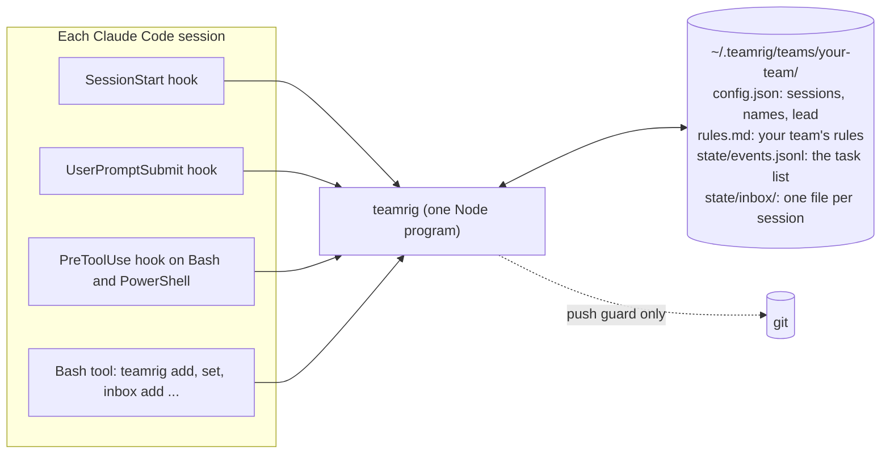
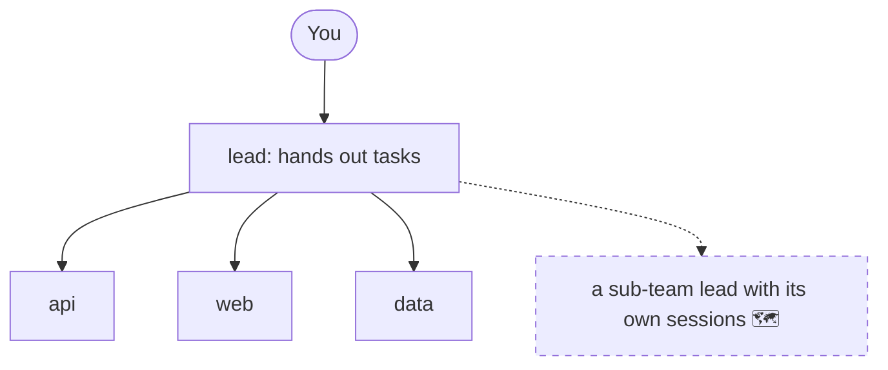
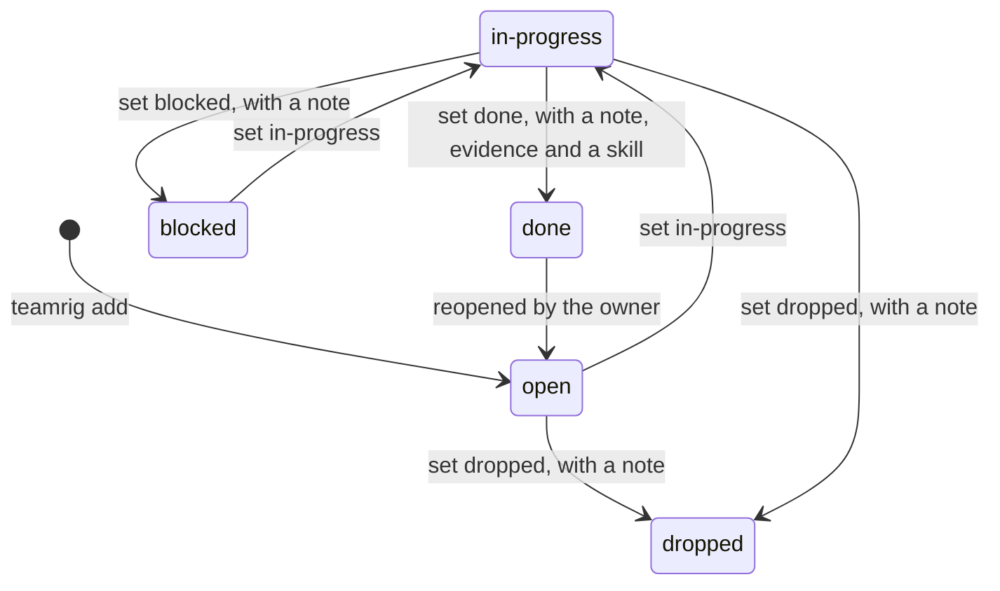
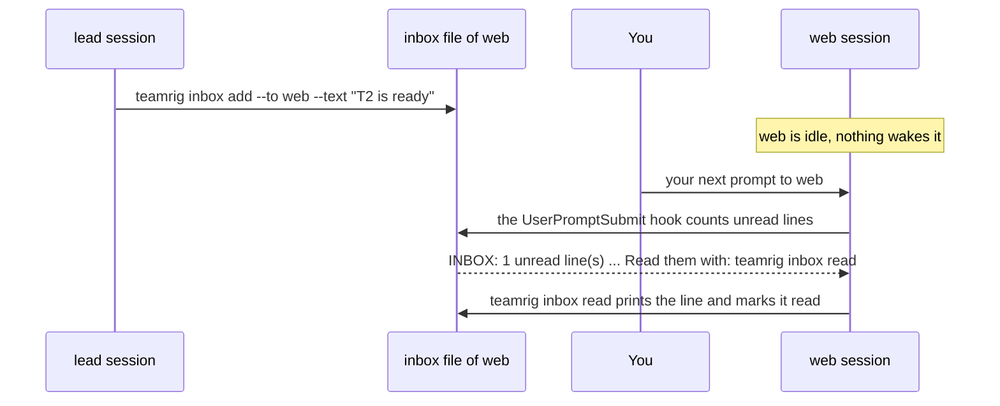
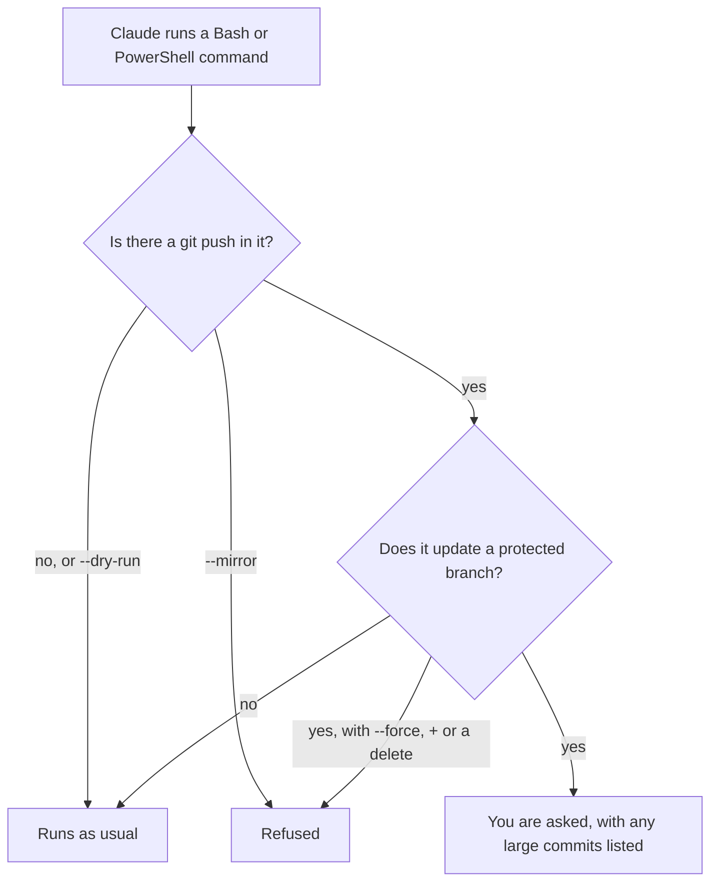
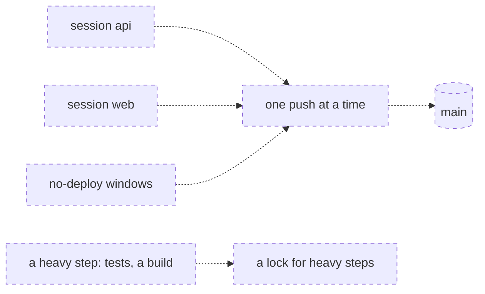
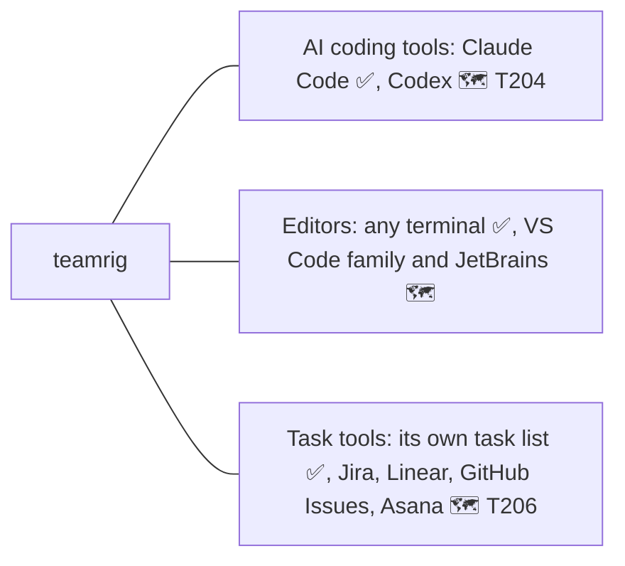

# How teamrig works

teamrig is one small Node program, three Claude Code hooks and a folder of plain files. Nothing runs between
sessions: no server, no daemon, no network. Status marks, as in the [README](../README.md): ✅ works today ·
🚧 being built (task id) · 🗺 planned. Parts not built yet are drawn dashed.

- [The parts](#the-parts)
- [Who is on the team](#who-is-on-the-team)
- [A task's life](#a-tasks-life)
- [Notes between sessions](#notes-between-sessions)
- [Safe pushes](#safe-pushes)
- [Room for other tools](#room-for-other-tools)

## The parts

Each Claude Code session runs the same `teamrig` program, from its hooks and from its Bash tool, and that program
reads and writes your team's folder.

| Part | When it runs | What it does |
| --- | --- | --- |
| SessionStart hook | a session starts, resumes, is cleared or is compacted | gives the session the core rules, its name, the lead's name and your team's `rules.md` |
| UserPromptSubmit hook | you send a prompt | one `INBOX:` line when the session has unread notes, nothing otherwise |
| PreToolUse hook | Claude runs a Bash or PowerShell command | reads a `git push` in it and asks you or refuses ([Safe pushes](#safe-pushes)) |
| `teamrig` commands | Claude runs them in its Bash tool | the task list, the inbox, names, settings, checks (`teamrig help`) |

A session finds its team through `$TEAMRIG_TEAM`, else the nearest `.teamrig.json` above its folder
(`{"team": "your-team"}`). The folder is `~/.teamrig` unless `$TEAMRIG_HOME` says otherwise. The task list and the
name log change only under a lock, and the inboxes and read marks only ever grow by a line, so parallel sessions
never overwrite each other.

## Who is on the team

A team is a flat list of sessions with one lead; each session learns at start who it is and whom to message.

You start each tab with its session name, for example `TEAMRIG_SESSION=web claude`. At start the session reads
"You are the `web` session of team `your-team` … Message the lead as `lead`." `teamrig who` prints every session's
name, and `teamrig rename` gives a session a new name while every old name keeps working.

## A task's life

Every task has one owner, and only the owner moves it; these are the usual moves.

- The owner may move a task from any status to any other; the register keeps every move.
- `teamrig update` changes the owner, priority tier, due date or week, never the status; the lead may run it on any
  task.
- `teamrig check` reports tasks past due, not picked up 24 hours after they were handed out, untouched for 72 hours,
  or due this week but left out of the week's plan. It reports and never blocks.
- Being built: dependencies and parent/child tasks 🚧 T205; planned start, ETA, history and token estimates
  🚧 T209–T211.

## Notes between sessions

A note is one line added to the receiver's inbox file; the receiver hears of it at its next prompt.

- The inbox file is never edited: `inbox read` adds a mark to `state/inbox-marks.jsonl`.
- A note is one line; an empty line, several lines or a line that looks like a secret is refused.
- Nothing wakes an idle session, which is why `teamrig check` reports a task not picked up.

## Safe pushes

Before Claude runs a `git push`, teamrig reads the command and asks you, or refuses, when it would change a
protected branch (by default `main` and `master`).

- `--force-with-lease` is asked, not refused. `commits.gate` set to `refuse` turns the ask into a refusal when a
  commit is over the size rule (400 changed lines or 15 files, tests not counted) with no `Large-commit:` reason.
- `teamrig commits check --base <ref>` runs the same size rule in a script or CI.
- Outside a project tied to a team, the guard stays silent.

Planned 🗺 T228: a deploy coordinator.

## Room for other tools

Today teamrig works with Claude Code, any terminal and its own task list; other tools come through one small
interface per kind of tool.

There is no adapter interface in the code yet: what teamrig knows about Claude Code (its hook fields, its
environment variables, `~/.claude/skills`) is built in. The interface comes with the second AI tool (T204), so it is
shaped by two real tools instead of one.
