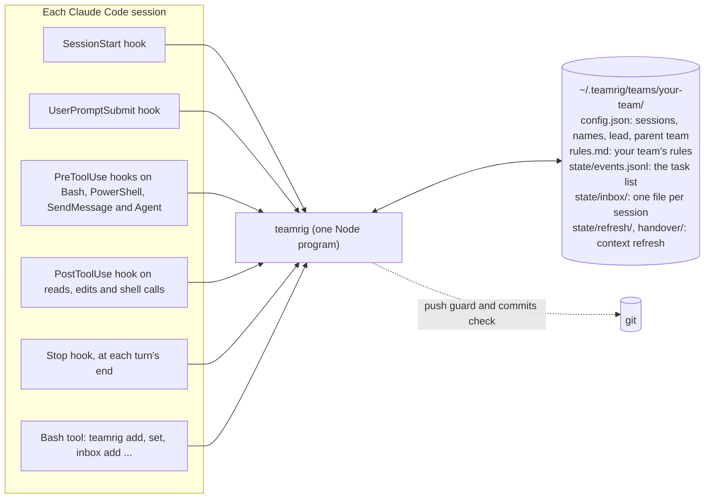
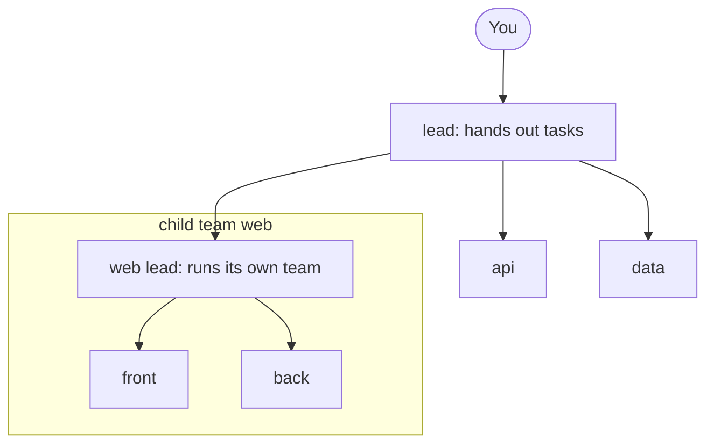
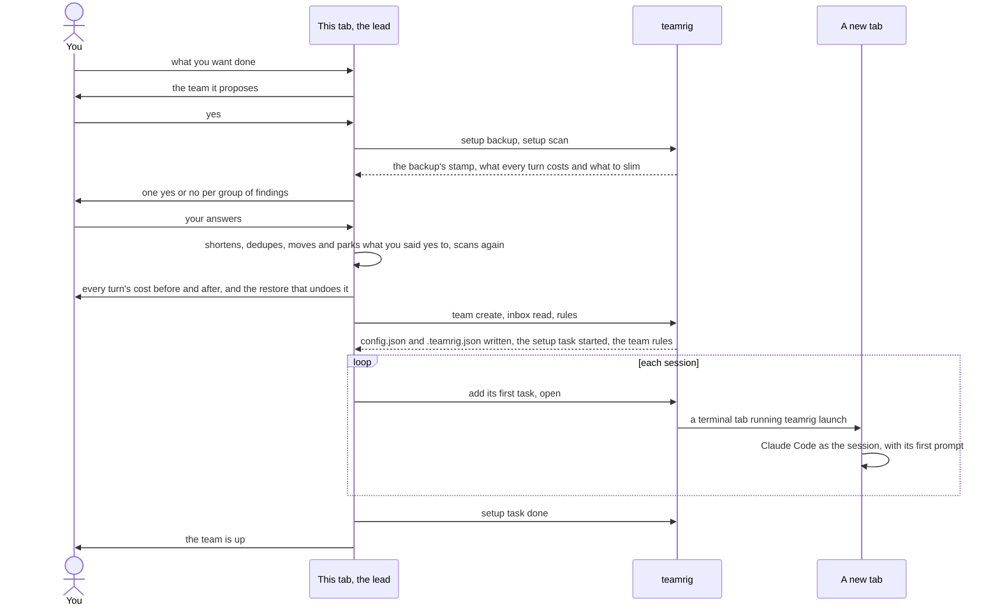
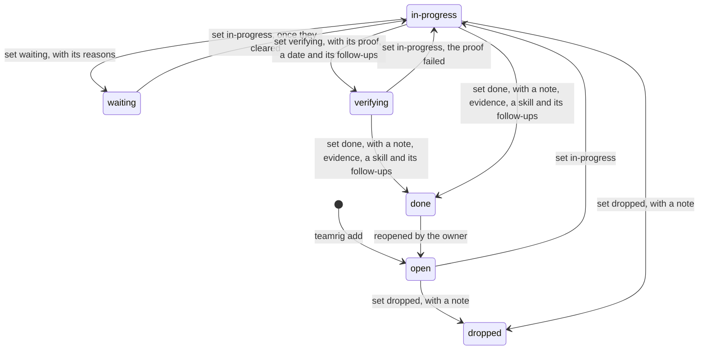
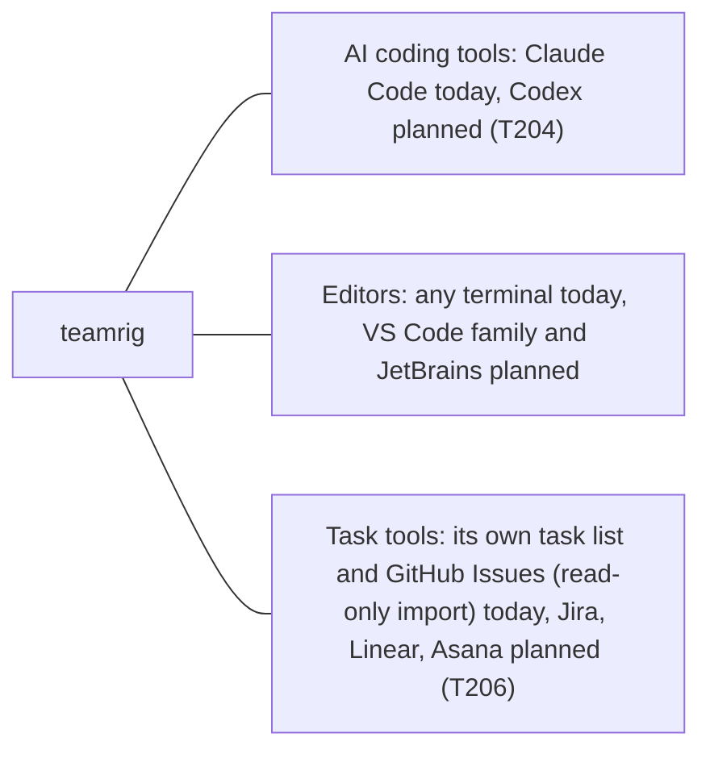

# How teamrig works

teamrig is one small Node program, four Claude Code hooks and a folder of plain files. Nothing runs between
sessions: no server, no daemon, no network. Each part says, as in [what teamrig does](features.md),
whether it works today, is being built (with its task id) or is planned. Parts not built yet are drawn dashed.

- [The parts](#the-parts)
- [Who is on the team](#who-is-on-the-team)
- [Setting up a team](#setting-up-a-team)
- [Updating the plugin](#updating-the-plugin)
- [A task's life](#a-tasks-life)
- [Bursts](#bursts)
- [Running your day](#running-your-day)
- [Recovering a session](#recovering-a-session)
- [Keeping it safe](#keeping-it-safe)
- [Room for other tools](#room-for-other-tools)

## The parts

Each Claude Code session runs the same `teamrig` program, from its hooks and from its Bash tool, and that program
reads and writes your team's folder.



| Part | When it runs | What it does |
| --- | --- | --- |
| SessionStart hook | a session starts, resumes, is cleared or is compacted | gives the session the core rules, its name, the lead's name, where its team sits in a tree of teams and your team's `rules.md`, after those of the teams above; tells you and the session, in one MODEL line, when it runs on another model than its `launch` entry asks, with the `/model` to type. It also marks a /clear or a compaction in the session's [turn log](guides/recover.md#the-turn-log) and removes the log's hours past `turnLog.keepHours` |
| SubagentStart hook | a session starts a helper | gives the helper the same core rules and team rules files, and says whose helper it is: the session, not the helper, sets task statuses, adds register entries and sends messages unless the helper's brief asks for them; a compaction inside a helper gets the same context ([A helper's start](../plugins/teamrig/skills/teamrig-guide/hooks.md#a-helpers-start)) |
| UserPromptSubmit hook | you send a prompt | the session's new inbox lines, each shown once; a line when it binds a hand-started tab by its title, once per cause when it cannot, when it records a Claude Code rename of the session as its team name, or when `.teamrig.json` is broken; once per level, a line telling the session it is past its daily budget while the team has no room today and, by default, is ahead of its pace line; once each, a line when a burst the session is in starts (how to work in it) and when it ends (wind down), and on the lead's tab, once a week, a line when the week's projected surplus is worth a burst ([Bursts](#bursts)); nothing otherwise. It writes the prompt to the session's [turn log](guides/recover.md#the-turn-log) |
| PreToolUse hook on Bash and PowerShell | Claude runs a Bash or PowerShell command | finds every `git push` in it, through wrappers, nested shells and git aliases, and asks you or refuses; asks when it cannot read the command ([Safe pushes](guides/keep-it-safe.md#safe-pushes)) |
| PreToolUse hook on SendMessage | Claude messages another session of the team | when the receiver has been idle `messages.coldAfterMinutes` (60 by default) or longer, the message would wake it cold: its first call re-reads its whole context at full price, about 8 times a warm wake. It holds the message once with a note: an inbox line if the receiver need not act now, else every ask for it in one message, sent again; the same tab's next send to it within 15 minutes goes through. Idle time runs from the receiver's last write to its own transcript; a helper, a receiver off the team or one with no transcript yet is never held |
| PreToolUse hook on Agent and Task | Claude launches a helper | with the budget on, asks you or refuses when the session is past its daily budget while the team has no room today and, by default, is ahead of its pace line, or in quiet hours, as `budget.overAction` and `budget.quietHours` say; the lead's helpers, a lifted session's and those of a session with an open or in-progress p0 task always go |
| PostToolUse hook on reads, edits, shell calls and web lookups | a Read, Grep, Glob, Bash, PowerShell, Edit, Write, MultiEdit, NotebookEdit, WebFetch or WebSearch call returns | counts the calls in a row since the last prompt that each ran one step (a read, a lookup, an edit, a test, a build); when the run reaches `loops.chainNudgeAt` (6 by default; 0 turns it off), gives the model one line asking it to put independent reads, and an edit with its re-test, in one message, priced in context re-reads. Once per run; a helper's calls are not counted. On the lead's tab, also one line at the lead's first edit outside its own files, first test or build, first research (a web lookup, or a search of another session's notes or a sub-team's folder, naming the session or child team lead to ask) and `leadBoundary.searchNudgeAt`-th code search (3 by default), asking it to hand such work off |
| Mod (`hooks/register.ts`) | in each interactive tab, while it runs; `/teamrig` in every session | runs `/teamrig <command>` in the tab with no model turn: a read at once, a command that changes the team's files only when you typed it, asking first when it adds the tab's session ([the /teamrig command](../plugins/teamrig/skills/teamrig-guide/hooks.md#the-mod-the-teamrig-command)); runs the refresh's `/clear` when the automatic restart asks ([A fresh context](guides/recover.md#a-fresh-context)); runs `/reload-plugins` once an installed plugin changed and no turn runs ([Updating the plugin](#updating-the-plugin)); wakes an idle tab when urgent work is handed to its session ([Waking on urgent work](guides/run-your-day.md#waking-on-urgent-work)) |
| Stop hook | a turn ends | after a task is marked done, asks for a handover when a refresh is due, then tells you once ([A fresh context](guides/recover.md#a-fresh-context)); after a task is set waiting, sends the session back once to its other tasks it can start (not those after the waiting one), outside quiet hours and within its daily budget; tells you once, in a MODEL line, when the session runs at another effort than its `launch` entry asks, or when Claude Code switched it to another model after its safeguards stopped a reply, with the `/effort` or `/model` to type; a Budget line as the session passes each warning level of its daily budget, and when a burst it is in starts or ends; on the lead's tab, a Lead boundary line naming the edits, tests and code searches the lead did itself that turn; nothing otherwise. It writes the turn's reply to the session's [turn log](guides/recover.md#the-turn-log) |
| `teamrig` commands | Claude runs them in its Bash tool; you type them in a terminal or after `/teamrig` | the task list, the inbox, names, settings, checks (`teamrig help`) |

A session finds its team through `$TEAMRIG_TEAM`, else the nearest `.teamrig.json` above its folder
(`{"team": "your-team"}`), else the nearest one above `$CLAUDE_PROJECT_DIR`. The folder is `~/.teamrig` unless
`$TEAMRIG_HOME` says otherwise. The task list and the name log change only under a lock, and the inboxes and read
marks only ever grow by a line, so parallel sessions never overwrite each other.

## Who is on the team

A team is a list of sessions with one lead, and a lead may also lead child teams, each with a lead and a task list
of its own; each session learns at start who it is and whom to message.



You ask one tab for the team in plain words, and it opens a tab for each other session
([Setting up a team](#setting-up-a-team)). At start the session reads "You are the `web` session of team
`your-team` (name `your-team-web`). Message the lead as `your-team-lead`." A session the config gives no name is
called `<team>-<id>`. `teamrig who` prints every session's name, and `teamrig rename` gives a session a new name
while its old names keep finding it until another session takes one. A Claude Code rename of the session
(`/rename`, `claude --name`) is recorded the same way at its next prompt or start, as if it ran `teamrig rename`.

A team grows into a tree of teams when part of its work needs a lead of its own: `teamrig team split` moves that
lead and its sessions, with the tasks they own, into a child team under the lead, and `team create --parent` starts
a new one ([Setting up a team](#setting-up-a-team)). You still talk to one lead: the root team's.

- Each team keeps its own folder, config, task list and inboxes. Its config names its parent team
  (`"team": {"id": "web", "parent": "your-team"}`), so the tree is read from the configs, with no other file to keep
  in step. A tree has at most 3 levels and a team at most 8 child teams.
- The tree numbers its tasks from one count, so `T12` names one task in every team of it and a moved task keeps its
  number; a wait or an `after` may name another team's task. Work crosses teams as a task: `teamrig add --team web`
  puts it in that team's list, its lead gets a copy line, and the asker hears when it is done or dropped
  ([A task's life](#a-tasks-life)).
- Any session writes a note to any session of its tree, `<team>/<id>`, with no relay through the leads between them:
  a note hands no work, which is a task on the receiver's own register, and wakes it only with `--wake now`, or
  with `--wake-by <time>` at that time if it is still unseen. Teams
  of separate trees never reach each other. Only the root's lead talks to you: a wait on your decision in any team of
  the tree is in its decisions batch and daily meeting as `<team>/<id>` (`web/T2`), and your answer, recorded on
  that task, reaches the task's owner when the meeting ends. An urgent one also tells its team's own lead, who
  passes it up.
- A member's leader is its team's lead, and a child team's lead answers to the lead of the team above it: its
  approval waits, say before a push or a merge, go to that lead's inbox (`--waits approval:app/lead`), which answers
  with `teamrig approve web/T3`, and under `pushGuard.pushToProtected: lead` its own push waits for that answer.
- A child team's sessions start with the `rules.md` of each team above, root first, then their own. A role the
  child team leaves to a team above names that team's holder as `<team>/<id>` (`"securityReviewer":
  "your-team/security"`), so its exec requests go to that reviewer; `teamrig doctor` names one that does not hold
  the role there.
- Claude Code session names are machine-wide, so two teams never share one: `team create` refuses a clash and
  `teamrig doctor` names one, along with a broken link in the tree.
- `teamrig team tree` prints the tree with each team's lead and sessions.

The lead hires a temporary member for one job with `teamrig hire`, within the team config's `hiring` block; a
child team's lead hires the same way into its own team:

- `policy`: `off` (no hires by command), `owner` (the default: each hire names who approved it), `lead`, or
  `automatic` (the lead decides, and a hired session whose last open task closes is asked at its next turn end to
  write its handover and retire itself).
- `maxSessions` (2) hired members at once; each gets its part of the team's daily budget by its share and queued
  work, like any session; `reviewDays` (7) sets a hire's review day.
- Each hire is logged in `state/hires.jsonl` with its job, reason, approver, model, effort and review day. `teamrig check` flags a hired session with no open task for `idleHours` (4) as RETIRE-DUE, and one past its
  review day as REVIEW-DUE.
- `teamrig hire --burst` hires for the burst in force ([Bursts](#bursts)), within its hires as well as these caps,
  on the lead's model and at least its effort; the burst's approver approves it. Once the burst is over, `check`
  flags the hire RETIRE-DUE.
- `scaleOut` says when to hire: `check` flags SCALE-OUT on an area (never the lead or a hire) when more of its dated
  work is due by a date than its pace finishes by then. Its pace is the tasks it finished over the last `windowDays`
  (7), once it finished `minDone` (3); its dated work is its active tasks of the top `topPriorities` (2) priorities
  with a due, their own or that of a task that needs them. The flag names the slice to move (the latest open tasks no
  started work needs) and its cost, a new hire's part of the team's daily budget today, a day until the slice's last
  due or the week's pace end; the areas furthest behind are paid first, out of the team's part of the week's projected
  spare (as for a surplus burst, below), and none
  once it cannot pay or the team's daily budget is unknown. Its action moves the slice to an idle hire, else hires
  within `maxSessions`, else brings the owner a card to raise it (a child team's lead asks its parent team's lead to), or under `hiring.capRaisedBy` `lead` raises it itself and says so in its next report. The hire retires as RETIRE-DUE once its slice is
  done.

When its job is done, the lead retires it with `teamrig retire <id>`. It refuses while the session owns open tasks
unless `--to <heir>` takes them, and without its handover note (`handover/<id>.md`) unless `--no-handover "<why>"`.
It takes the session's keys out of `sessions`, `names`, `launch` and `budget.sessions`, keeping the old config in
`backups/`, and logs the retire in `state/hires.jsonl`. Its tasks, inbox and records stay where they are, readable by
its id, and `teamrig doctor` reads its inbox as kept, not orphaned.

Hiring a retired id again is a rehire. `teamrig hire` shows the retire and handover it comes back from and measures
the last Claude Code session that read its inbox: when its transcript is still in the project folder, its context is
at most `resumeMaxTokens` (250,000) and it was idle at most `resumeMaxIdleDays` (7), `teamrig open <id> --resume`
goes on in it. Else `teamrig open <id>` starts it fresh, its first prompt sending it to the handover.

## Setting up a team

You tell Claude in any tab what you want the team to do: building, research, writing or any other work, for example
"Price our new plan: one session gathers competitors' prices, one models price points, one drafts the
recommendation." If you ask for a team without saying what for, it asks you first. The plugin's `team-setup` skill
proposes a team in a few lines, and on your yes:



- Before anything changes, `teamrig setup backup` copies your Claude setup (CLAUDE.md and rules files, settings,
  skills, memory) into a dated backup, and `teamrig setup scan` shows what each session start costs and what to slim:
  files over 6,000 chars, lines loaded twice and skills no transcript used in 30 days. On your yes for a group, the
  lead shortens those files, moves rules needed only in some folders into files that load only there, removes the
  repeats and parks the unused skills in `skills-parked/`, then scans again for the before and after.
  `teamrig setup restore <stamp> --yes` puts every backed-up file back.
- `teamrig team create signup --sessions api,web,tests` writes the team's `config.json` and ties the project folder
  to it with `.teamrig.json`, which it keeps out of git in that clone (`.git/info/exclude`). The lead's first task,
  `Set up the team`, goes in the task list in progress, so the setup shows in the task pane like any work, and the
  lead closes it once every session runs its first task. It refuses another team
  with the same id and a project tied to another team, a repeat changes nothing once both are in place, and
  `--dry-run` prints what it would write. `--parent your-team` hangs the new team under that
  team's lead; it refuses a parent with no config, a tree deeper than 3 levels, a team's 9th child team and a
  session name another team uses.
- `teamrig team split front --lead web --sessions ui --dry-run` plans moving sessions of your team, with the tasks
  they own, their inboxes, files and renames, into a new child team `front` under you, and names what blocks it: a
  staying task that waits on a moved session's decision or approval, or a moved session whose Claude Code runs.
  Without `--dry-run` it writes the move, reads both task lists back to check each moved task reads the same, and
  prints the `teamrig open front/<id>` line that reopens each moved session on its new team. The move changes
  stored data and nothing undoes it, so the lead shows you the dry run's counts first.
- The tab that ran the setup becomes the lead without a restart. `teamrig inbox read --session lead` ties its Claude
  Code session to the lead, so the hooks still know it after a compact or a resume, and `teamrig rules --session lead`
  gives it the rules it missed at start. Its next prompt titles the tab with the lead's name, and Claude Code keeps
  that title across a `/clear`, so the session a `/clear` starts binds itself to the lead by it.
- A tab you start by hand binds itself when its Claude Code title (`claude --name`, `/rename`) is a session's id or
  current name, or the `[<team>] <name>` form teamrig titles tabs with, on the team of the folder it started in,
  and on no other team of the tree. The hooks then know it as
  `inbox read` would, but nothing is marked read. A title that names no session, or sessions of two teams, binds
  nothing, and the prompt hook says once how to bind the tab. `$TEAMRIG_SESSION` and an earlier binding always win.
  A bound tab with no title gets its session's name as title at its next prompt (`sessionTitle` in the prompt
  hook's answer); a tab with a title keeps it.
- `teamrig open <session>` opens a tab in tmux (when run inside tmux), Windows Terminal, macOS Terminal, GNOME
  Terminal, Konsole or x-terminal-emulator, in that order; `open.terminal` in the config or `--terminal` picks one.
  It refuses any session but the lead, and `hire --yes` refuses a hire, when the host has no room for one more:
  free memory over `coordinator.heavy.memoryFloorMb` and the commit charge within `open.headroom.commitMaxPct` (92%),
  with the session counted at the median running one (what it holds resident against free memory, what it
  committed against the commit charge), else `open.headroom.sessionMb` (1200 MB). A session
  `teamrig close` ended goes on in its last Claude Code session when that is small and recent enough, else opens
  fresh; `state/session-log.jsonl` logs each close and reopen. `teamrig close` (the lead) ends only a session
  quiet `open.headroom.closeIdleMinutes` (60) or more, with no work it can start and no time wait of its own ending
  within 30 minutes, its last turn ended (not at a tool call or a decision put to the person), no background work
  or shells, and
  small and recent enough to resume.
  The tab runs `teamrig launch`, which sets `$TEAMRIG_SESSION` and starts `claude --name <name> "<first prompt>"`,
  with `--model` and `--effort` from the session's `launch` entry in the config. The lead, for each it leaves unset,
  starts on `opus` (Claude Code's newest Opus) at `xhigh` effort; the others on Claude Code's own. The `OPENED` and
  `Starting` lines name the model and effort a tab starts on, and `launch.<id>` in the config changes either one.
  When no terminal opens, it prints the command to paste and exits 3. `teamrig open web/lead` opens a session of
  another team in the same tree.

## Updating the plugin

Claude Code installs the version that the plugin's `plugin.json` gives and moves an install only when that version
rises, so every change to the plugin raises it. To take the newest one:

```sh
claude plugin marketplace update teamrig
claude plugin update teamrig@teamrig
```

Each open tab then takes the new version by itself: teamrig's mod (`hooks/register.ts`) reads Claude Code's
`installed_plugins.json` every 15 s, and once an install changed (any plugin's that applies to the tab), the file
has read the same for 10 s and nothing in the plugin store changed for 10 s (an install still copied into the
cache), it runs `/reload-plugins` in the tab while no turn runs. It runs at most one reload per 5
minutes in a tab and never two for the same installs; a refused one goes to Claude Code's debug log and is tried again
5 minutes later. A tab that does not load mods (an older Claude Code, mods off) or a plugin loaded with `--plugin-dir`
still needs `/reload-plugins` typed, or a restart. Claude Code does not check this marketplace for updates by itself
unless you turn on its auto-update in `/plugin`, under Marketplaces.

The `teamrig` the Bash tool runs is the first plugin `bin` folder on its PATH. Claude Code adds the tab's own at the end
of PATH and, from version 2.1.301, adds the new one again after `/reload-plugins`; an older Claude Code keeps the
version the tab started with until it restarts. A session teamrig starts (`teamrig open`, `teamrig restore`) leaves
the opener's plugin `bin` folders off the PATH it hands on, so its Bash tool runs the session's own install and follows
its updates.

## A task's life

Every task has one owner, and only the owner moves it; these are the usual moves.



- The owner may move a task from any status to any other; the register keeps every move.
- `done` takes `--skill none` or the name of a skill in your Claude Code skills folder; setting a task to its own
  status again needs `--note`; `add` refuses a title an open, in-progress, verifying or waiting task already has.
- `verifying` and `done` take `--followups` with the tasks the work leaves, each already on the list, or `none`, so a
  finding written only in a notes file cannot close unseen [register.requireFollowupsOn]; `show` lists them.
- `verifying` is a change that has shipped and waits for what proves it: a test run, a night's flow, a number.
  `--proof` names that proof, and `--due` the date to verify it by. It stays active, so `list`, `check`,
  `teamrig verify`, the session's start context and `inbox read` keep it in view until the owner sets it `done`
  with the proof as evidence. Work that needs it waits for that proof: its start is refused until then
  (`register.verifyGate`), and the owner hears of it in its inbox. A start that names what met the proof
  (`--met`) goes through, and the owner is asked to confirm it (`done`) or reopen the task. The owner's own first
  start of new work also waits while one of its verify steps is due: its proof's waits cleared, its verify-by day
  came, or it holds more than `register.maxVerifying`, so shipped changes get proven instead of piling up.
- `waiting` is a started task that cannot go on, with every reason it waits for (`--waits`): a decision or an
  approval (the lead's or the owner's; a peer's work is a task, asked for with `set --ask`), another task to
  finish first, or a time. It stays waiting until all of
  them have cleared: a task when it is done or dropped, a time when it passes, a decision or an approval only when
  the owner sets the next status. A task not started that needs another first is not waiting: it stays `open`,
  planned after it (`teamrig update T3 --after T2`), and its line shows `after T2`. A `blocked` written by an
  older teamrig reads as `waiting` with no reasons.
- A wait on the owner reaches the owner through the lead, in batches, so the owner is not interrupted once per
  wait. A wait counts as asked once the lead records a batch asked (`teamrig decisions asked`, kept in
  `state/decisions-asked.json`) or starts the daily meeting after it was set. A batch is due when a wait not yet
  asked is due before the next batch time (asked at once), `decisions.batchAt` waits are not yet asked, or a
  `decisions.batchTimesUtc` time passed; the lead's `start` and `check` say so in one line, and `teamrig
  decisions` prints the batch. A wait asked at once wakes the lead who asks it: the team's lead, or, in a tree of
  teams, the root team's lead.
- A task's effective due is the earliest of its own due date and the effective dues of the active tasks that need
  it (planned after it or waiting on it), so the work a dated task needs inherits its date: a row shows it as
  `due 10-17 (from T9)`, and lists, `plan`, the meeting's late tasks and `check`'s date flags go by it. A row
  also names another session's active task that needs it (`· needed by T9 (api, due 10-17)`); `show <id> --tree`
  prints what the task needs and what needs it, then the next move (who acts first, on which task); `start` and
  the live task list name the other sessions' tasks waiting on the session (`WAITING ON YOU`). A plan (`--after`)
  or a wait (`--waits task:`, `--ask`) that would close a loop is refused: no task in a loop can finish.
- `teamrig update` changes a task's title, owner, priority, ref, due date, goals, week, the tasks it comes after, its
  size, its type or its critical mark (`--type task|bug`, `--critical`, `--not-critical`; `none` clears the ref, due
  date, goals, week, plan or size), never the status; on a task it does not own, the lead may change the owner,
  priority, due date, week, plan order, size, type, critical mark or pin (`--pin`: the task goes above every other
  task of its owner, one pin per owner, never set by the owner itself), and any session may add a `--note` alone as
  context.
- `teamrig check` reports tasks past their effective due, not picked up 24 hours after they were handed out, untouched for 72 hours,
  or due this week but left out of the week's plan, and owner orders left out of it. A verifying task past its due
  date is `VERIFY-OVERDUE`: it was not verified by then. One with a due date is not called stale while it waits. A verifying task another task needs is `VERIFY-BLOCKS`, and a session holding more than 5 (`register.maxVerifying`) gets a `PILE-UP` on its oldest. Tasks that need each other in a circle (rows an older teamrig could write) are a `LOOP`, flagged on the lowest-numbered one. The first sized task of the week that no longer fits the weekly usage limit left is `OVER-LIMIT` (`plan` prints that line). An unfinished sized task whose cost, as the budget meter attributes it over the 8 UTC days it keeps, passed twice its size (`register.check.overSizeMultiple`) is `OVER-SIZE`, so its owner re-sizes what is left or splits it off. A waiting task whose every reason has cleared is `READY`, one waiting on a peer's decision or approval, as an older teamrig wrote it, is `PEER-WAIT`, one waiting on the owner with no decision card is `NO-CARD`, and one the owner ordered that asks the owner with no `--why-ask` is `OWNER-ORDERED` (an order approves its own work and proof), and one asking the owner to decide with no `--gate` is `UNGATED` (only an owner gate or a business decision is the owner's). It also reports a session that
  skips its own priorities: `PRIORITY-SKIP` is a task in progress for over 24 hours
  (`register.check.prioritySkipAfterHours`) while the same session has an open p1 free to start (every task it comes after finished), counted from the latest change of
  owner, status or priority on either task. `SELF-MADE` is a session that added more than 10 tasks for itself
  (`register.check.maxSelfMadePerDay`; created by it, asked by no one else) in the last 24 hours, raised on the
  first of them past that count still active: work nothing asked for, piling up that fast, may be a loop or a drift
  from the goal. `OVER-PACE` is a session holding more unfinished p1 tasks (open, in progress or waiting) than the
  p1 it finished (done or verifying) in the last 7 days and past the first p1, which is in hand, raised on the first p1 in plan order past that pace once
  the session has held tasks for 7 days: p1 then no longer says what comes first, so the lead re-prioritizes. `OFF-GOAL` is a task in progress with no goal outside the week's plan:
  work nothing in the plan asked for. teamrig has no parent tasks yet, so a goal tag or the week is what ties a task
  to the plan. `NO-PROGRESS` is a plan that stood still: no goal or week-plan task moved by its owner (started, noted, set
  waiting, shipped or closed) since the start of the day before (`register.check.goalProgressDays`; the day starts at
  `wake.dayStartUtc`, else midnight UTC), while the week has usage left. It names the first planned task its owner
  can move now. `STOPGAP-DONE` is a `stopgap T<id>` tag whose task is done or dropped, in a skill or in the files
  `register.check.stopgapFiles` names (default `CLAUDE.md` and `.claude/rules` in the project folder): the stopgap
  it marks is due to go. Then it flags skills in your Claude Code skills folder that break the skill rules. It reports and never
  blocks.
- `teamrig list` and `teamrig check` print a short form within 3,000 characters by default, since a session reads
  them at every work block: counts, short rows and `+N more`. `--all` prints every field of every task or flag.
  A command line teamrig cannot read prints only that command's usage lines; `teamrig <command> --help` shows them.
- Any session asks another team of its tree for work with `teamrig add --team web --title "..." --description "..." --priority p2`:
  the task lands in `web`'s own list, marked as from the asker (`your-team/alpha`). Without `--owner` it goes to
  `web`'s lead, who splits it among its sessions and opens them; `--owner web-front` gives it to that session, and
  `web`'s lead gets a copy line, as it sets its team's work order and may reorder or reassign it with `teamrig update`.
  A team outside the tree is refused. When the task is done or dropped, the asker gets one inbox line,
  `web/T1 done: <title> | evidence: ...`, as its own register holds no copy (its team's lead, once it left that team).
- `teamrig list --tree`, `check --tree` and `plan --tree` give a lead its team's tasks and those of every team
  under it, with ids like `web/T4`. They only read the other teams' lists. With `--tree`, `--session` names the
  lead asking, so a tab without `$TEAMRIG_SESSION` passes `--session lead`. The teams of a tree number their tasks
  from one count, so an id names one task in the whole tree: a new task in any of them takes the next number none
  of them has used. So a wait or an `after` may name another team's task of the tree: `set` and `update` take it,
  `list`, `check`, `plan` and `verify` hold the task while that one is open, `show` prints it read-only, and the
  wake check, the idle pass and keep-working wake, reopen or send its owner on once that team finishes it. A team
  outside a tree reads only its own log: the others are read only when an active task names an id its own list
  lacks.
- The task list is one log that only grows, a line for every move. `teamrig compact` archives it: the log becomes
the next file in `state/archive/` byte for byte and is never deleted, a fresh log starts with a line naming it,
and `state/snapshot.jsonl` holds every task as it stood, so commands and the task pane read the snapshot and the
recent lines instead of the whole history. Tasks done or dropped over 8 days ago, in no week plan from the current
one on, leave the snapshot: `show`, `list --status done` and the plan of a past week still read them from the
archive, and a task that left cannot be changed. `compact --dry-run` prints what it would archive and write, and writes nothing; a real run first
reads the new files back and holds every task against the whole history, and writes nothing on any difference.
`compact --from-history` folds the new snapshot from the archive alone, not the old snapshot: the repair for a
snapshot that lost fields an older teamrig did not read.
After that first `compact`, a write that leaves the log over 512 KiB archives it again and says so in a NOTE line,
or keeps the write and warns when archiving fails (the next write tries again). Both lines name the switch that
turns this off: `register.autoArchive: false` in the team's `config.json`, after which only `compact` archives. Every session must run teamrig
0.3.1 or later before the first `compact`: an older one refuses to write to an archived task list.
- Move every session to teamrig 0.7.0 or later before anyone sets a task `verifying`. An older teamrig skips that
  line with a warning (`1 unreadable line(s)`) and shows the task at its status before it, though it still writes;
  and its `compact` would leave the line out of the new snapshot, so never run `compact` from a teamrig older than
  0.7.0 on a task list that holds one. The default `register.requireNoteOn` already names `verifying`: list it in
  a `config.json` of your own only once every session runs 0.7.0, as an older one reports it as a config problem.
  From 0.7.0 on, a status a later teamrig adds reads as a line from a newer teamrig: the task keeps its last
  status, writes go on, and archiving waits until this teamrig is updated.
- Being built: dependencies and parent/child tasks (T205); planned start, ETA, history and token estimates
  (T209–T211).
- Token use: `teamrig budget` reads each session's use from the Claude Code transcripts (only the lines added
  since its last run, kept per session and day for 8 days in `state/usage/`) and shows it against the week's pace
  line. The daily budget is never a fixed number: at every reading, what is left to the target is spread
  over the active time to the pace end (quiet hours count at `budget.quietHours.paceWeight`). The teams of the kit
  home on one Claude account (`budget.account`, else the Claude config dir) split each day by weight: a session's
  weight is its share times its queued work, a team's its sessions' summed, and each session's part of its team's
  part comes after the lifts. With sub-leads (`leads`), a team's part splits first among its sub-leads' groups and
  the sessions the lead leads directly, a group's weight its sessions' summed, and each group splits its part the
  same way.
  The week's use in percent comes from status line snapshots (`teamrig statusline install` sets the status line
  up), else from the metered W at the week's W per percent: learned from `state/usage/meter-log.jsonl` (a line
  each time the status line passes a whole percent, fitted once 8 weeks of lines span 10 points), else
  `budget.weeklyLimitW`. Today's use is the use now less the use at today's start, each read between the meter
  log's lines by the W metered and held to the status line's percent, so the fitted rate prices only the part past
  the last line; once that use spans 2 points, the sessions' W today counts at today's own W per percent, so their
  parts add up to the team's day. Past 100% of the week, what is left is the extra-usage pool the lead enters with
  `teamrig budget extra` (its W per dollar learned from two spent readings, else `budget.extraWPerUsd`), spread the
  same way. A subagent's W is multiplied by `budget.subagentWeight` (default 1), what
  one W of a helper costs in W of a main session, so all W share one price. A session past its part is held (only
  p1 work wakes it, and it escalates as `budget.escalate` says) only while the team has no room today: everyone's
  use today, the use outside the team included, at or past the in-day pace: today's use in quiet hours, plus today's
  allowance times the share of today's active time gone by (the quiet-hour use already lowered the allowance, so a
  night a lift worked through does not read as a morning past the pace). So no session waits while the week has
  room. The hooks warn a session as it passes its daily budget, tell the lead, and can hold its helper launches (`budget.overAction`,
  `budget.quietHours`), never while it has p0 work: urgent work goes on past the daily stop. The lead sets that policy with `teamrig budget setup`, which shows the change before it
  writes it.

## Bursts

A burst is a time-boxed scale-out for when the week will end with tokens unspent, or work must land by a time.
For its time, each session in it gets a daily budget of at least the burst's floor and may run more helpers at
once; the lead may also hire sessions for it. The same gates hold as on any other day. Like the team's daily
budget, the floor is never fixed: at every reading, what is left to the burst's stop % is spread over the active
time to the burst's end by the same pace rule, and its sessions share today's part evenly, so a burst that spends
fast gives less a day and one that spends slowly gives more. The floor at its start is kept in its record.

- Who starts one: a person, by command, never a hook. `teamrig burst` shows the week, its projected surplus and
  what to run; `teamrig burst start surplus|deadline --reason "<why>"` previews the burst, and `--yes` starts it.
  `burst.policy` is `owner` by default (each burst names its approver with `--approved-by`, since spending more of
  the week is a budget call; a child team's lead asks its parent team's lead, who takes it to the owner), `lead`, or `off`. No value starts a burst by itself; the lead's hook only suggests
  one, once a week, when the surplus is worth it.
- A surplus burst covers the whole team (or `--sessions`) from `burst.surplusHours` (48) before the reset until the
  pace end, once the team's part of the week projected unused is at least `burst.minSparePct` (5%). The account's
  spare is the use so far plus the week's mean rate so far, nights included, until the pace end, against
  `budget.targetPct`; teams sharing the Claude account split it by weight as they split the daily budget (each
  session's share times its queued work, summed per team, lifts included), so a lift inside one team moves no spare
  between teams. A burst's daily floor is not split: it is a share of what the account has left to the stop %,
  which the other teams' use already lowers.
- A deadline burst covers the owners of its `--task` tasks (or `--sessions`) until `--by`, at the latest the reset,
  and needs a `--stop-pct`.
- Its bounds: the stop % is at most `budget.targetPct`, so a burst never spends the incident reserve; it ends at its
  time, when the week reaches its stop %, or by `teamrig burst end --reason "<why>"`. It runs up to `--helpers`
  (`burst.maxHelpers`, 3) at once per session and `--hires` hired sessions (`burst.maxHires`, 2; none unless set).
  Quiet hours still apply, and a lift wins over it for its session.
- How its sessions work: the model is told once, with the next prompt, to split only independent tasks, to give
  each edit in a repo its own worktree, to integrate one change at a time, to keep its model and effort for its
  helpers and never to skip a test or check. A burst hire runs on the lead's model at no lower effort.
- Its log: each start and end is a line in `state/usage/bursts.jsonl`; `teamrig budget` marks a session's budget
  "(burst)" and names the burst, and `check` flags its hires RETIRE-DUE once it is over.

## Running your day

The owner's day has its own guide, [Run your day](guides/run-your-day.md): the daily meeting, never stuck on a
question, no prompt while nobody answers, notes between sessions and waking on urgent work.

## Recovering a session

How a session comes back has its own guide, [Recover from a crash or a full context](guides/recover.md): after a
crash or a reboot, a fresh context and the turn log.

## Keeping it safe

The guards that read each command before it runs have their own guide, [Keep it safe](guides/keep-it-safe.md):
safe pushes, skipped hooks, unvetted packages, secrets kept out of the conversation, privileged commands on review
and reads without a prompt.

## Room for other tools

Today teamrig works with Claude Code, any terminal and its own task list; other tools will come through one small
interface per kind of tool.



There is no adapter interface in the code yet: what teamrig knows about Claude Code (its hook fields, its
environment variables, `~/.claude/skills`) is built in. The interface comes with the second AI tool (T204), so it is
shaped by two real tools instead of one.

A program that only shows the team's files, such as the [teamrig-pane](https://github.com/GeneralA6/teamrig-pane)
task pane, reads them through `src/read/index.ts`: the same parse and replay every teamrig command uses, with no
`node:` import anywhere behind it, so it runs where Node's built-in modules do not. It takes the text of the task
list, an inbox, the inbox read marks, the config and a turn-log line, and gives back the tasks, the unread lines and the counts
`teamrig list` warns about. A task list that was rotated keeps a snapshot of its working set beside it and its older
lines in archive segments: the reader reads the snapshot first (`readSnapshotText`), then the task list, asks
`workingSetPlan` which segments it still needs (none, unless the snapshot is damaged or missing) and folds them with
`assemble`, so its cost follows the recent lines, never the whole history. A task list never rotated reads as
before. A rotation (`src/register/rotate.ts`, run by `teamrig compact` and by a write on a long log, under the task
list's lock) writes in an order every reader survives: the archive segment first, created whole, then the task
list replaced by the marker, then the snapshot. A rotation stopped at any step reads as before, and the next one
completes it. The reader hands `unreadOf` its own line hash: the first 16 hex digits of the SHA-256 of
the line. With no config to read, it names priorities from `DEFAULT_REGISTER`, the register settings a config that
sets none gets.

The reader builds the dependency tree (`TaskTree`) from the rows it keeps, any row with the fields `TreeTask`
names, so the effective dues and needed-by names it shows are the ones teamrig prints.

From each team's config and roster it builds the team tree (`teamNodeOf` per team, then `TeamTree`: a team's parent,
children and root), and from the text of the hire log it reads who was hired and who retired (`readHiringLog`, then
`activeHires`, `retiredSessions`, `rehiredFrom`), the same records teamrig's routing and hire commands use.
It words a session as the tab titles do, `[acme] lead`, through `sessionDisplay` (and `bareName`, the name without
its team's prefix), so the reader and the titles cannot drift. It reads the model and effort a session starts on with
`launchOf` (its `launch` entry, the lead's defaults under the keys it leaves unset) and words them with
`describeLaunch`, as teamrig launches the session.
