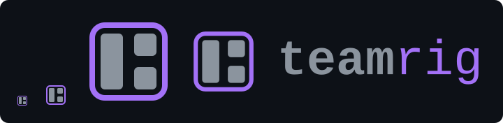

# teamrig logo and icon: three options

Three options for teamrig's mark, for the maintainer to pick one. Each sits beside the same word "teamrig": the
wordmark's look, monospace, "team" gray and bold, "rig" purple and regular, drawn as paths (Liberation Mono, SIL Open
Font License 1.1), so no font is needed. The options differ only in the mark; the colors are in
[`colors.md`](colors.md).

In each mark the gray shapes are the team's sessions and the purple one is the rig that holds them together.

| | [Option A: hub](option-a/README.md) | [Option B: panes](option-b/README.md) | [Option C: register](option-c/README.md) |
| --- | --- | --- | --- |
| Logo |  |  |  |
| Icon, 128 px |  |  |  |
| Icon, 32 px |  |  |  |
| Icon, 16 px |  |  |  |
| Plain text | ⁂ | ◫ | ☰ |
| Files | [logo](option-a/logo.svg), [icon](option-a/icon.svg), [one color](option-a/icon-mono.svg) | [logo](option-b/logo.svg), [icon](option-b/icon.svg), [one color](option-b/icon-mono.svg) | [logo](option-c/logo.svg), [icon](option-c/icon.svg), [one color](option-c/icon-mono.svg) |

The table shows the icons on the background of the theme you view GitHub in. Each SVG's colors follow your
system's color scheme, so the light and dark values each meet both backgrounds.

Option B, the one picked, on GitHub's light and dark backgrounds side by side, whatever your theme: the icon at 16,
32 and 128 px, then the logo.

The previews hold fixed colors: the light values on a light background, the dark values on a dark one, with no
color-scheme switch. Their backgrounds, `#ffffff` and `#0d1117`, are GitHub's page colors, there for the preview
only; they are not brand colors.

Each option's folder holds:

- `logo.svg`: the mark beside the word, 504 x 128.
- `icon.svg`: the mark alone, 64 x 64, two colors, no line thinner than 4 units (one pixel at 16 px).
- `icon-mono.svg`: the same mark in one color, every fill and stroke `currentColor`.

Once one is picked, its three files move up to this folder and the other two options are removed.
