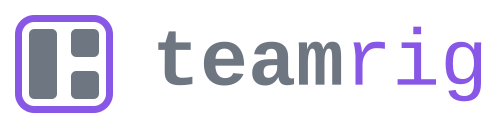
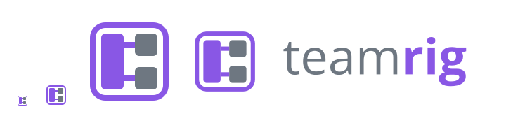

# teamrig logo and icon

**Idea:** a frame holding three tiled panes, one tall and two stacked: the sessions of a team laid out side by side
in one rig, as they run in a terminal.

**Colors** ([palette](colors.md)): purple for the frame, the rig; gray for the three panes, the team. The word
"teamrig" keeps the wordmark's look: monospace, "team" gray and bold, "rig" purple and regular, drawn as paths
(Liberation Mono, SIL Open Font License 1.1), so no font is needed.

**Plain text:** ◫ (a square split into panes)

## On light and dark

The icon at 16, 32 and 128 px, then the logo, on GitHub's light and dark backgrounds, whatever your theme:

The previews hold fixed colors: the light values on a light background, the dark values on a dark one, with no
color-scheme switch. Their backgrounds, `#ffffff` and `#0d1117`, are GitHub's page colors, there for the preview
only; they are not brand colors. The brand files themselves follow the viewer's system color scheme, and the light
and dark values each meet both backgrounds.

## Files

- [`logo.svg`](logo.svg): the mark beside the word, 504 x 128.
- [`icon.svg`](icon.svg): the mark alone, 64 x 64, two colors, no line thinner than 4 units; drawn on a 4-unit grid,
  so at 16 px the frame and the gaps between the panes are each one whole pixel.
- [`icon-mono.svg`](icon-mono.svg): the same mark in one color, every fill and stroke `currentColor`.
- [`colors.md`](colors.md): the palette.
- [`preview-light.svg`](preview-light.svg), [`preview-dark.svg`](preview-dark.svg): the pictures above.
