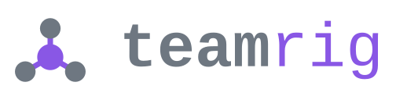

# Option A: hub

**Idea:** three sessions wired to one hub: a team that works as one because every session is tied into the same rig.

**Colors** ([palette](../colors.md)): purple for the hub and the three wires, the rig; gray for the three session
nodes, the team.

**Plain text:** ⁂ (asterism: three marks held together as one)

**Files:** [`logo.svg`](logo.svg) 504 x 128, [`icon.svg`](icon.svg) 64 x 64, [`icon-mono.svg`](icon-mono.svg) 64 x 64
in `currentColor`. At 16 px the wires shrink to a pixel and the icon reads as a purple hub with three gray nodes.
