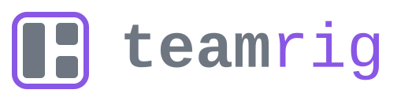

# Option B: panes

**Idea:** a frame holding three tiled panes, one tall and two stacked: the sessions of a team laid out side by side
in one rig, as they run in a terminal.

**Colors** ([palette](../colors.md)): purple for the frame, the rig; gray for the three panes, the team.

**Plain text:** ◫ (a square split into panes)

**Files:** [`logo.svg`](logo.svg) 504 x 128, [`icon.svg`](icon.svg) 64 x 64, [`icon-mono.svg`](icon-mono.svg) 64 x 64
in `currentColor`. At 16 px the frame and the gaps between the panes are each one whole pixel.
