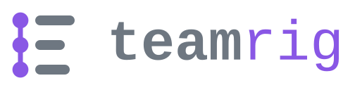

# Option C: register

**Idea:** three session rows tied to one spine: the shared register every session of the team reads its work from
and writes its status to.

**Colors** ([palette](../colors.md)): purple for the spine and its three nodes, the rig; gray for the three rows,
the team.

**Plain text:** ☰ (three rows)

**Files:** [`logo.svg`](logo.svg) 504 x 128, [`icon.svg`](icon.svg) 64 x 64, [`icon-mono.svg`](icon-mono.svg) 64 x 64
in `currentColor`. At 16 px each row is two whole pixels tall with three between them.
