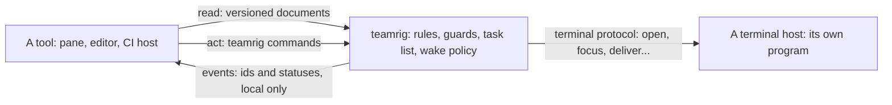

# Build on teamrig: the public interface (design)

> **Proposal under discussion on [#1048](https://github.com/GeneralA6/teamrig/issues/1048), not agreed: do not build on
> it.**

**Status: design, nothing on this page is built yet.** It answers
[#1048](https://github.com/GeneralA6/teamrig/issues/1048), which asks how a terminal app can work with teamrig without
following teamrig's insides. It is open for comments on that issue; what ships will be marked in
[Everything teamrig does](features.md) as each part lands.

**Contents**

- [Why an interface](#why-an-interface)
- [Five rules it keeps](#five-rules-it-keeps)
- [Read](#read)
- [Act](#act)
- [Events](#events)
- [The owner's own acts](#the-owners-own-acts)
- [Terminals as a protocol](#terminals-as-a-protocol)
- [Versions and notice](#versions-and-notice)
- [The conformance kit](#the-conformance-kit)
- [Order of work](#order-of-work)
- [Answers to #1048's open questions](#answers-to-1048s-open-questions)

## Why an interface

teamrig changes many times a day. A tool that reads its files, runs its commands with a fixed argument list, parses
their output or patches its code breaks with each change, and catching up costs more than the tool's own work. One
small interface, versioned on its own, lets a terminal app, a task pane, an editor or a CI host work with any teamrig
release whose interface version it supports.

Today the public part is small: the pure reader `src/read/index.ts`, which the
[teamrig-pane](https://github.com/GeneralA6/teamrig-pane) task pane uses ([Room for other
tools](how-it-works.md#room-for-other-tools)), and the `--json` output of `teamrig config` and `teamrig meetings`.
Everything else (file layouts, other commands' text, hook fields, environment variables) is internal and may change in
any release.

The interface has three parts, **read**, **act** and **events**, plus a **terminal protocol** for the apps that show
the sessions.

## Five rules it keeps

1. **The rules stay in teamrig.** Guards, approvals, the task rules, the budget and the decision to wake a session are
   teamrig's. A tool reads and asks; teamrig decides. A host never carries a rule, so a team's safety does not depend
   on which terminal it runs in.
2. **Outside code stays outside.** teamrig loads no other project's code into its own process. A host is a separate
   program that speaks a protocol, the way an editor and a language server do, so each side is written in any language
   and released on its own.
3. **A wake delivers a message, never keystrokes.** teamrig decides that a session should wake; the host delivers one
   fixed message only into an idle pane with no question showing.
4. **Each side owns its code.** teamrig owns the interface and its tests; a host's authors own the host, in their own
   repository.
5. **Outside text is data.** Text that came from outside the team (an issue's title, a comment) is marked as such on
   every read, and nothing the interface sends asks a reader to run it.

## Read

A read returns a versioned JSON document built from parsed data, never a file's raw bytes:

| Document | What it holds |
| --- | --- |
| `tasks` | Each task's id, title, owner, status, priority, what it waits on, due time and ref |
| `inbox` | A session's unread lines with their sender and time |
| `sessions` | Each session with its team, its leader and whether it is busy, idle or asking |
| `meetings` | The meetings and their agenda, as `teamrig meetings --json` gives them today |
| `config` | The team's settings a tool may show, as `teamrig config --json` gives them today |

- Out of process, a tool runs `teamrig read <document> --json`. A JavaScript tool may instead import the reader
  library, which is what `src/read/index.ts` becomes.
- Every document carries `interface`, the interface version that wrote it. A reader ignores fields it does not know.
- Text passes the same secret scan as the inbox (`register.secretPatterns`) before it leaves teamrig: a line that looks
  like it holds a secret is cut to its link or its id.
- A text field that came from outside the team carries `"source": "outside"`. A tool shows it as quoted data, never as
  an instruction, and never puts it into a prompt.

## Act

An act is a teamrig command, run through the same code the command line runs, so the interface never has a second,
weaker copy of a rule:

- the task list: add a task, set its status, add an inbox line;
- sessions: open, focus or wake one (each through teamrig's wake rules);
- answers: answer a decision put to the caller, or ask for an approval.

Three things hold for every act:

- **Who acts comes from the channel, never from a field.** A session's act carries the session its process was started
  for; a tool started by the owner acts as the owner's tool, with the reach the team's config gives it. A caller cannot
  name someone else.
- **Every act is logged**: who, through which channel, what, when and how it ended, refusals too.
- **An owner-only act needs the owner's proof** ([The owner's own acts](#the-owners-own-acts)); without it, it is
  refused, or turned into a request the owner answers.

## Events

A tool that shows the team learns that something changed from events, then reads what it needs:

- **Local only.** Events go over a named pipe (Windows) or a Unix socket (macOS, Linux) that only the user's account
  can open. Where neither works, a `127.0.0.1` listener checks the `Host` and `Origin` headers and wants a per-client
  token. Never on another address.
- **Ids and statuses only**: `task T12 is waiting`, `session alpha has 2 unread lines`, `session bravo is asking`. No
  text, no titles, no inbox lines: those come only through a read, which scans and marks them.
- A frame carries the interface version; a client ignores frames and fields it does not know.

## The owner's own acts

Some acts are the owner's alone: approving a push to a protected branch, an owner gate (a destructive data change, a
budget or permission change), a grant. A token a tool holds cannot prove the owner pressed the button, because any
program running as the same user could read it. So an owner-only act needs one of:

- a gesture the operating system checks (Windows Hello, Touch ID, a polkit prompt), or
- the act made from a separate operating system account that only the owner uses.

The proof is bound to one action (the exact command and the commit it names), carries a one-time nonce and expires
within minutes. An act without a proof is never run; it becomes a request in the owner's decision queue, the way an
owner gate reaches the owner today.

## Terminals as a protocol

Today the terminals teamrig opens sessions in are a fixed list (`open.terminal`), each built in. The design makes a
terminal a **host**: a program teamrig runs, speaking a small protocol, in the manner of the Language Server Protocol.

| Request | What the host does |
| --- | --- |
| `open` | Opens a pane for a session, with the command, folder, title and an opaque identity bag teamrig gives |
| `focus` | Brings a session's pane forward |
| `close` | Closes it |
| `restart` | Restarts it, resuming the conversation when asked |
| `rename` | Changes its title |
| `deliver` | Delivers one wake message, only if the pane is idle and no question shows; else it answers `held` with why |
| `isIdle` | Says whether the pane is idle, busy, asking or gone |

- **Transport.** teamrig runs the host program, writes one JSON-RPC 2.0 request to its standard input and reads one
  answer from its standard output, with a time limit. A host that fronts a running app forwards the request over its
  own channel. This works the same on Windows, macOS and Linux.
- **Capabilities.** The host's first answer lists the requests it serves and the interface versions it speaks; teamrig
  uses nothing else. A host without `deliver` gets no wakes; the session sees new work at its next prompt.
- **Pinned by the owner.** The team's config names a host by its path and its sha256, and only the owner sets them.
  teamrig refuses to run a host whose file no longer matches, and says so.
- **Built-in terminals are hosts too.** tmux, Windows Terminal and the others move behind the same protocol, inside
  teamrig, with no change in what they do, and pass the same conformance tests.
- **Waking is delivery.** Whether and when to wake a session (its priority, the budget, quiet hours, once per task)
  stays teamrig's decision. The host only delivers, under these conditions:
  - a token per pane that allows a wake and nothing else;
  - its channel bound to `127.0.0.1`, or a pipe or socket only the user can open;
  - fixed wake text: teamrig's message, which points the session at its inbox, never text from a caller;
  - one atomic check that the pane is idle and shows no question, at the moment of delivery.

## Versions and notice

- The interface has its own version, `interface`, apart from the plugin's. Read documents, act results, event frames
  and host answers all carry it.
- **Minor** (1.0 to 1.1): a new document, field, act, frame or request. Readers ignore what they do not know.
- **Major** (1.x to 2.0): a removal or a change in meaning. teamrig serves the old major beside the new one for at
  least 30 days, and gives notice at least 30 days before, in the release notes and as a `deprecated` field on what
  goes.
- **A security fix may break the interface at once, without notice.** The release notes name what broke once the fix
  ships.
- A tool or host states the range it supports; teamrig refuses a range it cannot serve, and says which it serves.

## The conformance kit

teamrig ships a conformance kit with the interface:

- **For hosts**: a test runner that drives a host through scripted cases and checks each answer against the protocol.
- **For tools**: a fake teamrig that serves read documents and events from a scripted team and records the acts it
  gets.
- **Negative tests are part of it**, and a host passes only with them: `deliver` held in a busy pane, in one that shows
  a question, or with a wrong token; a listener refused on any address but `127.0.0.1`; an owner-only act refused
  without its proof; outside text never in an event frame; unknown fields ignored.
- teamrig's own CI runs the kit against its built-in hosts at each change; a host's CI runs it against the host.

## Order of work

1. Close the known security gaps on the paths the interface will expose. No part ships before that.
2. **Read** version 1: the documents above, with the scan and the outside marks.
3. **The terminal protocol and the kit**: the built-in terminals move behind it with no change in behaviour.
4. **Outside hosts**, pinned by path and sha256.
5. **Act**, then **events**.
6. **The owner's own acts**, once the proof exists on each operating system.

Each step ships on its own and is usable without the next.

## Answers to #1048's open questions

These are teamrig's answers. The questions about the terminal app's own design are its maintainers' to answer.

**For the teamrig author**

1. **A terminal-host port in core?** Yes, as the protocol above rather than code loaded into teamrig. The generic
   changes proposed for upstream are welcome as separate pull requests, smallest first, each judged on whether it
   works for every user on every operating system.
2. **Loading an extension.** teamrig loads no extension code. A host is a program the owner pins by path and sha256 in
   the team's config. A host's own commands stay in the host's own command line, which calls teamrig's act interface;
   teamrig gets no extension command group.
3. **Where the adapter lives.** In the host's own repository, owned and reviewed by its maintainers. A host can speak
   the protocol in its own language, so it may need no adapter. teamrig owns the interface, the kit and the built-in
   hosts.
4. **The push guard without a person at the prompt.** Generic, so it belongs in core: in a session nobody watches, a
   guard question is refused and routed to the session's leader as a request; a grant covers one exact command and
   commit, once, and expires.
5. **The memory headroom gate.** A separate change from the interface. It is welcome upstream if it works on Windows,
   macOS and Linux, each with its own way to measure.
6. **Naming.** Per [the teamrig name](../TRADEMARKS.md): a separately made host says what it is ("works with teamrig")
   under a name of its own that is not easily mistaken for teamrig. A name built on "teamrig" fits only work the
   project itself ships.

**Shared**

1. **A red contract suite** blocks the release of the side whose change turned it red, not the other side's: each
   side's release states the interface versions it supports.
2. **What version 1 holds**, on teamrig's side: read, and the terminal protocol with `deliver` (its atomic idle and
   no-question check) and `isIdle`. Act and events follow in minor versions; the owner's own acts come last.

**For the owner, teamrig's view**

- **Bundled or installed?** Installed. A bundled copy lags the releases, and a host's supported interface range already
  says which teamrig releases it works with.
- **Pane meta keys.** Under this design teamrig writes no keys into a host's panes; the identity bag `open` carries is
  the host's to store. A host that keeps it in shared meta should put it under its own namespace.
